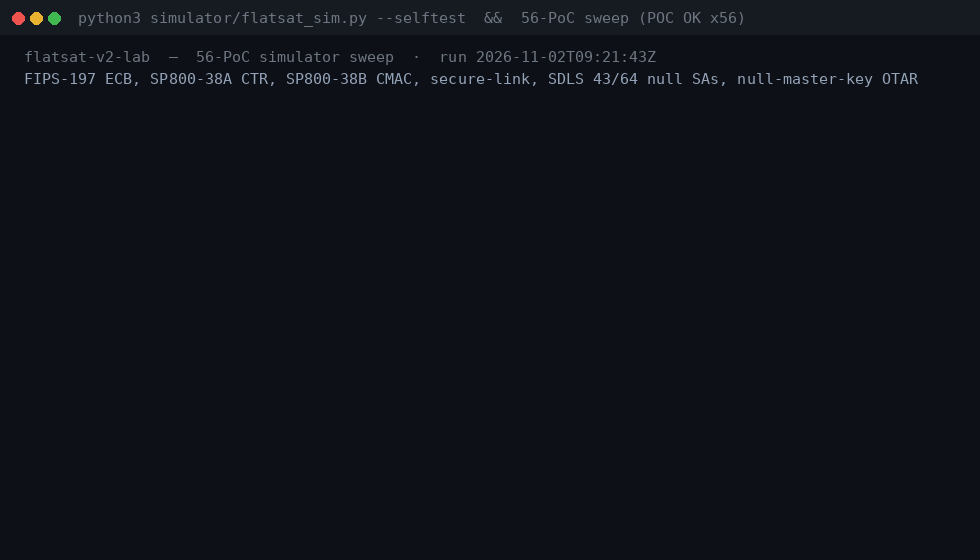
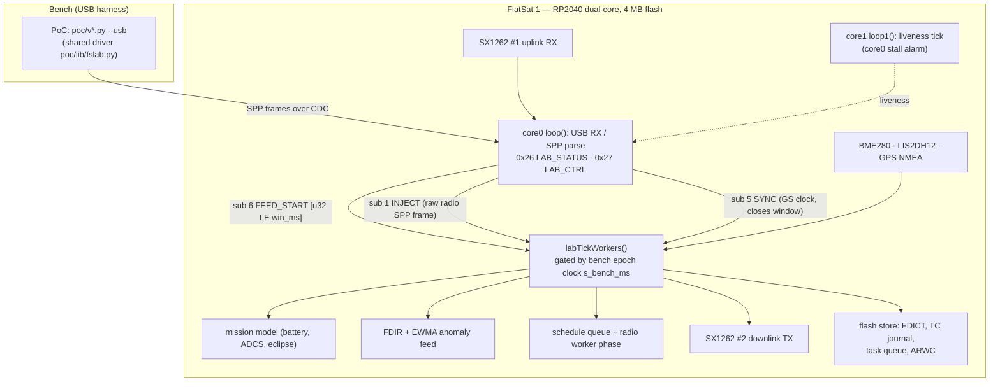
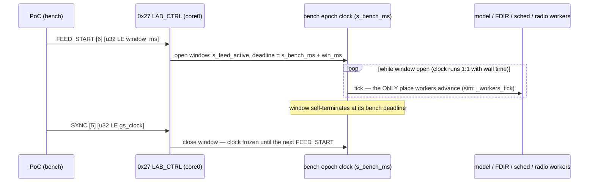

<p align="center">
  
  
  
  
  
</p>

<p align="center">
  <a href="https://xenographic.org"></a>
</p>

> ## 🛰️ ▶ The whole lab is live: **[xenographic.org](https://xenographic.org)**
>
> No install, no clone, no account. The **unmodified** simulator and all **56 Python PoCs**
> run in your browser (CPython → WebAssembly): press **RUN**, watch the craft die, every
> verdict hash-checked against the committed bench evidence. Desktop browsers; hardened
> ones welcome (Mullvad, Brave, strict ETP). Everything below is reproducible offline with
> plain Python too — `make check`.

> **Built on [FlatSat](https://github.com/Pwnsat/FlatSat)** — the open-hardware CubeSat platform
> by [PwnSat](https://github.com/Pwnsat) ×
> [Electronic Cats](https://electroniccats.com). The board, the baseline firmware and the original
> idea are theirs; the vulnerable-by-design extensions, the 56-finding catalog, the bit-for-bit
> simulator and this mission control are this independent research engagement.
> Unofficial — not affiliated with, sponsored, or endorsed by PwnSat or Electronic Cats.

# FlatSat electr0sm0g Lab Version — vulnerable-by-design CubeSat pentest lab

**56 real vulnerabilities. 56 executable PoCs. Real C++ firmware on real RP2040 silicon —
and a bit-for-bit Python simulator.**

FlatSat electr0sm0g Lab Version is a complete offensive-security extension of the official **FlatSat v1.0** CubeSat
firmware ([Pwnsat/FlatSat](https://github.com/Pwnsat/FlatSat), upstream v1.0.3, GPL-2.0-or-later),
built and tested on **FlatSat 1** hardware (Electronic Cats × PwnSat, RP2040 + 2× SX1262 LoRa),
extended into the electr0sm0g laboratory where **every one of the 56 findings** of the master catalog is:

1. **implemented in the real firmware** (vulnerable by design, no shims),
2. **mirrored bit-for-bit in a Python simulator** (the authoritative behavioural reference),
3. **proven end-to-end by an executable PoC** — the *same unmodified PoC code* runs against
   the simulator *and* the real FlatSat 1 board over USB (**bench parity**),
4. **documented** by an English exploit tutorial (root cause, wire format, attack steps,
   evidence excerpts, mitigations) and mapped to **SPARTA v3.2**
   (Space Attack Research and Tactic Analysis, The Aerospace Corporation).

| | |
|---|---|
| Findings | **56** — 18 upstream baseline (`V0-01`…`V0-18`) + 38 v2 lab extension (`V-01`…`V-38`) |
| PoCs | **56**, one per finding; identical code on simulator and hardware |
| Evidence | **112 PoC transcripts** — 56 simulator ([`evidence/`](evidence), plus 2 host-check logs) + 56 real-board ([`evidence-hw/`](evidence-hw)) |
| Writeups | **56** English tutorials in [`docs/writeups/`](docs/writeups) |
| Threat mapping | [`docs/SPARTA_MAPPING.md`](docs/SPARTA_MAPPING.md) — 56-row SPARTA v3.2 matrix (IDs verified against the v3.2 archive; v4.0 re-numbering explicitly labelled; notional risk H/M/L) |
| Firmware | C++ for Raspberry Pi Pico (RP2040) / PwnSat, PlatformIO |
| Simulator | [`simulator/flatsat_sim.py`](simulator/flatsat_sim.py) — no dependencies, byte-for-byte twin |

**In 60 seconds.** A complete CubeSat security lab, not a blog post: real firmware
vulnerable by design, a bit-for-bit simulator, and one executable PoC per finding that
passes on *both* — 56/56, 112 transcripts committed. You can be breaking it in 5 minutes
(`make check`), walking a full kill chain in a half day ([`docs/CURRICULUM.md`](docs/CURRICULUM.md)),
and auditing the whole catalog against the SPARTA v3.2 matrix
([`docs/VERIFICATION.md`](docs/VERIFICATION.md)). The blue-team side is included too
([`docs/DEFENSE.md`](docs/DEFENSE.md)): every broken control, its countermeasure, the standard.
And the realism of the claims is explicit, not assumed
([`docs/REALISM.md`](docs/REALISM.md)): which flaw classes are documented in real flight
software, which triggers the lab facilitates, and what is pure instrumentation.




---

## Bench parity: one PoC, two targets

Every PoC is written against the shared driver [`poc/lib/fslab.py`](poc/lib/fslab.py) and runs
unchanged on both targets:

```bash
python3 poc/v114_memcpy_rce.py              # simulator (default)
python3 poc/v114_memcpy_rce.py --usb        # real FlatSat 1 over USB
```

Parity is not a slogan — it is engineered and re-verified after every firmware change:

- **Same protocol, same state machine.** The simulator implements the exact wire protocol
  (SPP framing, AES-ECB link wrap, SDLS/CMAC, SpaceCAN bridge, FDIR, flash store, mission
  model) and the same error strings, which the PoCs assert on.
- **Same bench epoch.** Hardware PoCs run inside *FEED windows*: `LAB_CTRL`
  `0x27 sub 6 FEED_START` opens a window where the board's bench clock
  (`s_bench_ms`) runs 1:1 with wall time and the mission model / FDIR / schedule queue /
  radio workers advance **only** on that clock — exactly where the simulator's
  `_workers_tick` advances. The window self-terminates at its deadline; the harness pins
  the cold-boot time scale to 60.0x (the simulator's cold boot) and re-arms the bench
  state (FDICT factory reset, OTA restore, queue wipe) between PoCs, so every PoC starts
  from the same reference state.

**Board architecture and the FEED-window mechanism** — the two halves of the
parity argument (bench transport, and the window-gated workers):




- **Verified 2026-10-31 / 2026-11-02:** full 56-item simulator sweep green, and 56/56 PoCs
  green on the physical FlatSat 1 board — the full 56-item hardware sweep ran on firmware
  image `G` (`181c603e…`, 2026-10-31); the final image `H`
  (`bfc145c93039177b7393147978cdd432`, 2026-11-02) re-verified the rebuilt lab modules plus
  spot-checks, and the kept transcripts span images E–H exactly as annotated per run in
  [`hw_pass.txt`](hw_pass.txt), after four documented firmware/harness parity fixes (sweep
  passes 8–9 in [`docs/BUILD.md`](docs/BUILD.md))
  and the evidence annotations.

**Crash PoCs are by-design impacts, not failures.** `v003` / `v015` (poisoned-broadcast
crash, no watchdog) permanently wedge the board — on the current silicon the wild copy
takes the USB stack down too (documented in [`docs/HARDWARE-USB-TEST.md`](docs/HARDWARE-USB-TEST.md)); `v135` (downlink saturation) can do the same under the flood. Recovery is a
physical USB replug; the harness polls up to 10 min and resumes.

---

## Quickstart — no hardware needed

```bash
# 0) crypto + protocol self-test (FIPS-197, SP800-38A CTR, SP800-38B CMAC, shim build)
python3 simulator/flatsat_sim.py --selftest

# 1) run any PoC against the simulator
python3 poc/v114_memcpy_rce.py

# 2) full 56-PoC sweep (simulator)
for f in poc/v0*.py poc/v1*.py; do python3 "$f" --quiet --no-save || break; done
#   (add --no-save is on purpose: the committed evidence/ transcripts are the deliverable)
```

Every run writes a timestamped transcript (auto-dumped to `evidence/<poc>.txt`) that ends in
`POC OK` (exit 0) or `POC FAILED` (exit 1). `--quiet` trims the raw TM hexdumps that are
otherwise included in the transcript.

## In-browser mission control (no install, no clone)

> **▶ Just open it: [https://xenographic.org](https://xenographic.org)** — the exact artifact
> described below, deployed from this repo on every release. This is the fastest way to see
> any finding: open **INDEX**, click its card, press **RUN LIVE**.

[`web/dist/index.html`](web/dist/index.html) runs the **unmodified** simulator and PoCs in your
browser (Pyodide/CPython-WASM, pinned v0.27.4, in a Web Worker), as a five-view console.
Mermaid diagrams inside the documentation views render offline with a vendored
mermaid 11.4.1 (MIT, `web/vendor/`, evaluated lazily on first diagram — no CDN):

- **OVERVIEW** — the honest **A-to-Z explanation of what this project is**, opening on its
  lineage: what [Pwnsat/FlatSat](https://github.com/Pwnsat/FlatSat) is (the open-source
  vulnerable-by-design hardware platform this lab stands on), an exact upstream ↔ lab mapping
  table, the three steps that compile and flash this firmware onto that same RP2040 board, a
  real-vs-simulated split, the 56 findings, the V-36 chain as a five-stage flow, the five views,
  and how to verify everything outside the page. Below it: the KPI band (56 findings · 112/112
  PoC OK · SPARTA families · APID
  attack surface · image H digest), the five hero findings, the SPARTA family grid, the APID
  attack surface (every APID as exercised by the 56 committed transcripts), and the V-36
  killchain pipeline whose five stages light up live as the committed evidence anchors appear;
- **OPS** — the live mission control: SPP frame stream with bit-field inspector, full
  spacecraft state introspection (GPS / GS / SDLS / FDIR / flash / SpaceCAN / mission
  model), the live PoC transcript, and a verdict bar that hash-verifies the fresh
  transcript against the committed `evidence/<poc>.txt` digest;
- **INDEX** — the 56 writeups, step by step (summary → root cause → attack mechanism →
  exploitation walkthrough → impact → mitigations → references, SPARTA v3.2 mapped),
  searchable and filterable, with a live-proof pane that runs the unmodified PoC in place
  and jumps straight to its source or committed evidence;
- **REPORT** — the engagement report rendered verbatim from
  [`reports/pentest-report.json`](reports/pentest-report.json): all 56 findings with
  impact breakdown, PoC steps, remediation priority and status, severity filters, plus the
  full PDF report (`reports/FlatSat-Electr0sm0g-Lab-Pentest-Report.pdf`) in-page;
- **REPO** — a byte-identical browser over the repository itself: the 12 `docs/` documents
  (threat model, SPARTA mapping, defense, verification…), the 114 committed evidence
  transcripts (56 simulator + 56 hardware + 2 host checks), the 45 vulnerable-by-design `firmware/` sources, the runnable Python
  the Worker actually executes (simulator, `fslab.py`, harness, 56 PoCs), `FINDINGS.json`,
  the talk, and the PDF — each file with its committed md5 in the header.

Keys `1`–`5` switch the five views; `?` shows help, `G` the glossary.
All 56 PoCs run in one session (`SWEEP 56/56`, ≈ 20 s wall). Serve `web/dist/` — e.g.
`python3 -m http.server 8931 --directory web/dist` — and open the page. The artifact is
committed; CI re-verifies it in headless Chromium (row 10 of
[`docs/VERIFICATION.md`](docs/VERIFICATION.md)). Regenerate: `make web-demo`.

## On real hardware (PwnSat / FlatSat over USB)

The lab targets **real FlatSat hardware only**: Raspberry Pi Pico (RP2040), 2× SX1262 LoRa,
BME280, LIS2DH12, GPS on UART, 4 MB QSPI NOR. There is **no** ADCS/EPS/CAN/FPGA/HSM on the
board — attitude, power, heaters, eclipse and the SpaceCAN bus are virtual models
(`mission_model.cpp`, `spacecan.cpp`) driven over the internal software bus, wired exactly
like real subsystems; the firmware and the docs say so explicitly.

```bash
cd firmware
python3 -m pip install platformio
pio run                        # verified build: SUCCESS (335872 B UF2)
pio run -t upload              # or the manual 1200-baud BOOTSEL recipe, §2 of the guide
cd ..
python3 poc/v117_sb_forged_mids.py --usb     # any PoC on the board
./tests/hw/run_all_usb.sh /dev/ttyACM0       # full 56-item hardware sweep (health-gated)
```

Full guide: [`docs/HARDWARE-USB-TEST.md`](docs/HARDWARE-USB-TEST.md) — transport semantics,
LAB_STATUS/LAB_CTRL bench services (APIDs 0x26/0x27, cleartext on the trusted USB bus,
PER-0002), FEED-window bench epoch, zombie/wedge recovery, troubleshooting.

## The 56 findings

| ID | Finding | Primary SPARTA v3.2 technique | PoC (runs on sim **and** the real board) |
|----|---------|-------------------------------|------------------------------------------|
| [`V0-01`](docs/writeups/V0-01_send_fw_cpe.md) | Unauthenticated SEND_FW + APID surface enumeration (CPE fingerprint) | REC-0001.01 · Gather Spacecraft Design Information: Software Design | [`v001_send_fw_cpe.py`](poc/v001_send_fw_cpe.py) |
| [`V0-02`](docs/writeups/V0-02_hardcoded_ecb_key.md) | Hardcoded AES-128 ECB link key `PWNsatLabKey1234` in image | REC-0001.03 · Gather Spacecraft Design Information: Cryptographic Algorithms | [`v002_hardcoded_ecb_key.py`](poc/v002_hardcoded_ecb_key.py) |
| [`V0-03`](docs/writeups/V0-03_broadcast_underflow_crash.md) | BROADCAST_MSG length underflow → worker crash (silent death) | EX-0009.01 · Exploit Code Flaws: Flight Software | [`v003_broadcast_underflow_crash.py`](poc/v003_broadcast_underflow_crash.py) |
| [`V0-04`](docs/writeups/V0-04_set_thruster_noauth.md) | SET_THRUSTER accepted from raw radio, no authentication | EX-0005.02 · Exploit Hardware/Firmware Corruption: Malicious Use of Hardware Commands | [`v004_set_thruster_noauth.py`](poc/v004_set_thruster_noauth.py) |
| [`V0-05`](docs/writeups/V0-05_gps_no_checksum.md) | GPS NMEA accepted without checksum → position spoofing | EX-0014.04 · Spoofing: Position, Navigation, and Timing (PNT) Spoofing | [`v005_gps_no_checksum.py`](poc/v005_gps_no_checksum.py) |
| [`V0-06`](docs/writeups/V0-06_gs_auth_xor_static.md) | GS authentication = challenge XOR static key (offline-computable) | EX-0003 · Modify Authentication Process (weak scheme) | [`v006_gs_auth_xor_static.py`](poc/v006_gs_auth_xor_static.py) |
| [`V0-07`](docs/writeups/V0-07_no_replay_protection.md) | No anti-replay protection on telecommands | EX-0001.01 · Replay: Command Packets | [`v007_no_replay_protection.py`](poc/v007_no_replay_protection.py) |
| [`V0-08`](docs/writeups/V0-08_resetc_unauth_dos.md) | RESETC unauthenticated → one-TC reboot DoS, window loss | EX-0005.02 · Malicious Use of Hardware Commands | [`v008_resetc_unauth_dos.py`](poc/v008_resetc_unauth_dos.py) |
| [`V0-09`](docs/writeups/V0-09_flash_read_hardcoded_tag.md) | FLASH_READ guarded only by a hardcoded magic tag | REC-0001.02 · Gather Spacecraft Design Information: Firmware | [`v009_flash_read_hardcoded_tag.py`](poc/v009_flash_read_hardcoded_tag.py) |
| [`V0-10`](docs/writeups/V0-10_cleartext_downgrade.md) | Crypto-bypass: AES engine can be switched OFF over the air | EX-0006 · Disable/Bypass Encryption | [`v010_cleartext_downgrade.py`](poc/v010_cleartext_downgrade.py) |
| [`V0-11`](docs/writeups/V0-11_ecb_bitflip.md) | AES-ECB malleability: TC bit-flip without any integrity check | EX-0009.01 · Exploit Code Flaws: Flight Software | [`v011_ecb_bitflip.py`](poc/v011_ecb_bitflip.py) |
| [`V0-12`](docs/writeups/V0-12_usb_debug_bypass.md) | USB debug mode bypasses link authentication | IA-0011 · Auxiliary Device Compromise | [`v012_usb_debug_bypass.py`](poc/v012_usb_debug_bypass.py) |
| [`V0-13`](docs/writeups/V0-13_spacecan_busoff.md) | SpaceCAN bridge: junk storm drives nodes BUS-OFF (bus jam) | LM-0002 · Exploit Lack of Bus Segregation | [`v013_spacecan_busoff.py`](poc/v013_spacecan_busoff.py) |
| [`V0-14`](docs/writeups/V0-14_beacon_flood.md) | Beacon-flood (SET_BEACON_RATE) freezes the mission loop | EX-0013 · Flooding | [`v014_beacon_flood.py`](poc/v014_beacon_flood.py) |
| [`V0-15`](docs/writeups/V0-15_no_watchdog.md) | No watchdog: hang/crash survives indefinitely until power cycle | EX-0009.01 · Exploit Code Flaws: Flight Software | [`v015_no_watchdog.py`](poc/v015_no_watchdog.py) |
| [`V0-16`](docs/writeups/V0-16_spp_offbyone.md) | SPP unpack off-by-one: TM payload over-read (RAM byte leak) | EX-0009.01 · Exploit Code Flaws: Flight Software | [`v016_spp_offbyone.py`](poc/v016_spp_offbyone.py) |
| [`V0-17`](docs/writeups/V0-17_gps_strtok_columns.md) | GPS parser `strtok` column handling → forged sentences accepted | EX-0014.03 · Spoofing: Sensor Data | [`v017_gps_strtok_columns.py`](poc/v017_gps_strtok_columns.py) |
| [`V0-18`](docs/writeups/V0-18_gs_status_station_leak.md) | GS_STATUS leaks ground-station coordinates to any poller | REC-0003 · Gather Spacecraft Communications Information | [`v018_gs_status_station_leak.py`](poc/v018_gs_status_station_leak.py) |
| [`V-01`](docs/writeups/V-01_send_fw_inventory.md) | SEND_FW unauthenticated inventory/version leak (CPE match to CVE catalogue) | REC-0001.01 · Gather Spacecraft Design Information: Software Design | [`v101_send_fw_inventory.py`](poc/v101_send_fw_inventory.py) |
| [`V-02`](docs/writeups/V-02_chatty_beacon.md) | Over-talkative beacon discloses mode, crypto state, battery, eclipse | REC-0003 · Gather Spacecraft Communications Information | [`v102_chatty_beacon.py`](poc/v102_chatty_beacon.py) |
| [`V-03`](docs/writeups/V-03_tc_rssi_oracle.md) | Per-TC RSSI/SNR/APID oracle exported unauthenticated | REC-0005 · Eavesdropping (.01 Uplink Intercept Eavesdropping) | [`v103_tc_rssi_oracle.py`](poc/v103_tc_rssi_oracle.py) |
| [`V-04`](docs/writeups/V-04_leak_padding.md) | Heartbleed-style RAM leak inside TM 'padding' (GS challenge disclosed) | EX-0009.01 · Exploit Code Flaws: Flight Software | [`v104_leak_padding.py`](poc/v104_leak_padding.py) |
| [`V-05`](docs/writeups/V-05_mem_read.md) | Arbitrary MEM_READ: SA table + GS challenge walk out over raw radio | EX-0012.03 · Modify On-Board Values: Memory Write/Loads | [`v105_mem_read.py`](poc/v105_mem_read.py) |
| [`V-06`](docs/writeups/V-06_pass_cadence.md) | TM cadence + beacon eclipse bit reveal operator pass plan and orbit phase | REC-0003.02 · Gather Spacecraft Communications Information: Commanding Details | [`v106_pass_cadence.py`](poc/v106_pass_cadence.py) |
| [`V-07`](docs/writeups/V-07_arc_replay.md) | 16-bit volatile anti-replay counter, W=5 window, wraps at 65536 | EX-0001.01 · Replay: Command Packets | [`v107_arc_replay.py`](poc/v107_arc_replay.py) |
| [`V-08`](docs/writeups/V-08_sdls_clear_sas.md) | 43 of 64 SDLS security associations default to Clear (auth-free) | EX-0006 · Disable/Bypass Encryption | [`v108_sdls_clear_sas.py`](poc/v108_sdls_clear_sas.py) |
| [`V-09`](docs/writeups/V-09_spi_oob.md) | Unbounded SPI: OOB table read passes; SPI 9000 hangs the worker | EX-0009.01 · Exploit Code Flaws: Flight Software | [`v109_spi_oob.py`](poc/v109_spi_oob.py) |
| [`V-10`](docs/writeups/V-10_otar_null_key.md) | OTAR with 128 NULL master keys: attacker installs his own SA key | PER-0004 · Replace Cryptographic Keys | [`v110_otar_null_key.py`](poc/v110_otar_null_key.py) |
| [`V-11`](docs/writeups/V-11_key_verify_oracle.md) | KEY_VERIFY key-confirmation oracle + CTR keystream recoverable from clear header | REC-0001.03 · Gather Spacecraft Design Information: Cryptographic Algorithms | [`v111_key_verify_oracle.py`](poc/v111_key_verify_oracle.py) |
| [`V-12`](docs/writeups/V-12_tc_bitflip.md) | Silent TC tampering: clear-header APID re-routing + ECB block splice | EX-0012.02 · Modify On-Board Values: Internal Routing Tables | [`v112_tc_bitflip.py`](poc/v112_tc_bitflip.py) |
| [`V-13`](docs/writeups/V-13_log_name_overflow.md) | SET_LOG_NAME unbounded copy overwrites protection-state guard variables | EX-0009.01 · Exploit Code Flaws: Flight Software | [`v113_log_name_overflow.py`](poc/v113_log_name_overflow.py) |
| [`V-14`](docs/writeups/V-14_memcpy_rce.md) | MEMCPY TC → write-what-where → VTOR redirect → RP2040 RCE | EX-0009.01 · Exploit Code Flaws: Flight Software | [`v114_memcpy_rce.py`](poc/v114_memcpy_rce.py) |
| [`V-15`](docs/writeups/V-15_uplink_starvation.md) | Uplink flood (blocking ledBlink + error TMs) starves telemetry | EX-0013.02 · Flooding: Erroneous Input | [`v115_uplink_starvation.py`](poc/v115_uplink_starvation.py) |
| [`V-16`](docs/writeups/V-16_priv_confusion.md) | TEST APID window (0xF0–0xFF) opens in safe mode, no own auth | EX-0011 · Exploit Reduced Protections During Safe-Mode | [`v116_priv_confusion.py`](poc/v116_priv_confusion.py) |
| [`V-17`](docs/writeups/V-17_sb_forged_mids.md) | Forged software-bus MIDs (cFS SB analogue) consumed as truth | EX-0014.02 · Spoofing: Bus Traffic Spoofing | [`v117_sb_forged_mids.py`](poc/v117_sb_forged_mids.py) |
| [`V-18`](docs/writeups/V-18_ota_unsigned.md) | Unsigned OTA image push + slot activation (CRC-16 only) | EX-0010 · Malicious Code (installed via unverified on-orbit update) | [`v118_ota_unsigned.py`](poc/v118_ota_unsigned.py) |
| [`V-19`](docs/writeups/V-19_sched_persistence.md) | Flash-resident scheduled task queue replays after any reboot | PER-0002.02 · Software Backdoor  | [`v119_sched_persistence.py`](poc/v119_sched_persistence.py) |
| [`V-20`](docs/writeups/V-20_fdict_contingency.md) | FDIR contingency dictionary = flash-resident executable trojan | PER-0002.02 · Software Backdoor | [`v120_fdict_contingency.py`](poc/v120_fdict_contingency.py) |
| [`V-21`](docs/writeups/V-21_watchdog_cookie.md) | Persistence cookie in RP2040 watchdog scratch registers (boot policy) | PER-0001 · Memory Compromise | [`v121_watchdog_cookie.py`](poc/v121_watchdog_cookie.py) |
| [`V-22`](docs/writeups/V-22_forced_safe_downgrade.md) | Forced safe mode = protection downgrade (crypto off, ARC 5→15, persists) | DE-0005 · Subvert Protections via Safe-Mode | [`v122_forced_safe_downgrade.py`](poc/v122_forced_safe_downgrade.py) |
| [`V-23`](docs/writeups/V-23_tc_logging_absent.md) | No TC journal by default; optional log capped at 128 entries | DE-0003.08 · On-Board Values Obfuscation: Received Commands | [`v123_tc_logging_absent.py`](poc/v123_tc_logging_absent.py) |
| [`V-24`](docs/writeups/V-24_ewma_ramp_evasion.md) | On-board EWMA anomaly detector evadable by slow ramp | DE-0003.12 · Poison AI/ML Training for Evasion (detector tuning/staleness) | [`v124_ewma_ramp_evasion.py`](poc/v124_ewma_ramp_evasion.py) |
| [`V-25`](docs/writeups/V-25_spacecan_full_bus.md) | Full unauthenticated SpaceCAN bus over the radio bridge (jam/spoof/overflow) | LM-0002 · Exploit Lack of Bus Segregation | [`v125_spacecan_full_bus.py`](poc/v125_spacecan_full_bus.py) |
| [`V-26`](docs/writeups/V-26_sensor_bus_injection.md) | Radio→I2C bridge: sensor mask rewrite + GPS blinding via GPIO write | LM-0002 · Exploit Lack of Bus Segregation | [`v126_sensor_bus_injection.py`](poc/v126_sensor_bus_injection.py) |
| [`V-27`](docs/writeups/V-27_fdir_consumes_forged_mids.md) | FDIR consumes forged MIDs → attacker-launders control of the safety loop | EX-0014.03 · Spoofing: Sensor Data | [`v127_fdir_consumes_forged_mids.py`](poc/v127_fdir_consumes_forged_mids.py) |
| [`V-28`](docs/writeups/V-28_gs_session_hijack.md) | GS challenge has no TRNG (millis ^ GPS) → predicted-challenge session hijack | EX-0003 · Modify Authentication Process | [`v128_gs_session_hijack.py`](poc/v128_gs_session_hijack.py) |
| [`V-29`](docs/writeups/V-29_rf_fingerprint.md) | 64-sample RF fingerprint export (RSSI/SNR/freq-error) usable for LR detector | REC-0005 · Eavesdropping | [`v129_rf_fingerprint.py`](poc/v129_rf_fingerprint.py) |
| [`V-30`](docs/writeups/V-30_stego_padding_channel.md) | Covert channel inside TM padding drains a FIFO over the legitimate downlink | EXF-0004 · Out-of-Band Communications Link (covert variant) | [`v130_stego_padding_channel.py`](poc/v130_stego_padding_channel.py) |
| [`V-31`](docs/writeups/V-31_payload_snap_audit.md) | Unauthorized payload snap + VCC audit-counter freeze | DE-0003.01 · On-Board Values Obfuscation: Vehicle Command Counter (VCC) | [`v131_payload_snap_audit.py`](poc/v131_payload_snap_audit.py) |
| [`V-32`](docs/writeups/V-32_freq_squat.md) | Downlink frequency squat via BROADCAST_MSG operator-frequency field | DE-0003.06 · On-Board Values Obfuscation: Telemetry Downlink Modes | [`v132_freq_squat.py`](poc/v132_freq_squat.py) |
| [`V-33`](docs/writeups/V-33_adcstumble_saturation.md) | ADCS momentum spam (30 valid thruster TCs) → TUMBLE safe + detumble saturation | EX-0012.08 · Modify On-Board Values: Attitude Determination & Control Subsystem | [`v133_adcstumble_saturation.py`](poc/v133_adcstumble_saturation.py) |
| [`V-34`](docs/writeups/V-34_brownout_drain.md) | Heater/eclipse power drain → brownout reset wipes ARC, cookie, crypto state | EX-0012.09 · Modify On-Board Values: Electrical Power Subsystem | [`v134_brownout_drain.py`](poc/v134_brownout_drain.py) |
| [`V-35`](docs/writeups/V-35_beacon_broadcast_saturation.md) | Beacon/broadcast downlink saturation (service_control analogue) | EX-0013.01 · Flooding: Valid Commands | [`v135_beacon_broadcast_saturation.py`](poc/v135_beacon_broadcast_saturation.py) |
| [`V-36`](docs/writeups/V-36_gps_spoof_chain.md) | GPS spoof → range-lock dissolve → XOR auth → privileged control (full chain) | EX-0014.04 · Spoofing: Position, Navigation, and Timing (PNT) Spoofing | [`v136_gps_spoof_chain.py`](poc/v136_gps_spoof_chain.py) |
| [`V-37`](docs/writeups/V-37_build_metadata.md) | Unauthenticated FLASH dump + banner TMs pin the open-source fork and version | REC-0001.01 · Gather Spacecraft Design Information: Software Design (.02 Firmware) | [`v137_build_metadata.py`](poc/v137_build_metadata.py) |
| [`V-38`](docs/writeups/V-38_arwc_rollback.md) | Anti-rollback counter writable by TC → patch level unenforceable | EX-0009.03 · Exploit Code Flaws: Known Vulnerability (COTS/FOSS) | [`v138_arwc_rollback.py`](poc/v138_arwc_rollback.py) |

**Legend:** baseline = kept from upstream v1.0.3; new = v2 lab extension. PoC `v0XX` ↔
`V0-XX`, PoC `v1XX` ↔ `V-XX` (e.g. `v114` = `V-14`). Each finding row links to its English
tutorial; the PoC link is the file to run.

* Full matrix with secondary techniques and notional-risk triples:
  [`docs/SPARTA_MAPPING.md`](docs/SPARTA_MAPPING.md) (SPARTA v3.2, The Aerospace
  Corporation, 2026-03-11 — technique IDs and risk scores verified against
  `sparta.aerospace.org`).
* Master catalog of the 56 findings (FR):
  [`docs/RAPPORT-FIRMWARE-VULNERABLE-FLATSAT.md`](docs/RAPPORT-FIRMWARE-VULNERABLE-FLATSAT.md).
* Per-finding evidence: [`evidence/<poc>.txt`](evidence) (simulator) and
  [`evidence-hw/<poc>.txt`](evidence-hw) (real board).

## Repository layout

```
firmware/      v2 firmware (upstream v1.0.3 + lab modules) — PlatformIO, RP2040
simulator/     flatsat_sim.py — bit-for-bit behavioural twin (authoritative reference)
poc/           56 PoCs + poc/lib/fslab.py (shared driver: --sim default / --usb)
evidence/      56 simulator transcripts (POC OK) + 2 host-check logs
evidence-hw/   56 real-board transcripts (POC OK, FlatSat 1 over USB, images E–H; per-run images annotated in hw_pass.txt)
hw_pass.txt    56/56 hardware pass list + evidence annotations
FINDINGS.json  machine-readable catalog (generated from SPARTA_MAPPING.md, CI drift-checked)
reports/       FlatSat-Electr0sm0g-Lab-Pentest-Report.pdf (46 pages, 56 finding cards) + pentest-report.json
talk/          15-slide conference deck (HTML, reveal.js loaded from CDN)
docs/          SPARTA_MAPPING.md · writeups/ (56 tutorials) · BUILD.md (build + parity
               history) · HARDWARE-USB-TEST.md (hardware guide) · THREAT-MODEL.md ·
               REALISM.md (how real is this — 3-tier mapping) · LICENSING.md (per-file provenance) ·
               DEFENSE.md (blue-team countermeasures) · KILLCHAIN-V36.md (flagship chain) ·
               VERIFICATION.md (claim → proof → command) · CURRICULUM.md (3 learning tracks) ·
               DESIGN-RATIONALE.md · RAPPORT-FIRMWARE-VULNERABLE-FLATSAT.md (master catalog)
tests/host/    crypto vectors (FIPS-197, SP800-38A/B) + syntax gate + catalog integrity
               gate (check_catalog.py / gen_findings.py) + demo GIF renderer
tests/hw/      hardware sweep runner + board health gate
tools/         gen_report.py — regenerates reports/ from the catalog (never hand-edited)
               · build_web_demo.py — builds the in-browser demo (web/dist/)
               · gen_attack_diagrams.py — regenerates the attack-surface diagrams
web/           in-browser mission control: index.html + style.css (templates) ·
               harness.py (wire taps on the real sim) ·
               worker.js (Pyodide host, pinned CDN) · app.js (UI) · vendor/ (mermaid 11.4.1, MIT) ·
               dist/ (committed artifact)
assets/        sweep-demo.gif (real run) · flatsat-reel-30s.mp4 (30-s reel) · social-card.png (repo social image)
CONTRIBUTING.md  the contract: what a complete finding needs (enforced by the CI gate)
Makefile       make check / sweep-sim / sweep-hw / build-fw / flash / findings
```

## Key simulator/firmware invariants (authoritative: `simulator/flatsat_sim.py`)

* Secure link ON by default: radio TC payloads are AES-ECB wrapped with the known lab key
  `PWNsatLabKey1234` (that leak *is* V0-02); v2 extension TMs (APID 0x14–0x25) downlink
  cleartext, baseline TMs are wrapped.
* Error strings are part of the protocol (`SDLS MAC FAIL`, `GS RANGE LOCK`, `FREQ LOCK`,
  `NOT SAFE`, `RELEASE WINDOW`, …) — PoCs assert on them.
* Mission time only advances through `advance()`; brownout/safe-mode/anomaly models are
  deterministic under the lab time base (FDIR sub=10).

## Safety

This codebase is **intentionally vulnerable**: hardcoded keys, missing authentication,
exploitable memory corruption, unauthenticated telecommands. Run it only on isolated lab
hardware (a bench PwnSat, radio side off any hostile network) and for training or authorized
assessment use only. Do not expose it, modified or unmodified, to production or hostile
environments.

## Contact

Étienne Lacoche — Cybersecurity Researcher · etienne.lacoche@pm.me. Questions on
the lab, parity divergences or
new-finding candidates: use the issue templates (`.github/ISSUE_TEMPLATE/`).

## License

This repository is distributed under **GPL-2.0-or-later** ([LICENSE](LICENSE)): it is based on the
official FlatSat v1.0 firmware ([github.com/Pwnsat/FlatSat](https://github.com/Pwnsat/FlatSat),
GPL-2.0-or-later) and contains derivative works of it, so the copyleft terms apply to the whole
repository (every source file — firmware, simulator, PoCs, tests — carries the `SPDX-License-Identifier`).

**Acknowledgments & non-affiliation.** The firmware tree is a FlatSat v1.0.3-based build: the
drivers carried over from upstream (`led.cpp`, `rdownlink.cpp`, `ruplink.cpp`, `sensors.cpp`,
`usbCDC.cpp` — a few carry minimal documented bench/lab patches, e.g. the V-24 blink fix;
per-file provenance in [docs/LICENSING.md](docs/LICENSING.md), host-compile status in
`evidence/HOST-02-firmware-compile.txt`), the patched baseline handlers, and
the new lab modules are all credited per file in [docs/LICENSING.md](docs/LICENSING.md), which
also inventory the third-party components (Pyodide, mermaid, vendor libraries, fonts) and their
licenses. This repository is an independent security-research engagement **not affiliated with,
sponsored, or endorsed by PwnSat or Electronic Cats** — the credit for the platform, the board
and the original firmware goes entirely to them, and we recommend buying and building the real
[FlatSat 1](https://electroniccats.com/store/flatsat1) to run this lab against your own hardware.

Hardware reference platform: **FlatSat 1** by Electronic Cats and PwnSat
([electroniccats.com/store/flatsat1](https://electroniccats.com/store/flatsat1)) — hardware under
CERN Open Hardware Licence v1.2. *PwnSat* and *Electronic Cats* are registered trademarks.

Threat taxonomy: **SPARTA** — Space Attack Research and Tactic Analysis — is created and maintained
by **The Aerospace Corporation** ([sparta.aerospace.org](https://sparta.aerospace.org/)); its
technique IDs, tactic families and notional-risk scores are reproduced here for analysis, with
attribution, under its terms of use.

Copyright (C) 2026 Étienne Lacoche (v2 lab extension); upstream copyright PwnSat / Electronic Cats.
