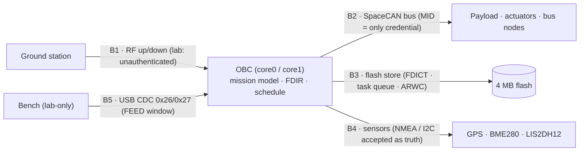

# Threat model — FlatSat electr0sm0g Lab

Who the adversary is, what the craft is defending, which boundaries exist, and
why the 56 findings compose into chains. One page; read it before the writeups.

## Assets (what the vehicle is supposed to protect)

| Asset | Why it matters | Lab control (deliberately broken) |
|---|---|---|
| Control plane (mission mode, thrusters, heaters) | command integrity = mission survival | GS range gate + static XOR challenge (V-36, V0-06) |
| Telemetry authenticity | ground decisions are made on TM | AES-128-ECB link wrap, key in the image (V0-02), switchable OFF (V0-10) |
| Flash-resident state (FDICT, task queue, ARWC) | persistence across reboots = resident code | no signature, TC-writable (V-20, V-19, V-38) |
| Sensor truth (GPS, environment) | navigation + ground-station gating | NMEA accepted without checksum (V0-05) |
| Availability (bus, workers, downlink) | mission time is non-recoverable | no watchdog, no rate limits (V0-15, V0-13, V-35) |

## Adversary model

Three adversaries, ascending capability:

1. **Passive eavesdropper** (anywhere in RF range, no uplink) → the Recon
   group: version, inventory, crypto state, battery, station coordinates,
   RF fingerprint — 9 findings, zero interaction required.
2. **Unauthenticated uplink** (any transmitter on the ISM band) → most of the
   lab: the vast majority of TC APIDs execute without link authentication.
3. **RF adversary with PNT capability** (GPS spoofer / RF front-end at the
   antenna) → the V-36 initial-access chain plus V0-05 / V0-17.

Assumed resources: off-the-shelf SDR + RP2040-class hardware, sub-$300,
hours of effort. Nothing in the catalog requires custom silicon or a
classified capability — that is the point of the lab.

## Trust boundaries

| Boundary | Integrity mechanism (as designed) | What the lab breaks |
|---|---|---|
| B1 · Space ↔ OBC | GS range gate + XOR challenge | gate is range-gated on spoofable position; XOR key static (V-36, V0-06) |
| B2 · OBC ↔ SpaceCAN | message ID | MID is forgeable; FDIR consumes forged MIDs (V-17, V-25, V-27) |
| B3 · OBC ↔ flash | CRC-16 on OTA images | OTA unsigned, stores TC-writable (V-18, V-19, V-20, V-38) |
| B4 · OBC ↔ sensors | none | NMEA without checksum (V0-05, V0-17); sensor masks writable (V-26) |
| B5 · bench ↔ OBC | USB-only APIDs | lab service by design (0x26/0x27); would be an incident on flight hardware |

## Attack chains (how the findings compose)

Single findings are the atoms; the value is in the chains:

- **V-36 → full initial access (flagship):** GPS spoof dissolves the GS range
  gate → static XOR handshake → privileged TCs. See
  [`KILLCHAIN-V36.md`](KILLCHAIN-V36.md) for the end-to-end walkthrough.
- **V-28 + V0-06 → passive session hijack:** challenge seeded from the
  last-seen mission clock (no TRNG) and a static XOR key — the handshake can
  be answered offline.
- **V-17 → V-27 → V-24 → safety-loop laundering:** forged bus MIDs are
  consumed by FDIR, the EWMA anomaly detector is evadable by a slow ramp, so
  the attacker steers the vehicle *through* the safety loop.
- **V-18 → V-20 → persistence:** unsigned OTA push (CRC-16 only) installs a
  flash-resident FDICT contingency trojan that survives every reboot.
- **V0-03 + V0-15 → total loss of craft:** an unbounded `memcpy` from a
  0xFFFD broadcast underflow crashes the worker, and with no watchdog the
  vehicle stays down until a physical power cycle.

## Consequence for defenders

Every boundary above has exactly one (weak or absent) integrity mechanism.
The defensive view — what a real flight-software team must put in place — is
[`DEFENSE.md`](DEFENSE.md); the reproducible evidence for each claim is
[`VERIFICATION.md`](VERIFICATION.md); how realistic the modeled flaws are,
tier by tier, is [`REALISM.md`](REALISM.md).
