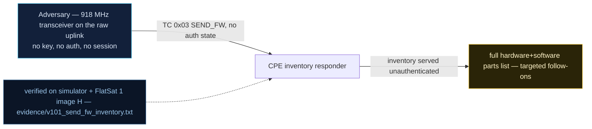

# V-01 — CPE inventory leak via `SEND_FW`

| Field | Value |
|---|---|
| ID | V-01 |
| Severity | Medium — no control-plane effect, but a zero-credential query returns the exact firmware version plus a live 20-APID responder map, collapsing the attacker's CVE-matching effort to a lookup |
| Category | Information disclosure (CWE-200) |
| Interface | Radio uplink — TC APID 0x03 (`SEND_FW`), APID 0x0C (`GET_STATUS`); confirmation TMs on 0x03/0x0C |
| SPARTA | REC-0001.01 · Gather Spacecraft Design Information: Software Design; secondary REC-0002.01 Identifiers (v3.2, no notional-risk triple published for these IDs) |
| PoC | `poc/v101_send_fw_inventory.py` — evidence `evidence/v101_send_fw_inventory.txt` (`POC OK`) |

## Summary
One empty `SEND_FW` telecommand over the raw radio makes the spacecraft answer with
its exact firmware version (`1.0.0`). Chained with `GET_STATUS` (which leaks the
protection flags) and an APID sweep, the attacker obtains a full CPE-style inventory —
software name, version, and the live set of unauthenticated responders — and can match
it against the published vulnerability catalogue for this firmware line. The PoC
demonstrates 20 APIDs answering with no challenge, session, or rate gate.

## Attack diagram



## Root cause
`worker.cpp` implements the `SEND_FW` handler (`SPP_APID_TC_SEND_FW`) as an
unconditional version reply — no challenge, no authentication state consulted. The v2
catalog decision (RAPPORT §4.A, V-01) was to keep it that way and lean into it:
build identity plus the APID→handler table are answerable by anyone. `spp.cpp`
parses and dispatches the primary header unconditionally, so every probed APID that
has a handler produces a TM or a named error on APID 0x09.

## Attack mechanism
The probe is a minimal SPP frame: 6-byte big-endian primary header
`[ident | seqc | length]` with `ident = (type<<12)|(sechdr<<11)|APID`, empty data
field (secure-link AES-ECB wrapping uses the hardcoded key from V0-02 but requires no
*authentication state*). The `SEND_FW` TM is 5 bytes on APID 0x03:
`[SCID=0x01][ver][ver][ver][0]` — bytes 1..3 little-endian read back as version
`1.0.0`. A follow-on sweep of 22 candidate APIDs records which ones produce TMs.

## Exploitation walkthrough
1. Send `SEND_FW` raw: `dev.tc(0x03, b"", via="radio")`; decode the version from the
   reply. Simultaneously query `GET_STATUS` (0x0C) for the protection flags:

```
SEND_FW payload=0100000100 -> firmware version 1.0.0
GET_STATUS flags=0x1F: secure_link=True payload_armed=False usb_debug=False
```

2. Sweep the probe table (0x01…0x25, plausible payload per APID — e.g. `a5000020c35a`
   for 0x0B FLASH_READ, `000000200800` for 0x19 MEM_READ) and count responders:

```
unauthenticated responders (20): ['0x1', '0x3', '0x6', '0x7', '0xb', '0xc', '0xd', '0xe', '0xf', '0x11', '0x13', '0x17', '0x19', '0x1d', '0x1e', '0x1f', '0x20', '0x21', '0x23', '0x25']
attacker holds exact CPE (software + version + live APID map) and can match it to the published vulnerability catalogue
```

3. The PoC asserts the version reads `1.0.0` and that at least 18 APIDs answer; 20 do,
   including the SDLS/crypto families 0x15–0x25 introduced in v2 (MEM_READ 0x19,
   TC_STATS 0x20 visible in the list — seeds for V-03…V-05).

## Impact
The whole inventory takes milliseconds of uplink — a fraction of a 5–15 min LEO pass —
and needs no key. It converts the encrypted-payload downlink into an open book: the
attacker knows which firmware release this is, which findings from the public catalogue
apply (the lab's own V-04/V-05/V-13/V-14 are all reachable from responders in that
list), and which protection flags are currently set. This is the reconnaissance step
that prioritizes every later attack.

## Mitigations
- Gate version/identity queries behind SPARTA CM0031-style Authentication (challenge or
  SDLS MAC) — the honest cost is that operators' own tooling needs the key on cold
  acquisition, and lost-comms recovery must fall back to a pre-agreed limited APID set.
- Return a truncated or hashed build ID instead of a dotted version, and make builds
  reproducible (CM0013-style manifest per the course's build-metadata chapter); costs
  a little release-tooling complexity, zero flight CPU.
- Default-deny dispatcher for unknown APIDs and a per-pass rate limit on query-type
  TCs — a 22-APID sweep in one second is trivially anomalous versus operator cadence.

## References
- PoC + evidence: `poc/v101_send_fw_inventory.py`, `evidence/v101_send_fw_inventory.txt`
- `docs/SPARTA_MAPPING.md` — table row V-01 (primary REC-0001.01)
- `../RAPPORT-FIRMWARE-VULNERABLE-FLATSAT.md` §4.A "V-01 · Fuite d'inventaire CPE par
  SEND_FW" (CWE-200; course Ch.5, Ch.6)
- Wire formats: `simulator/flatsat_sim.py` (`spp_pack`, APID 0x03 handler)
