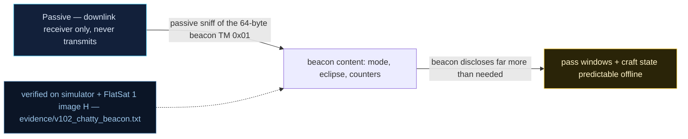

# V-02 — Over-talkative status beacon (window prediction)

| Field | Value |
|---|---|
| ID | V-02 |
| Severity | Medium — purely passive, but the beacon publishes the SECURE_LINK bit, mission mode, battery and eclipse, so an eavesdropper learns the protection state and the right injection moment without emitting anything |
| Category | Information disclosure (CWE-200) |
| Interface | Telemetry downlink — beacon TM APID 0x01 (64-byte frame) |
| SPARTA | REC-0003 · Gather Spacecraft Communications Information; secondary REC-0007 Monitor for Safe-Mode Indicators (15\|11\|5), EXF-0003.02 Downlink Exfiltration (v3.2) |
| PoC | `poc/v102_chatty_beacon.py` — evidence `evidence/v102_chatty_beacon.txt` (`POC OK`) |

## Summary
The beacon is designed for operators but speaks like a debug console. Its 64-byte frame
carries mission mode, protection flags (including the AES `SECURE_LINK` bit), virtual
battery voltage, tilt, GS/eclipse state, timestamp and boot counter. A passive RTL-SDR
operator parses the protection state in real time and picks the injection window from
the beacon alone — the PoC shows the SEC bit flipping in the clear the instant crypto
is switched off over the air (V0-10).

## Attack diagram



## Root cause
`worker.cpp :: telemetrySPPTransmitBeacon` builds the frame with
`buffer[8]=mission_ctx.mode`, `buffer[9]=missionStatusFlags()` (bit 0x10 =
`FLAG_SECURE_LINK`, 0x20 = payload armed, 0x40 = USB debug), bus voltage (LE dV at
offset 11), tilt (offset 13), `gs_bits | eclipse<<4` (offset 15), `millis()` BE32
(offset 16) and boot count (offset 20). The catalog (RAPPORT §4.A, V-02) deliberately
added these 8-plus bytes "like AX.25 FUNcube"; the CM0006 cloak
(`labBeaconCloaked()` / `DEF_CLOAK`) exists but is off by default.

## Attack mechanism
No uplink needed. Each beacon frame after the 8-byte magic `Beacon\0` decodes as:
`[8]=mode, [9]=flags, [10]=flags2, [11:13]=bus (LE, 0.01 V), [13:15]=tilt (LE,
0.01 °/s), [15]=GS bits | 0x10 eclipse, [16:20]=millis BE32, [20]=boot count`.
Flag bit 0x10 in byte 9 is the live AES-engine state. When the attacker (or the
operator's own downgrade, V0-10) flips crypto off via APID 0x0A, the very next beacon
shows it — a free confirmation oracle for protection-state attacks (V-08, V-13, V-22).

## Exploitation walkthrough
1. Speed the beacon to 1 s (`SET_BEACON_RATE`, APID 0x05 payload `\x01`) and collect
   frames over 2.5 s; parse the status core:

```
beacon: mode=0x01 flags=0x1F flags2=0x00 bus=23.99V tilt=0.00 boot=0
```

2. Assert the leaked SECURE_LINK bit matches device state and the battery model is
   readable (23.99 V bus) — no intrusion, pure eavesdrop.
3. Switch the AES engine off over the radio (APID 0x0A payload `\x00`, sent in the
   clear — the V0-10 crypto-bypass) and watch the next beacon:

```
after AES-off beacon flags=0x0F (SEC bit cleared)
attacker picks the injection window from the beacon alone
```

The PoC asserts bit 0x10 is gone: `beacon reflects crypto downgrade instantly`.

## Impact
For a passive adversary the beacon is a live status dashboard across every orbit:
protection state (AES on/off), mission mode, power budget, eclipse phase and reboot
history. Knowing *when* the link is downgraded and *when* the spacecraft is in eclipse
(power-stressed) lets an attacker schedule injection inside the 5–15 min pass with
maximum success probability and minimum emitted energy — the course's "predict the
window" reconnaissance, done with nothing but a receiver.

## Mitigations
- Enable the CM0006-style cloak (`DEF_CLOAK`) by default: zeroes the 13-byte status
  core while keeping the magic; cost is the ground losing passive health audit —
  replace with authenticated on-demand status requests.
- Keep only a beacon-id/minimal health core in the clear and move mode/flags/battery
  behind an authenticated `GET_STATUS`; costs an uplink round-trip for routine ops.
- Publish a coarse, fixed template instead of live values (quantized battery bucket,
  no SEC bit); negligible compute cost, removes the instant-downgrade feedback loop.

## References
- PoC + evidence: `poc/v102_chatty_beacon.py`, `evidence/v102_chatty_beacon.txt`
- `docs/SPARTA_MAPPING.md` — table row V-02 (primary REC-0003)
- `../RAPPORT-FIRMWARE-VULNERABLE-FLATSAT.md` §4.A "V-02 · Balise d'état trop bavarde"
  (course Ch.5.1)
- Wire formats: `simulator/flatsat_sim.py` (`FlatSatSim._beacon`)
