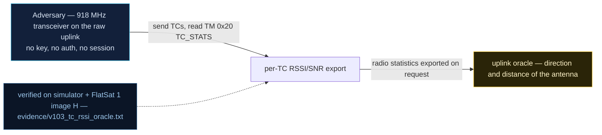

# V-03 — Per-TC RSSI/SNR export (uplink oracle + APID leak)

| Field | Value |
|---|---|
| ID | V-03 |
| Severity | Low — discloses radio metrics and the last-executed APID only; no control effect, but it tunes the attacker's overshadowing/EIRP setup and punctures the deniability of encrypted payloads |
| Category | Information disclosure / side channel (CWE-200) |
| Interface | Radio uplink (every TC sampled) — export via TC/TM APID 0x20 (`TC_STATS`) |
| SPARTA | REC-0005 · Eavesdropping (.01 Uplink Intercept Eavesdropping); secondary DE-0003.04 Command Receivers Received Signal Strength (v3.2, no notional-risk triple published for these IDs) |
| PoC | `poc/v103_tc_rssi_oracle.py` — evidence `evidence/v103_tc_rssi_oracle.txt` (`POC OK`) |

## Summary
Every telecommand the receiver accepts is sampled — RSSI, SNR, estimated frequency
error — and the running statistics are handed back, unauthenticated, by a single query
(`TC_STATS`, APID 0x20). The reply even names the APID that just executed
(`last_apid`), so an attacker can confirm *which* encrypted command landed without
decrypting anything. The PoC closes the loop: ten PINGs, then the export reports
`samples=11 ... last_apid=0x20`.

## Attack diagram



## Root cause
`ruplink.cpp` samples RadioLib's `getRSSI()` (via `radioLastStats`), SNR and `getFrequencyError()` for
every accepted frame (the hook the catalog asked for, RAPPORT §4.A V-03, "Coût : 6 o de
TM"). `extcmds.cpp` (`SPP_APID_TC_TC_STATS`) exports the window with no gate: the same
handler resets the window on payload `\x01` and returns an 18-byte cleartext TM on an
empty payload — including a `last_apid` field, which turns a signal-strength service
into a command-type oracle.

## Attack mechanism
The export TM (APID 0x20, sent `clear`) is
`[SCID][0][n][rssi_avg i16 LE][snr_avg i16 LE, dBi×10][ferr i16 Hz][rssi_min i16][rssi_max i16][crc_on][apid_hi][apid_lo][tm_ctr u16 LE]`.
The attacker uses it as a feedback loop: adjust transmitter power/EIRP until the
reported RSSI/SNR straddles the demodulation threshold (overshadowing calibration),
inspect `freq_err` to tune Doppler compensation, and read `last_apid` to confirm which
ciphertext was which command — a labeled-codebook aid against the ECB link (V0-11,
V-12). `crc_on=0` also tells them uplink CRC is disabled (V-12).

## Exploitation walkthrough
1. Reset the statistics window: `dev.tc(0x20, b"\x01", via="radio")` (returns a 4-byte
   clear ack).
2. Send ten encrypted PINGs (APID 0x01) over the radio — each one is sampled.
3. Export with an empty `TC_STATS` and decode. The export itself counts as a sample,
   so `n=11` (asserted `n >= 11`):

```
samples=11 rssi avg=-71 [-80..-65] dBm snr=9.8dB freq_err=-80Hz crc_on=0 last_apid=0x20
```

4. The PoC asserts the RSSI window is self-consistent (`min ≤ avg ≤ max`) and that
   `last_apid == 0x20` — "oracle names the APID that just executed -> command-type leak
   despite encrypted payloads".

## Impact
A few bytes of telemetry convert a blind uplink into an instrumented one. An attacker
sharing the channel measures their own signal through the satellite's receiver,
calibrates a β=13 dB overshadowing attack against the 5–15 min pass without guessing,
and builds an RF-fingerprint sample set (the course's Costas-lock/MACNN material — see
V-29 for the 64-sample variant). The APID leak means payload encryption no longer hides
*what kind* of command was executed, only its bytes.

## Mitigations
- Gate `TC_STATS` behind the GS session / SDLS MAC (CM0031 Authentication): the
  operator keeps the diagnostic, the eavesdropper loses the export. Cost: none in
  flight CPU, one key check.
- Drop `last_apid` and `crc_on` from the unauthenticated view, or return them quantized
  (RSSI bucketed to ±5 dB) — removes the command-type oracle at zero cost.
- Keep the *sampling* (cheap) but log locally for anomaly detection (feeds the course's
  RF IDS hook, cf. V-24) so the same telemetry that leaks to attackers becomes an
  on-board detection feature.

## References
- PoC + evidence: `poc/v103_tc_rssi_oracle.py`, `evidence/v103_tc_rssi_oracle.txt`
- `docs/SPARTA_MAPPING.md` — table row V-03 (primary REC-0005)
- `../RAPPORT-FIRMWARE-VULNERABLE-FLATSAT.md` §4.A "V-03 · Exposition RSSI/SNR par TC
  reçue" (CWE-200; course Ch.1, Ch.5.2)
- Wire formats: `simulator/flatsat_sim.py` (`_ext`, `apid == 0x20` branch)
