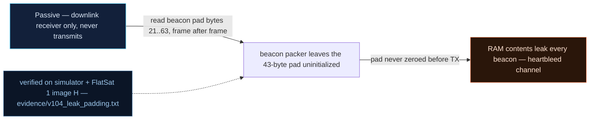

# V-04 — Uninitialized RAM leak in telemetry padding (Heartbleed channel)

| Field | Value |
|---|---|
| ID | V-04 |
| Severity | High — a fresh 4-byte ground-station authentication challenge rides out inside the "padding" of a beacon with no crash and no auth; steady-state secret leakage on the legitimate downlink |
| Category | Exposure of sensitive memory to an unauthorized actor (CWE-201, over-read class CWE-125) |
| Interface | Telemetry downlink — beacon TM APID 0x01, bytes 21..63 (the 43-byte pad); configured via TC APID 0x21 (`PADDING_CONFIG`) |
| SPARTA | EX-0009.01 · Exploit Code Flaws: Flight Software; secondary EXF-0003.02 Downlink Exfiltration (v3.2, notional risk 24\|21\|17) |
| PoC | `poc/v104_leak_padding.py` — evidence `evidence/v104_leak_padding.txt` (`POC OK`) |

## Summary
Short telemetry frames are padded to 64 bytes, but in mode 1 the pad is filled from a
live RAM string pool instead of zeros — the exact Heartbleed/ESTCube-1 ICP pattern the
course teaches. Whatever recent command processing wrote into that pool leaks into the
clear. The PoC drives the GS handshake phase 0, which copies the freshly generated
authentication challenge (0x1F26789C in this run) into the pool; the very next beacon
carries those four bytes inside its "padding", defeating the challenge before the
operator's answer ever flies.

## Attack diagram



## Root cause
`worker.cpp :: telemetrySPPTransmitBeacon` delegates bytes 21..63 to
`covert.cpp :: covertApplyPadding` with the catalog's mode policy
(`PADDING_CONFIG`, APID 0x21: 0=zeros, 1=raw RAM leak, 2=covert FIFO; the v2 lab keeps
the leak pool reachable). The simulator (`_beacon` / `_leak_take`) fills the pad by
walking backwards through the 256-byte `leak` pool that recent writes land in — here
`GS_ACCESS` phase 0 (`_leak_write(struct.pack("<I", challenge))`). Nothing zeroes the
TX slack, so secret adjacency is exported verbatim (catalog: "ne plus nettoyer
`buffer[MAX_PAYLOAD_CHUNK]`", CWE-201).

## Attack mechanism
1. `PADDING_CONFIG` mode=1 selects the leak pool as pad source.
2. Any activity that writes secrets into the pool makes them beacon-eligible: the GS
   phase-0 challenge is one, AES key-schedule scraps and stack fragments are the
   catalog's general case.
3. The 64-byte beacon's bytes 21..63 (43 bytes) are then a rolling window over recent
   RAM. The pool stores the challenge little-endian; `_leak_take` reads backwards from
   the write cursor, so in the beacon padding it appears as the big-endian byte string
   `1f26789c`, and a `MEM_READ` of the pool base shows the little-endian form.

## Exploitation walkthrough
1. Beacon at 1 s over USB; then `dev.tc(0x21, b"\x01", via="radio")` → padding mode 1.
2. Fire GS phase 0 (`dev.tc(0x12, b"\x00", via="radio")`) to mint a challenge:

```
GS challenge generated: 0x1F26789C (firmware also copies it into the RAM string pool)
```

3. Collect the next beacon and dump its pad — the challenge is there, verbatim:

```
beacon padding bytes: 1f26789c000000000000000000000000000000000000000000000000000000000000000000000000000000
```

4. Cross-check with `MEM_READ` of the pool base (`0x20002800`, len 16) — same bytes in
   memory order:

```
MEM_READ leak pool: 9c78261f000000000000000000000000
=> 43 secret-ish RAM bytes per beacon, no crash, no auth
```

The PoC asserts `struct.pack(">I", chal) in tail` — a fresh challenge leaked in the
"padding" of a cleartext beacon.

## Impact
43 bytes per beacon, every beacon, indefinitely — a permanent covert read-primitive on
the *legitimate* downlink. For the 5–15 min pass budget the killer property is timing:
the GS challenge's validity window is 60 s, and a passive listener beats the honest
responder by simply watching the pad. Combined with the static XOR key (V0-06) this
yields full GS session forgery from a receive-only setup, and it is the soft-memory-read
half of the ESTCube-1 ICP story (hard version: V-05).

## Mitigations
- Zero the TX slack: `memset` pad region before fill (the upstream `spp_unpack` already
  zeroes on RX; do the same on TX). Cost: a few cycles per frame — the honest fix.
- Keep pool/covert modes (0/2) as production defaults and make mode 1 a
  bench-only, physically-gated option (CM0037 Disable Physical Ports analogue).
- If a RAM-pool channel is wanted for the covert-channel demo (V-30), fence the pool to
  a dedicated non-secret buffer; trade-off: loses the "secrets leak naturally" pedagogy.

## References
- PoC + evidence: `poc/v104_leak_padding.py`, `evidence/v104_leak_padding.txt`
- `docs/SPARTA_MAPPING.md` — table row V-04 (primary EX-0009.01, risk 24\|21\|17)
- `../RAPPORT-FIRMWARE-VULNERABLE-FLATSAT.md` §4.A "V-04 · Fuite de RAM non initialisée
  dans le padding TM" (CWE-201; course Ch.7.1, ESTCube-1 ICP over-read)
- Wire formats: `simulator/flatsat_sim.py` (`_beacon`, `_leak_take`, `PADDING_CONFIG`)
