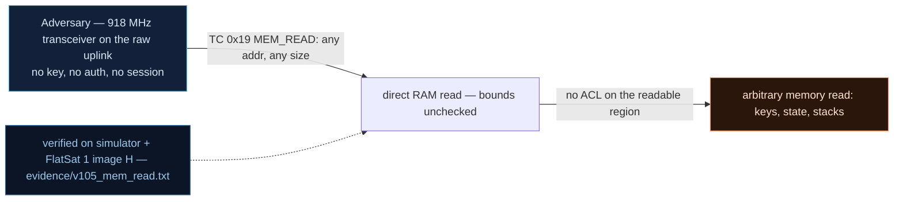

# V-05 — Arbitrary memory read via `MEM_READ` (attacker-sized over-read)

| Field | Value |
|---|---|
| ID | V-05 |
| Severity | High — one unauthenticated TC pulls the live GS challenge, the full 16-byte AES link key, and the master-key table straight out of SRAM over the raw radio |
| Category | Out-of-bounds read / unprotected memory exposure (CWE-125) |
| Interface | Radio uplink — TC APID 0x19 (`MEM_READ`); data returns on TM APID 0x19 (clear), faults on APID 0x09 |
| SPARTA | EX-0012.03 · Modify On-Board Values: Memory Write/Loads; secondary EXF-0003.02 Downlink Exfiltration, REC-0001.03 Cryptographic Algorithms (v3.2, notional risk 19\|14\|9 quoted against EX-0012) |
| PoC | `poc/v105_mem_read.py` — evidence `evidence/v105_mem_read.txt` (`POC OK`) |

## Summary
`MEM_READ` is a laboratory oscilloscope probe left wired to the radio: `offset(u32)
len(u16)`, checked only against the *address map* (RP2040 SRAM 0x20000000–0x20041000,
XIP, a few peripherals) — never against what the data is. The attacker controls the
size, so this is ESTCube-1's ICP Heartbleed with the volume knob: the PoC walks the GS
challenge, the SDLS SA0 session key (= the hardcoded link key), and the 128-slot master
key table (all zero, foreshadowing V-10) out of the spacecraft in four telecommands.

## Attack diagram



## Root cause
`memserv.cpp :: memservRead` bounds the request with `addrReadable()` (SRAM/XIP/periph
windows) and a 200-byte length cap, then `memcpy`s straight from the address into the
TM buffer. There is no notion of ownership or sensitivity: the same function serves the
operator's debug reads and an attacker's key extraction. The command dispatcher
(`extcmds.cpp`, `SPP_APID_TC_MEM_READ` → simulator `_ext`, `apid == 0x19`) answers
*unconditionally* and returns the read-back `clear` (unencrypted), because "it's only a
read" — the catalog's deliberate CWE-125 call (RAPPORT §4.A V-05).

## Attack mechanism
Request frame: secure-link wrapped data field carrying `<IH` = `addr u32 LE, len u16
LE`. Reply: `[SCID] + echo(addr,len) + data`, sent in the clear. Faults (off-map address
or `len > 200`) return APID 0x09 error text `MEM READ FAULT` — the bounds exist, they
just don't protect any secret. Known-symbol addresses used by the PoC (firmware build
symbols, mirrored in `flatsat_sim.py`): GS challenge `0x20002100`, SA0 key
`0x20002200`, master keys `0x20003000`.

## Exploitation walkthrough
1. Mint a GS challenge (`APID 0x12` phase 0), then read it back from RAM
   (`002100200400` = addr 0x20002100, len 4):

```
MEM_READ 0x20002100 -> challenge 0x1F26789C
```

2. Read the SA0 session key (`002200201000`, len 16) — the bytes spell the operator's
   link key in ASCII:

```
MEM_READ sa0_key -> 50574e7361744c61624b657931323334 == link key: True
```

   (that is `PWNsatLabKey1234`, breaking every encrypted exchange on the link).
3. Confirm the master key table is all-zero (`003000201000` @ 0x20003000):
   `master key table base 0x20003000: all-zero master keys confirmed` — the setup V-10
   weaponizes.
4. Probe the fault gates to map behavior: `len=0x012c` (300 > 200) → `MEM READ FAULT`;
   `addr=0x00000000` (off-map) → `MEM READ FAULT`.

## Impact
Full cryptographic-material inventory from a raw transceiver, in seconds, with zero
authentication: session keys, the whole SDLS SA table region, FDIR state, the ARC
counter (`0x20002300`) — everything the course lists for the ICP over-read, plus a
free oracle for staging V-13/V-14 attacks (verify flag values before overwriting them).
Read-only, so nothing alarms; fits trivially in one LEO pass (four 6-byte TCs).

## Mitigations
- Replace raw address/length with an allow-listed *symbol table* API (read these 6
  named telemetry variables), or gate `MEM_READ` behind the GS session / SDLS MAC
  (CM0031 Authentication). Cost: loses ad-hoc in-flight debugging — the real trade
  CubeSat teams accept this for.
- If kept for ops, return reads *encrypted with the session key* (not clear) and
  rate-limit to a few reads per pass; a 200-byte read is ~1.6 kB of uplink-equivalent
  TM — trivially anomalous.
- Longer term: the honest fix is the course's — move link/SA keys to memory the TC
  path cannot address (MPU-less RP2040 can't; this finding is partly a hardware-cost
  decision, cf. the catalog's "pas de MPU" note).

## References
- PoC + evidence: `poc/v105_mem_read.py`, `evidence/v105_mem_read.txt`
- `docs/SPARTA_MAPPING.md` — table row V-05 (primary EX-0012.03, risk 19\|14\|9)
- `../RAPPORT-FIRMWARE-VULNERABLE-FLATSAT.md` §4.A "V-05 · Lecture mémoire arbitraire
  MEM_READ" (CWE-125; course Ch.2.1, ESTCube-1 ICP size-field over-read)
- Wire formats: `simulator/flatsat_sim.py` (`_ext` `apid == 0x19`, `_mem_read`)
