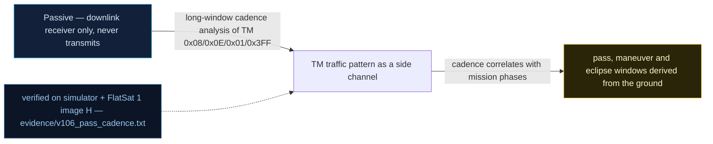

# V-06 — Pass metadata derivable from the ground (TM cadence fingerprint)

| Field | Value |
|---|---|
| ID | V-06 |
| Severity | Low — inference-only, but fixed downlink cadences plus public TLEs hand a passive listener the operator's contact plan and orbit phase before the first uplink of the pass |
| Category | Metadata exposure / traffic analysis |
| Interface | Telemetry downlink — APIDs 0x08 (mission TM), 0x0E (nav TM), 0x01 (sync TM), 0x3FF (idle TM), beacon eclipse bit |
| SPARTA | REC-0003.02 · Gather Spacecraft Communications Information: Commanding Details; secondary REC-0002.03 Operations (v3.2, no notional-risk triple published for these IDs) |
| PoC | `poc/v106_pass_cadence.py` — evidence `evidence/v106_pass_cadence.txt` (`POC OK`) |

## Summary
Nothing on the firmware side is "broken" here — that is the point. The spacecraft
emits its mission, navigation, sync and idle telemetry on *fixed* periods (14 s, 22 s,
20 s, 30 s), and the beacon carries an eclipse bit. A receiver that just timestamps
APIDs reconstructs the operator's schedule; crossed with public TLEs it reconstructs
orbit phase. The catalog calls this inherent-by-design (RAPPORT §4.B: "Rien de neuf
côté firmware ... Statut : inhérent, documenté") and it is the resource-development
step that lets an attacker pre-program TC injection for the exact second it will matter
inside the next 5–15 min pass.

## Attack diagram



## Root cause
Design property of the mission loop in `worker.cpp`/`rdownlink.cpp`: the TM emission
schedule is a static table of intervals (`mission 14 s`, `nav 22 s`, `sync 20 s`,
`idle 30 s`, plus the beacon's own clock), never jittered, never gated by the pass
state — the firmware "respecte une cadence stable" (catalog V-06) so the attacker can
model it. The beacon's eclipse bit (`buffer[15] & 0x10`, `worker.cpp ::
telemetrySPPTransmitBeacon`) additionally marks day/night transitions, i.e. orbit
phase, for free (V-02 supplies the frame parser).

## Attack mechanism
Pure eavesdropping: record every frame with a wall-clock timestamp for a few orbits,
then compute per-APID inter-arrival minima. Constant intervals ⇒ deterministic future
emission times. The eclipse-flanking beacons give the orbital period and phase; public
TLEs pin the ground track. Output: a per-pass template — when mission TM fires, when
the sat enters eclipse (power-stressed, V-34), and therefore when injection windows
open and close.

## Exploitation walkthrough
1. Beacon to 1 s over USB for a fine clock, then watch 70 simulated seconds, keeping
   timestamps for APIDs 0x08, 0x0E, non-beacon 0x01 (sync) and 0x3FF (idle).
2. Compute the minimum gap per APID:

```
mission TM: interval=14 s (observed 5 frames)
sync TM: interval=20 s (observed 3 frames)
nav TM: interval=22 s (observed 3 frames)
idle TM: interval=30 s (observed 2 frames)
```

3. The PoC asserts each period (14/22/20/30 s). On the wire bench each frame is
   booked in the 1 s window it arrives in, so a nominal-N cadence reads N±1 s per
   individual gap on hardware (the simulator books at the exact emission tick and
   still measures exactly 14/22/20/30). The assertion is therefore over the whole
   contact: every gap within N±1 s and the mean within max(0.5, 1/n) s of nominal
   — the same PoC code on both transports. One minute of receive-only observation
   is enough:

```
operator cadence + contact plan reconstructed passively; eclipse bit in the beacon adds orbit phase
```

## Impact
For the operational tempo of a CubeSat with 5–15 min passes, knowing the cadence is
knowing the *contact plan*: which frames are routine (a missing one is a lost pass,
cf. V-15/V-35 denial metrics), when the satellite is eclipse-side and battery-poor, and
where in the orbit an injection lands. It costs the attacker nothing and gives the
resource-development layer (SPARTA RD tactics in the course numbering) of every
follow-on attack: replays (V-07), floods (V-15), and window-picked downgrades (V-02).

## Mitigations
- Randomize inter-TM jitter (±20 %) and vary APIDs per pass state: cheap, breaks exact
  period extraction; cost is operator tooling having to relearn cadences (use
  authenticated scheduling requests instead).
- Only emit the rich TM set while an authenticated session is active; outside passes
  fall back to a minimal beacon — power-positive and shrinks the observable.
- Accept the exposure but model it: treat "attacker knows our schedule" as an
  assumption in the mission threat model (course position) rather than pretending TLE
  secrecy exists.

## References
- PoC + evidence: `poc/v106_pass_cadence.py`, `evidence/v106_pass_cadence.txt`
- `docs/SPARTA_MAPPING.md` — table row V-06 (primary REC-0003.02)
- `../RAPPORT-FIRMWARE-VULNERABLE-FLATSAT.md` §4.B "V-06 · Métadonnées de passe
  dérivables depuis le sol" (course Ch.1, Ch.7.1)
- Wire formats: `simulator/flatsat_sim.py` (TM schedule in `advance`, `_beacon`)
