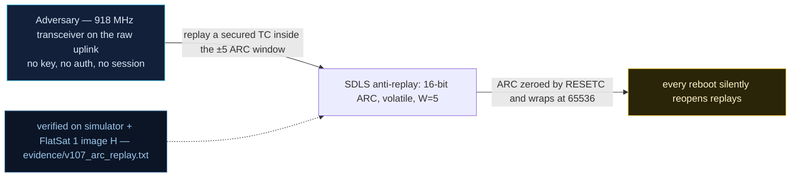

# V-07 — 16-bit volatile anti-replay counter with a W=5 acceptance window

| Field | Value |
|---|---|
| ID | V-07 |
| Severity | Medium — honest replay protection exists, but its numbers are weak by construction: P(accept)=5/2^16 per brute-forced frame, a 65536-command wrap, and a counter that resets on every reboot, making any captured valid frame replayable again |
| Category | Insufficient freshness / replay (CWE-294) |
| Interface | Radio uplink — SDLS-secured TCs (22-byte security header); config APID 0x15 (`SDLS_CONFIG`), ARC reset APID 0x16 sub 3 |
| SPARTA | EX-0001.01 · Replay: Command Packets; secondary DE-0003.11 WDT/counter-reset interaction (v3.2, notional risk 25\|24\|21) |
| PoC | `poc/v107_arc_replay.py` — evidence `evidence/v107_arc_replay.txt` (`POC OK`) |

## Summary
The v2 firmware's SDLS anti-replay counter (ARC) is configured — exactly as the course
asks the students to measure — at **16 bits with an acceptance window W=5**, and lives
in plain SRAM. The PoC maps the window empirically: deltas 1..5 accepted, delta 0 (a
full replay) and 6..9 rejected. It then quantifies the brute-force surface
(W/2^16 = 7.63·10⁻⁵) and demonstrates the sharpest flaw: after a power cycle the
counter rewinds to zero, and a frame that was accepted *before* the reboot is accepted
*again* after it.

## Attack diagram



## Root cause
`sdls_sim.cpp` keeps `s_arc_last` in `.bss` — zeroed at every boot (the file's own
comment: "Volatile-by-design ... Exactly the CryptoLib failure the course describes").
The uplink pre-check (sim `_sdls_pre`) computes `delta = (arc - arc_last) mod 2^16` and
accepts iff `1 <= delta <= window`, window default 5, set via `SDLS_CONFIG`
(`[mode, arc_bits, window]`). No flash/backup-domain persistence, no challenge — the
freshness guarantee dies at reset, and `RESETC` is unauthenticated (V0-08).

## Attack mechanism
The secured TC carries `SPI(u16 BE) | ARC(u32 BE) | MAC(16)` as a 22-byte security
header (SPP sec-head flag set); the CMAC covers the raw 6-byte primary header plus the
secured payload. Replaying a captured frame verbatim gives delta 0 → `SDLS ARC FAIL`.
But: a random ARC guesses the window with probability **5/65536 ≈ 7.63·10⁻⁵** per
frame; at 2 commands/s the 16-bit space wraps in 32 768 s ≈ 9.1 h, so over 3 years
(~64 wraps) roughly 321 replayed frames sail through by arithmetic alone (catalog
§4.C numbers). And any reset (operator, brownout V-34, hostile RESETC) rewinds
`arc_last`, reviving every captured frame.

## Exploitation walkthrough
1. Enable SDLS with the default posture: `SDLS_CONFIG` = `011005` (on, 16 bits, W=5);
   reset the ARC with `SDLS_OTA` sub 3 (`03`) before each trial.
2. Build a secured `GET_STATUS` frame for ARC delta d and observe acceptance:

```
ARC delta  0: reject (SDLS ARC FAIL)
ARC delta  1: ACCEPT
...
ARC delta  5: ACCEPT
ARC delta  6: reject (SDLS ARC FAIL)
```

   The PoC asserts the accepted set is exactly `[1,2,3,4,5]` — window boundary
   confirmed at W=5, and delta 0 (full replay) rejected while SDLS is on.
3. Note the arithmetic from the transcript:

```
accept probability for a random ARC = W/2^16 = 7.629e-05; 16-bit counter wraps every 65536 commands (~32768 s at 2 cmd/s) and is VOLATILE: RESETC rewinds it -> a captured valid frame becomes replayable again after a reboot
```

4. Power-cycle, re-enable SDLS (operator behavior), resend the pre-reboot delta-1
   frame — accepted again (`POC OK` implies the replay check passed):

```
--> POWER CYCLE (scratch + SRAM die, flash survives)
```

## Impact
Three layered weaknesses with a shared operational flavor: (i) the brute-force rate is
high enough that an attacker who can flood TCs inside a 5–15 min pass converts captures
into accepted commands; (ii) wrap-around makes long-horizon replay systematic, not
exotic; (iii) reset-triggered rewind means the *cheapest* remote event (unauthenticated
RESETC, brownout) silently voids all freshness ever achieved — the counter says
"fresh" about a months-old capture.

## Mitigations
- Persist `arc_last` monotonically (flash counter with wear leveling, or the boot-count
  trick) so reboot cannot rewind freshness; cost: flash writes and a boot-time compare
  — the standard fix, cheap on RP2040 XIP flash.
- Widen the counter (20/32 bits are already selectable via `SDLS_CONFIG`, `arc_bits ∈
  {16,20,32}`) and shrink W toward 1 for high-value APIDs; cost: none over the air
  (ARC field is fixed 4 bytes) — the lab kept the weak default for measurement.
- Gate `RESETC` (V0-08) or bind the ARC to a boot-epoch (V-21 watchdog-scratch
  survives reboots) so a reboot makes old frames *less* trustworthy, not more.

## References
- PoC + evidence: `poc/v107_arc_replay.py`, `evidence/v107_arc_replay.txt`
- `docs/SPARTA_MAPPING.md` — table row V-07 (primary EX-0001.01, risk 25\|24\|21)
- `../RAPPORT-FIRMWARE-VULNERABLE-FLATSAT.md` §4.C "V-07 · Chaîne de commande sans
  fraîcheur" (CWE-294; course Ch.3.1, Ch.7.1 — CryptoLib volatile counters)
- Wire formats: `simulator/flatsat_sim.py` (`_sdls_pre`, `SDLS_CONFIG`/`SDLS_OTA`)
