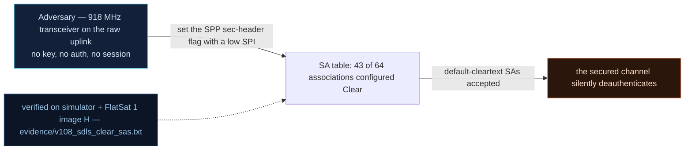

# V-08 — SDLS with 43 of 64 security associations stuck in Clear

| Field | Value |
|---|---|
| ID | V-08 |
| Severity | High — with SDLS "on", 43 of 64 SAs (including the default SPI 44 for headerless frames) demand no MAC and no ARC, so authenticated commanding is opt-in fiction |
| Category | Improper authorization / cryptographic bypass by configuration (CWE-862) |
| Interface | Radio uplink — SPP security-header flag + SPI field; SA table via TC APID 0x16 (`SDLS_OTA` sub 2), config 0x15 |
| SPARTA | EX-0006 · Disable/Bypass Encryption; secondary DE-0003.07 Cryptographic Modes (18\|15\|11) (v3.2, notional risk 24\|21\|17) |
| PoC | `poc/v108_sdls_clear_sas.py` — evidence `evidence/v108_sdls_clear_sas.txt` (`POC OK`) |

## Summary
The lab's simulated SDLS mirrors the CryptoLib posture the course dissects: a 64-entry
security-association table in which only SAs 0–20 were ever configured; the other 43 —
including SPI **44**, the default applied to every frame that carries no security
header — have `ast == 0`, i.e. mode Clear. A command routed through a Clear SA skips
MAC *and* ARC entirely. The PoC audits the table live, then executes a PING with no
security header at all, while `SDLS_CONFIG` reports SDLS enabled.

## Attack diagram



## Root cause
`sdls_sim.cpp :: sdlsBootDefaults()` zeroes the whole table (`.bss`) and configures
only `SDLS_NUM_SA_CONFIGURED = 21` entries (`sa[0..20]`, key = link key); the header
itself comments "43 zero SA_PLAINTEXT". The uplink gate (sim `_sdls_pre`) resolves the
SPI, and if `sa[spi]["ast"] == 0` it strips/keeps the payload and returns `PASS` —
without ever reaching the MAC or ARC checks. Frames whose SPP sec-head flag is 0 are
assigned `SDLS_SA_PLAINTEXT_DEFAULT = 44` — a Clear SA — so "no header" means "no
auth", not "no service". Memory layout note: zeroed entries behind the table reproduce
the CryptoLib default behavior the catalog asked for (RAPPORT §4.C V-08).

## Attack mechanism
Two paths to the same bypass:
1. **Omit the security header** (SPP sec-head flag = 0): the frame is standard CCSDS
   SPP; the gate maps it to SPI 44 → Clear → `PASS`.
2. **Claim a Clear SPI** in the security header (e.g. SPI 44 with any MAC): the MAC is
   never verified for `ast == 0` entries.
Either way the command executes with SDLS nominally "ON" — no error TM, no ARC burn.
Only SPIs 0–20 force a real CMAC + ARC-window check.

## Exploitation walkthrough
1. Enable SDLS: `SDLS_CONFIG` = `011005`. Audit the table by dumping each SA
   (`SDLS_OTA` sub 2, `payload = 02 SPI`, byte 4 of the reply = `ast`):

```
SA table: 21 secured, 43 Clear (incl. default SPI 44)
```

   The PoC asserts exactly 43 Clear entries.
2. Send a PING as a plain SPP frame (no security header) whose data field is the
   link-key-wrapped empty payload — i.e. `spp_pack(0x01, wrap(LINK_KEY,b""), 7,
   sechdr=0)`: a `0x01` PING TM comes back, unauthenticated and un-ARC'd:

```
frames without security header are treated as default-Clear
```

3. The PoC notes the same frame would face a real MAC check if it were routed to an
   authenticated SA (its re-pack step relabels it "claim SPI 1"), then disables SDLS
   (`001005`) and logs the strategic conclusion:

```
attackers route ALL traffic through Clear SAs: SDLS on, auth zero
```

## Impact
"Enable SDLS" as a checkbox buys an attacker a choice of 43 side doors. Every
authenticity-dependent control flow in the mission — thruster TCs, FDIR config, log
state — is reachable *while the console shows secure ops*, which is worse than plain
insecurity because operator dashboards and the beacon SEC bit (V-02) keep saying
"protected". Inside a 5–15 min pass the bypass costs zero additional setup: capture,
strip, re-send.

## Mitigations
- Default-deny SA policy: `ast == 0` must mean *reject*, not *clear* — Clear mode
  should be an explicit, per-SPI, authenticated configuration (CM0031 Authentication).
  Cost: a ground-segment migration plan for any legitimate Clear service (e.g. backup
  acquisition band commands).
- Boot-fail instead of boot-default: if fewer than N SAs are provisioned at power-up,
  raise a fault (this also arms V-10's null-master-key alarm); cost: a bricked-on-boot
  risk that must be mitigated by the bench flow.
- Bind APIDs to SPIs (only SPI 0–20 may command APID group X) in the dispatcher, so
  Clear traffic cannot reach sensitive APIDs even when present.

## References
- PoC + evidence: `poc/v108_sdls_clear_sas.py`, `evidence/v108_sdls_clear_sas.txt`
- `docs/SPARTA_MAPPING.md` — table row V-08 (primary EX-0006, risk 24\|21\|17)
- `../RAPPORT-FIRMWARE-VULNERABLE-FLATSAT.md` §4.C "V-08 · SDLS simulé ... 43 en mode
  Clear" (CWE-862; course Ch.2.1, Ch.3.1)
- Wire formats: `simulator/flatsat_sim.py` (`_sdls_pre`, `SDLS_SA_PLAINTEXT_DEFAULT`)
