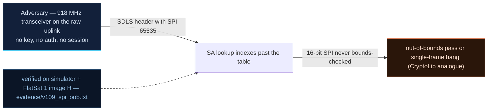

# V-09 — Unbounded SPI index: out-of-bounds pass and single-frame hang

| Field | Value |
|---|---|
| ID | V-09 |
| Severity | High — one crafted frame with SPI=9000 silently kills the telecom worker until a power cycle (no watchdog, V0-15): a whole pass is lost per trigger, and OOB SPIs bypass authentication entirely |
| Category | Out-of-bounds read → denial of service (CWE-125/CWE-400; CryptoLib CVE-2024-44911/44910/44912 analogue) |
| Interface | Radio uplink — 16-bit SPI field of the SDLS security header |
| SPARTA | EX-0009.01 · Exploit Code Flaws: Flight Software; secondary EX-0013.02 Erroneous Input, V0-15 chain (no watchdog) (v3.2, notional risk 24\|21\|17) |
| PoC | `poc/v109_spi_oob.py` — evidence `evidence/v109_spi_oob.txt` (`POC OK`) |

## Summary
The security-association lookup takes the 16-bit SPI straight from the attacker's
frame and uses it as an array index without the `spi < 64` bound. Two distinct
outcomes, both bad: an SPI past the end of the table but short of a faulting address
(8327 in the lab) lands on the zeroed arena and is read as a *Clear* SA — the command
executes unauthenticated; an SPI at/above the fault threshold (9000) dereferences
unmapped memory, hard-faults, and — because the firmware runs without a watchdog
(V0-15) — the satellite goes permanently silent until someone pulls the power.

## Attack diagram



## Root cause
`sdls_sim.cpp :: sdlsResolveSa(spi, &out_of_bounds)` — the file's comment says it
plainly: "V-09: unbounded index, exactly the CVE-2024-4491x shape". For
`SDLS_NUM_SA ≤ spi < SDLS_SPI_FAULT` it returns `&s_zero_sa`, a deliberately zeroed
stand-in (reproducing the CryptoLib behavior where the OOB read walks into a zeroed
arena → `SA_PLAINTEXT`, `CRYPTO_LIB_SUCCESS`); for `spi >= SDLS_SPI_FAULT (9000)` the
lookup faults — the simulator models the resulting hard fault as `state = "HANGED"`.
The RP2040 has no MPU, so which indices fault depends on the real memory map; the lab
places the table near a section end exactly as the catalog prescribes (RAPPORT §4.C
V-09). The missing `if (spi < 64)` is the whole vulnerability.

## Attack mechanism
The frame is a normal SDLS-secured TC (`sechdr=1`, 22-byte security header
`SPI(u16 BE)|ARC(u32 BE)|MAC(16)`); the MAC is computed under the *zero* key — which
does not matter, because Clear-class resolution short-circuits before MAC
verification. Path A: `SPI=8327` → resolves to the zero arena → `PASS` → the embedded
PING runs, and the attacker has just authenticated *nothing* with an index the code
never meant to accept. Path B: `SPI=9000` → fault → worker dead → every later TC,
including benign PINGs, gets zero response. No crash banner, no TM: silence
indistinguishable from propagation loss unless you were logging.

## Exploitation walkthrough
1. Enable SDLS (`SDLS_CONFIG` = `011005`). Send the secured PING with SPI=8327:

```
SPI=8327 (beyond table): frames back = True -> OOB entry read as Clear, command executed
```

   (the PoC asserts a `0x01` PING TM — "OOB SPI passes (unbounded index)").
2. Send the same construction with SPI=9000. The device stops answering; the harness
   records the sim state:

```
device silent after SPI fault (state HANGED)
```

3. Wait 30 s and re-ping: still nothing (`check(not dev.tc(0x01, ...))` — "still hung
   after 30 s"). The only recovery is a power cycle; after `POWER CYCLE` the PING
   answers again — the PoC's final assertion, "only power cycle recovers -> 3-minute
   mission window lost".

## Impact
Denial with perfect economics: one 44-byte uplink frame per kill, ~9,600 possible SPI
values above 64 (of which ≥9000 fault), and each hit costs the mission an entire
5–15 min pass plus operator trust — the satellite just "stops talking". The catalog
also budgets the *recon* side: sweeping SPI 64→65 534 at ~2,700 frames/min needs
≈25 min of useful uplink — four passes — so an attacker can map the pass-vs-fault
boundary empirically, then carry the exact kill value forward.

## Mitigations
- The bound check (`if (spi >= SDLS_NUM_SA) reject`) is free: one compare per frame.
  Its absence, not the fault, is the bug — CryptoLib's CVEs were fixed the same way.
- Add the independent watchdog (V0-15) so *any* hard fault self-recovers within
  seconds; cost: false-positive risk must be tested against long flash operations.
- Count and TM-log rejected SPIs even before auth succeeds — a 9000-class outlier is
  an unmissable anomaly for the on-board detector (V-24) or ground review.

## References
- PoC + evidence: `poc/v109_spi_oob.py`, `evidence/v109_spi_oob.txt`
- `docs/SPARTA_MAPPING.md` — table row V-09 (primary EX-0009.01, risk 24\|21\|17)
- `../RAPPORT-FIRMWARE-VULNERABLE-FLATSAT.md` §4.C "V-09 · SPI non borné → lecture
  hors limites" (course Ch.3.2; CVE-2024-44911/44910/44912 reproduction notes and
  SPI-sweep pass budget)
- Wire formats: `simulator/flatsat_sim.py` (`_sdls_pre`, `SDLS_SPI_FAULT`)
