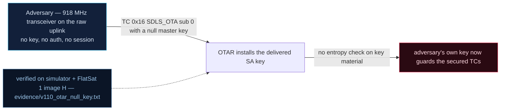

# V-10 — OTAR accepts null master keys: attacker installs his own SA key

| Field | Value |
|---|---|
| ID | V-10 |
| Severity | Critical — key material that is all-zero plus an index-only check lets any radio operator install his own SA key; the legitimate operator's authenticated TCs then fail MAC while the attacker commands with full authority until a reset |
| Category | Use of insufficient/default key + missing authorization on key delivery (CWE-321/CWE-1188) |
| Interface | Radio uplink — TC APID 0x16 (`SDLS_OTA` sub 0, OTAR); target SA thereafter carries all secured TC |
| SPARTA | PER-0004 · Replace Cryptographic Keys; secondary IA-0008.01 Rogue Ground Station, EX-0003 Modify Authentication Process (v3.2, no notional-risk triple published for these IDs) |
| PoC | `poc/v110_otar_null_key.py` — evidence `evidence/v110_otar_null_key.txt` (`POC OK`) |

## Summary
OTAR (Over-The-Air Rekeying) exists to provision SA keys remotely — but at power-up
the 128-slot master-key table is all zeros and the only validation is `m < 128`. All
128 master keys are therefore *usable and known*: they're zero. The attacker wraps his
chosen key under master key #0 (a pure AES-ECB encryption under a null key, computable
offline), delivers one OTAR frame, and the targeted SA now authenticates *his* MACs.
The operator's next authenticated `GET_STATUS` is rejected (`SDLS MAC FAIL`) while the
identical frame signed with the attacker's key passes: total expropriation of the
secure channel.

## Attack diagram



## Root cause
`sdls_sim.cpp :: sdlsOtar(m_idx, sa_idx, ct, out)` — header comment in the source:
"V-10: the ONLY validation is the index bound. No 'master key loaded' flag, no
length/quality check -- 128 null keys accepted at power-up. Not ARC-protected either
(key management runs before the secure channel exists), so OTAR frames are freely
replayable." The master keys are `.bss` zero (sdlsBootDefaults), OTAR arrives on the
Clear path (no security header → SPI 44 per V-08), and on success the SA flips to
`est=ast=1` with the *decrypted-by-null-key* key installed.

## Attack mechanism
OTAR body (link-key-ECB-wrapped, like every TC data field):
`[sub=0][master_idx u8][sa_idx u8][ct 16]`, where `ct = AES-ECB(master_key[m], K_new)`.
With `m=0` the wrapping key is `0^128`, so `ct = AES-ECB(0x00×16, K_new)` — the
attacker encrypts his own key under a key he controls. The PoC's key:
`C0FFE00DC0FFEED1C0FFEED1BADC0FFE` installed on SA 5. From then on the CMAC gate
(sim `_sdls_pre`) verifies secured TCs for SPI 5 against the attacker's key.

## Exploitation walkthrough
1. Enable SDLS (`SDLS_CONFIG` = `011005`), then post the OTAR (`sub=0, master=0,
   sa=5`) as an unsecured frame on APID 0x16:

```
OTAR ack: ok=1 master=0 sa=5
```

   The PoC asserts `ok=1` — "null master key accepted the install".
2. Operator side: a correctly MAC'd `GET_STATUS` claiming SPI 5, signed with the
   original link key `PWNsatLabKey1234`, now returns error `SDLS MAC FAIL` (asserted)
   — SA 5 no longer trusts the operator's key.
3. Attacker side: the identical frame MAC'd with the installed key gets its `0x0C`
   status TM back (asserted).

```
=> SA5 now trusts the attacker: operator locked out of his own secured APID, attacker writes with full authority
```

Reversibility: RESETC/power-cycle rewinds the `.bss` table (master keys re-zero, SA
keys re-provision from the link key) — the course's "reset restores the operator",
which V-19/V-21 later break for good.

## Impact
Full secure-channel takeover priced at **one frame** (the catalog's faithful budget:
a realistic OTAR exchange ≈64 frames ≈ a few seconds of pass), infinitely retryable
because OTAR is exempt from ARC. The operator doesn't just lose confidentiality — he
is *locked out*: every genuine TC fails MAC, which looks like propagation damage until
someone recognizes the signature. This is operator expropriation, the initial-access
prize the course's Ch.7.2 assigns to OTAR-with-null-key designs.

## Mitigations
- Refuse to OTAR under an unprovisioned master key: a `loaded` flag per slot, set by
  an authenticated/physical provisioning step (CM0031 Authentication for key
  management, CM0037-style physical gate for the first inject). Cost: ops must plan
  key provisioning on ground before flight.
- Check key quality (reject all-zero / repeated) and log every OTAR in the (currently
  off-by-default, V-23) TC journal; alert on OTAR without a preceding GS session.
- Bind OTAR acceptance to a challenge or a not-before window so captured OTARs aren't
  freely replayable; cost: slightly more complex key-management protocol.

## References
- PoC + evidence: `poc/v110_otar_null_key.py`, `evidence/v110_otar_null_key.txt`
- `docs/SPARTA_MAPPING.md` — table row V-10 (primary PER-0004)
- `../RAPPORT-FIRMWARE-VULNERABLE-FLATSAT.md` §4.C "V-10 · OTAR acceptant une master
  key nulle" (CWE-321/CWE-1188; course Ch.7.2 — OTAR budget ≈64 frames)
- Wire formats: `simulator/flatsat_sim.py` (`_ext` `apid == 0x16`, `sdlsOtar`)
