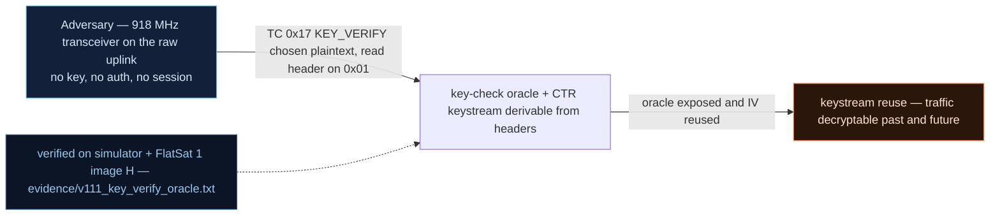

# V-11 — Key-verification oracle and header-derivable CTR keystream

| Field | Value |
|---|---|
| ID | V-11 |
| Severity | High — an unauthenticated encrypt-under-SA-key query confirms a guessed link key bit-exactly, and the optional "CTR everywhere" defense derives its counter from the *cleartext* TM sequence number, so captured "secure" telemetry is decryptable after the fact |
| Category | Cryptographic misuse — chosen-plaintext key oracle / IV-reuse class |
| Interface | Radio uplink — TC APID 0x17 (`KEY_VERIFY`); TM downlink primary header (APID 0x01) |
| SPARTA | REC-0001.03 · Gather Spacecraft Design Information: Cryptographic Algorithms; secondary EX-0006 Disable/Bypass Encryption (v3.2, no notional-risk triple published for these IDs) |
| PoC | `poc/v111_key_verify_oracle.py` — evidence `evidence/v111_key_verify_oracle.txt` (`POC OK`) |

## Summary
`KEY_VERIFY` was meant to help operators confirm which SA key is live. Implemented as
an *unauthenticated CTR-encryption oracle* — encrypt my 16 bytes under `sa[kid]`'s key
with *my* 4-byte counter — it hands the attacker a perfect key-confirmation machine:
compute the same CTR transform locally for a candidate key and compare. It also
inherits the course's IV-reuse weakness (Ch.7.2): KEY_VERIFY takes no ARC (V-07), so
the same query can be replayed, and two ciphertexts under one counter XOR to the
plaintext XOR. The PoC's second act shows the "defense" variant leaking too: enabling
`DEF_TM_CTR` encrypts telemetry with the TM sequence number — visible in the *clear
primary header* — as the keystream counter.

## Attack diagram



## Root cause
`extcmds.cpp` (sim `_ext`, `apid == 0x17`): request `[kid][ctr 4B][pt 16B]`, reply
`[SCID][kid][ctr_xor(sa[kid].key, bytes(12)+ctr, pt)][0x00]`, sent *clear*, with no
authorization and no ARC — "codé en dur sur la clé 0 comme CryptoLib" for the kid=0
hardcoding the catalog describes. The keystream block is
`00000000_00000000_00000000_ctr` — a trivially predictable counter. For telemetry,
`rdownlink.cpp`/sim `_defenses` with `DEF_TM_CTR (0x20)` uses the SPP sequence number
as that counter, and the sequence number lives in the unencrypted 6-byte primary
header (`spp_pack`).

## Attack mechanism
(a) **Key confirmation:** one TC with `kid=0`, any `ctr`, known plaintext. Locally
compute `ctr_xor(candidate, bytes(12)+ctr, pt)` for `candidate = "PWNsatLabKey1234"`;
equality of 16 output bytes confirms the key without ever observing it. At 1 TC per
guessed key, a dictionary (this one ships as an ASCII string) is searchable —
matching the catalog's "oracle de vérification de clé" framing where IV reuse lets
`M1 ⊕ M2 = C1 ⊕ C2` recover 16 plaintext bytes per IV collision.
(b) **Null-key amplification:** query `kid=44` (a Clear SA, V-08, key = zero): the
keystream is then universally computable, so the oracle decrypts *any* ciphertext
made under that SA.
(c) **Keystream from the header:** with `DEF_TM_CTR` on, anyone who records a TM gets
its counter free (seq in the clear header) → keystream `E(key, 0¹²||seq)` → offline
decryption.

## Exploitation walkthrough
1. Query the oracle (`kid=0`, `ctr=00000007`, `pt=000102...0f`) and reproduce it
   locally with the candidate key:

```
KEY_VERIFY(kid=0) -> 1c09e13190faa25d60cee92b25e86adb
local ctr_xor(candidate='PWNsatLabKey1234') -> 1c09e13190faa25d60cee92b25e86adb
```

   The PoC asserts equality — "oracle confirms the candidate SA0 key bit-exact".
2. Same query with `kid=44`: encrypting the reply under the zero key returns the
   original plaintext (asserted) — null-key SA means keystream known, plaintext
   recoverable.
3. Operator "hardens" the link: `DEFENSES_CONFIG` (APID 0x25) = `00 A0`
   (`DEF_TM_CTR | DEF_ANOMALY_EN`). Capture one "encrypted" TM, take `seq` from its
   clear header, CTR-decrypt — payload and mode fall out:

```
captured TM seq=5 -> recovered payload 01011f1f120a0a080000 (mode=0x01)
```

   Asserted: "header-derivable keystream decrypts the 'secure' TM"; the PoC then
   restores defenses to `0080`.

## Impact
The oracle turns key secrecy into key *guessability* — one round-trip per candidate,
no rate limit, inside any 5–15 min pass. And the counter-derived defense shows the
course's deeper lesson: encryption whose IV is public is just a labeled keystream, so
recorded telemetry has a half-life of "forever" once the key leaks (V-05, V0-02).
Confidence in "AES telemetry" drops to zero for archived-frame confidentiality.

## Mitigations
- Require GS-session/SDLS authentication for `KEY_VERIFY`, or return a truncated MAC
  tag over a fixed nonce instead of the raw encryption (CM0031 Authentication); cost:
  operators need the key for commissioning-time key checks.
- Derive TM CTR counters from a secret + non-repeating state (session salt), not the
  public seq — one extra 16-byte XOR per block, negligible on M0+ versus the AES cost.
- Provision all-zero-key SAs out (ties to V-08/V-10 fixes): the oracle is most deadly
  when half the keys are zero.

## References
- PoC + evidence: `poc/v111_key_verify_oracle.py`, `evidence/v111_key_verify_oracle.txt`
- `docs/SPARTA_MAPPING.md` — table row V-11 (primary REC-0001.03)
- `../RAPPORT-FIRMWARE-VULNERABLE-FLATSAT.md` §4.C "V-11 · Oracle de vérification de
  clé (IV réutilisé → 16 octets de clair)" (course Ch.7.2)
- Wire formats: `simulator/flatsat_sim.py` (`_ext` `apid == 0x17`, `ctr_xor`,
  `_defenses` `DEF_TM_CTR`)
