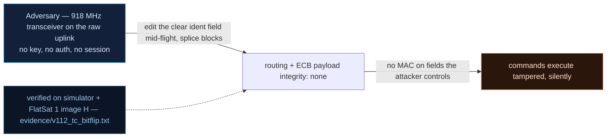

# V-12 — Silent telecommand tampering: clear-header reroute + ECB block splice

| Field | Value |
|---|---|
| ID | V-12 |
| Severity | High — in-flight bit flips are invisible (radio CRC off, no payload MAC on Clear SAs): one clear-header bit reroutes a valid encrypted command to another APID, and ECB block substitution silently changes the executed value |
| Category | Insufficient integrity protection (CWE-354) |
| Interface | Radio uplink — SPP primary header (identification field) + AES-ECB data field |
| SPARTA | EX-0012.02 · Modify On-Board Values: Internal Routing Tables; secondary EX-0009.01, EX-0006 (v3.2, notional risk 19\|14\|9 quoted against EX-0012) |
| PoC | `poc/v112_tc_bitflip.py` — evidence `evidence/v112_tc_bitflip.txt` (`POC OK`) |

## Summary
The uplink runs with the radio's CRC disabled (`setCRC(0)` in `ruplink.cpp`) and the
data field is AES-**ECB** with no per-frame integrity tag on the Clear path. That
leaves two clean, key-free mutations. (a) The primary header is *cleartext*: flipping
one bit (`frame[1] ^= 0x01`) retargets APID 0x1B `SB_PUBLISH` to 0x1A `SET_LOG_NAME`
while the ciphertext — and its meaning to the crypto layer — is untouched: a
privilege-domain mixup. (b) ECB is deterministic and position-free: swap one captured
16-byte ciphertext block into a fresh frame and the spacecraft executes a command
whose *value* is somebody else's, with no error anywhere.

## Attack diagram



## Root cause
Three design facts compose: `ruplink.cpp` initializes `radio0.setCRC(0)` (the
`DEF_RADIO_CRC` countermeasure exists but is off by default — the PoC reads it back as
`crc_on=0` from `TC_STATS`); `secure_link.cpp` encrypts the data field in ECB with the
shared link key (wrap format `[len BE16][plain][zero pad]`); and the Clear-SA path
(V-08) attaches no CMAC to any of it. So the only integrity in the chain is the
*disabled* CRC, and the dispatcher trusts the cleartext APID absolutely.

## Attack mechanism
(a) **APID reroute:** identification field = `(type<<12)|(sechdr<<11)|APID`; the low
11 bits are the APID. XOR'ing bit 0 of byte 1 maps 0x1B→0x1A. The receiver decrypts and
dispatches happily — the encrypted SB payload is now parsed by the log-name handler.
(b) **Block splice:** encrypt-then-send `SB_PUBLISH` with rate `(0,450,0)` twice gives
*identical* ciphertext blocks (asserted determinism); building a new frame from
`cB[:16] + cA[16:]` pastes B's effect bytes onto A's tail — no counter, no MAC, no
length-position binding to break.
(c) **Ciphertext flip:** one flipped bit avalanches the whole decrypted block; the
plaintext length prefix usually goes bogus and the frame dies at the unauthenticated
*AES DECRYPT FAIL* length gate — a reject with zero integrity semantics, occasionally
a silently corrupted execution.

## Exploitation walkthrough
1. Lab time base 0.1× (`FDIR_CONFIG` 0x1D, `0a0001`) so mission ticks settle fast.
2. Reroute an encrypted `SB_PUBLISH` by flipping one header bit; observe which APID
   answers:

```
flipped primary-header bit 0: SB_PUBLISH(0x1B) executed as SET_LOG_NAME(0x1A) with the SAME ciphertext -> privilege mixup
```

3. Prove ECB determinism and splice block 0 of an old capture (`rate y=450` →
   4.50 °/s) onto a fresh frame built from the `(123,0,0)` capture:

```
ECB determinism: identical publishes give identical ciphertext blocks -> True
spliced publish: frame built from A's capture -> tilt 4.49 (B's value replayed, no error, no replay detection)
```

   The PoC asserts the measured tilt moved to B's value (4.0 < t < 4.8) — the ADCS
   virtual bus consumed the spliced rate silently.
4. Flip one ciphertext bit and classify the outcome:

```
one flipped bit -> random reject ['AES DECRYPT FAIL'] -- never an AUTHENTICATED integrity verdict
radio CRC disabled by default: mutated TCs execute silently
```

## Impact
An attacker mid-pass doesn't need the key to *change what commands mean* — only to
edit the air. Header rerouting crosses privilege domains (a benign sensor publish
becomes a log-name write feeding V-13's overflow); block substitution replants values
across captures with no freshness marker. And the observability hole is total: the
"TC accepted despite bad CRC" counter is structurally 0, so ground software cannot
distinguish a tampered frame from a clean one. This is V0-11's ECB malleability grown
into routing and value tampering.

## Mitigations
- Turn the radio CRC on (`DEF_RADIO_CRC` / `setCRC(1)`): catches accidental corruption
  for ~free, though a deliberate attacker just fixes the CRC — it is a hygiene layer,
  not authentication.
- Require the SDLS CMAC (a secured SA, not Clear) for effectful APIDs — the real fix,
  cost ≈30–60 µs MAC per frame on the M0+ and 22 bytes per TC (catalog defense table).
- Bind the data field to its context: encrypt `APID|seq` into the first block (or use
  CTR per-frame), so header reroutes and block splices fail the length/content gate
  *with* an authenticated verdict.

## References
- PoC + evidence: `poc/v112_tc_bitflip.py`, `evidence/v112_tc_bitflip.txt`
- `docs/SPARTA_MAPPING.md` — table row V-12 (primary EX-0012.02, risk 19\|14\|9)
- `../RAPPORT-FIRMWARE-VULNERABLE-FLATSAT.md` §4.C "V-12 · Bit-flips silencieux sur la
  TC" (CWE-354; course Ch.1.1, Ch.2.1; V0-11 chain)
- Wire formats: `simulator/flatsat_sim.py` (`spp_pack`, `aes_ecb_encrypt_wrap`,
  `_sb_publish`)
