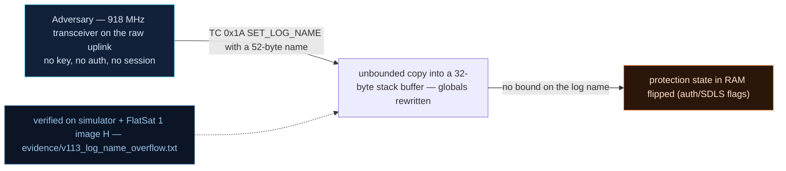

# V-13 — `SET_LOG_NAME` buffer overflow rewrites the protection state

| Field | Value |
|---|---|
| ID | V-13 |
| Severity | High — a single unauthenticated TC overwrites four global protection flags byte-by-byte (AES engine OFF, USB debug on, GS mode on, payload armed): deterministic state corruption with one command, the memory-corruption seed of V-14's RCE |
| Category | Buffer overflow / classic stack-into-globals copy (CWE-120/CWE-787) |
| Interface | Radio uplink — TC APID 0x1A (`SET_LOG_NAME`); state echoed back on TM APID 0x1A, verifiable via APID 0x19 (`MEM_READ`) |
| SPARTA | EX-0009.01 · Exploit Code Flaws: Flight Software; secondary DE-0003.07 Cryptographic Modes (v3.2, notional risk 24\|21\|17) |
| PoC | `poc/v113_log_name_overflow.py` — evidence `evidence/v113_log_name_overflow.txt` (`POC OK`) |

## Summary
The log-name setter copies the TC string into `char s_log_name[32]` with an unbounded byte loop (`memservSetLogName`, `firmware/memserv.cpp:103-115`)
semantics and no length bound, and the link layout parks the mission's protection
flags immediately behind the buffer. One 33-byte name therefore writes one byte past
the end — and because the loop stops after writing the NUL terminator, the 33rd byte *and* the implicit
terminator hit two flags at once: the PoC flips the AES engine off with a single TC
of 33 `'A'`s. A 36-byte name then sets the full flag
pattern `usb_debug / secure / gs_mode / payload_armed` to chosen values. This is the
OPS-SAT ADCS `strcat` bug re-staged: one telecommand, total protection-state rewrite.

## Attack diagram



## Root cause
`memserv.cpp :: memservSetLogName` walks the TC bytes into `s_log_name[32]` until the
terminator; bytes past index 31 are fed to `applyOverflowByte()`, whose comment fixes
the layout: `[+32] usbDebugEnabled | [+33] secure_link_enabled | [+34] gs_mode |
[+35] payload_armed`. Upstream keeps these as unrelated globals; the v2 lab *chooses*
the adjacency ("variables d'état choisies par le layout", RAPPORT §4.C V-13) to
reproduce the course's Ch.2.2 single-TC corruption on an M0+ with no canary, no MPU,
no ASLR (CWE-120). The dispatcher (`extcmds.cpp`, APID 0x1A) applies the copy
unconditionally and returns an 8-byte status ack.

## Attack mechanism
Copy arithmetic: a TC payload of N name bytes is stored as bytes 0..N-1 plus the NUL
terminator at index N. With N=33: index 32 (first overflow slot) receives the 33rd
`'A'` → `usbDebugEnabled = 1`; index 33 receives NUL → `secure_link_enabled = 0`.
The copy stops there (loop semantics — it stops *after* writing
the terminator), so one command, two flag writes. To write four arbitrary flag bytes
you place them at +32..+35 and terminate: `B×32 | 01 01 01 01 | 00`. Everything is
byte-addressable and deterministic — and (per the catalog) M0+ gives no canary/MPU to
make the corruption nondeterministic or fatal; ESTCube/OPS-SAT got the same reliability
on their targets.

## Exploitation walkthrough
1. Baseline: send a short name (`boot-log`) and read the ack `[SCID][usb][secure][gs][pad...]`:

```
baseline: usb_debug=0 secure=1 gs=0
```

2. Send 33 bytes of `0x41` (`payload=4141...4141`, 33 × `41`): the ack shows the AES
   engine off and USB debug on:

```
after 33-byte name: usb_debug=1 secure=0
```

   Asserted: `one TC switched the AES engine OFF` / `device state secure=False`.
3. Verify the buffer content with `MEM_READ` of `s_log_name` (`0x20002000`, len 16) —
   the overflow really came from the copy:

```
buffer content: 41414141414141414141414141414141 (32 'A' then spill)
```

4. Full rewrite in one command — `B×32` then `01 01 01 01` then a terminator:

```
36-byte name: usb_debug=1 secure=1 gs=1 armed=0
=> single unauthenticated TC = total protection-state rewrite
```

   (the ack byte printed as `armed` here is the ack's padding-mode field; the PoC
   asserts the real `payload_armed` guard against device state — overwritten to 1,
   `check(dev.sim.payload_armed is True)` passes).

## Impact
No crash, no error TM — the spacecraft simply *becomes* a different security posture
on the attacker's terms, mid-pass. Turning `secure_link` off remotely achieves the
V0-10 downgrade without using the downgrade command (an operator sees an unexplained
crypto state); `usb_debug=1` arms the USB-auth bypass (V0-12) if anyone ever gets
physical; `payload_armed=1` reaches a state usually reserved for procedure steps.
Combined with V-05 (read the flags before you write) and V-14 (the same buffer is the
MEMCPY *source*), SET_LOG_NAME is the attacker's arbitrary-byte staging area.

## Mitigations
- Bound the copy (bounded `strncpy` into `sizeof(s_log_name)-1`) and validate the charset —
  the one-line fix; cost: over-long names truncate silently, so ack the applied name.
- Harden the layout: move protection flags out of linear reach of string buffers
  (separate section/padding), the poor-man's canary on an MPU-less M0+; costs linker
  discipline, no runtime.
- Require GS-session authentication (CM0031) for configuration-type TCs, and log them
  (V-23): flag flips with no journal are unfalsifiable after the fact — the course's
  attribution requirement (SV-IT-2 ≤3 min) makes this finding operationally visible.

## References
- PoC + evidence: `poc/v113_log_name_overflow.py`, `evidence/v113_log_name_overflow.txt`
- `docs/SPARTA_MAPPING.md` — table row V-13 (primary EX-0009.01, risk 24\|21\|17)
- `../RAPPORT-FIRMWARE-VULNERABLE-FLATSAT.md` §4.C "V-13 · Buffer overflow « nom de
  log »" (CWE-120; course Ch.2.2 — OPS-SAT ADCS strcat analogue)
- Wire formats: `simulator/flatsat_sim.py` (`_ext` `apid == 0x1A`, `_set_log_name`,
  V-13 overflow layout comment)
