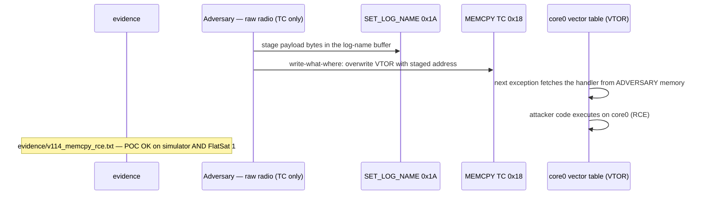

# V-14 — `MEMCPY` telecommand: write-what-where → VTOR redirect → RP2040 RCE

| Field | Value |
|---|---|
| ID | V-14 |
| Severity | Critical — two unauthenticated TCs give arbitrary mission-code execution: the memcpy primitive writes any mapped word, including the Cortex-M0+ vector-table offset register at 0xE000ED08, which the M0+ cannot lock |
| Category | Memory corruption → remote code execution (CWE-787) |
| Interface | Radio uplink — TC APID 0x18 (`MEMCPY`), staged via APID 0x1A (`SET_LOG_NAME`), verified via APID 0x19 (`MEM_READ`) |
| SPARTA | EX-0009.01 · Exploit Code Flaws: Flight Software; secondary EX-0012.03 Memory Write/Loads, EX-0010 Malicious Code (implant-ready) (v3.2, notional risk 24\|21\|17) |
| PoC | `poc/v114_memcpy_rce.py` — evidence `evidence/v114_memcpy_rce.txt` (`POC OK`) |

## Summary
A `MEMCPY src(u32) dst(u32) len(u16)` telecommand takes *all three* arguments from the
frame, bounded only by the address map. With V-05 providing the read half, this is the
classic read-what-where / write-what-where pair — and the lab aims it at the most
spectacular target on the RP2040: `SCB->VTOR` at **0xE000ED08**. The PoC stages a
function address into the `SET_LOG_NAME` buffer, copies 4 bytes onto VTOR, and the
exception vector table now points at mission functions the operator never scheduled:
first `labFnSecureLinkOff` (crypto drops), then `labFnBeaconFlood` (ten beacons in one
second). Two plaintext-equivalent TCs = remote code execution.

## Attack diagram



## Root cause
`memserv.cpp :: memservCopy(src, dst, len)` validates that source and destination
lie in writable windows (SRAM, modelled peripherals — the PPB region including
`MVPOR_ADDR = 0xE000ED08` is *writable by design*) and copies. It never maintains a
deny-list of semantic targets: vector table, GPIO (GPS UART pins comment), watchdog
scratch (V-21 persistence) are all one TC away. The Cortex-M0+ VTOR lives in RAM-mapped
control space with no lock mechanism — the catalog's blunt hardware assessment (RAPPORT
§4.C V-14: "le M0+ a son VTOR en RAM, aucun moyen de le verrouiller"). This is the
Flying Laptop / ESTCube-1 `TC memcpy` family (course Ch.2.1, Ch.7.1), reproduced
faithfully, CWE-787.

## Attack mechanism
Three TCs, each on the default Clear path (V-08), secure-link wrapped but
unauthenticated:
1. **Stage** (APID 0x1A): write the 4-byte little-endian hook address into
   `s_log_name` @ `0x20002000` — the attacker already knows the address space (V-01
   CPE match + V-05 read-back). `0x10012740` (`labFnSecureLinkOff`) serializes as
   `40 27 01 10`.
2. **Fire** (APID 0x18): `MEMCPY(0x20002000 → 0xE000ED08, 4)` — TC payload
   `0020002008ed00e00400` (src, dst, len, all little-endian `<IIH`). The firmware
   treats a VTOR write as a vector-table redirect and takes the hook.
3. **Verify** (APID 0x19): `MEM_READ(0xE000ED08, 4)` shows the new vector base.
The hook side effects are externally visible on the downlink, which is the PoC's
proof-of-execution channel.

## Exploitation walkthrough
1. Stage the first hook address (`40270110` + 28 NULs) via `SET_LOG_NAME`, then copy
   it onto VTOR; the ack echoes the request plus an execution marker:

```
MEMCPY log_name->0xe000ed08 ack=0101000052434500
```

   (`52 43 45 00` = `RCE\0` — the PoC asserts the marker; it also asserts the hook's
   effect: `device.sim.secure is False`, the secure link genuinely switched OFF.)
2. Read back the vector table offset (`MEM_READ 0xE000ED08`, len 4):

```
VTOR now 0x10012740 == labFnSecureLinkOff
```

3. Repeat for the second hook: stage `40260110` (`labFnBeaconFlood` = `0x10012640`),
   `MEMCPY` onto VTOR again, advance one simulated second — the beacon rate is now
   zero-interval:

```
after second hook: 10 beacons in 1 s -> flood hook ran
=> 2 unauthenticated TCs = arbitrary mission-code execution
```

   Asserted `len(flood) >= 5`: an arbitrary *mission* function, chosen by address,
   executed inside the telecom loop.

## Impact
This is the top of the CubeSat attack stack on this board: the endpoint the course's
Ch.2.1/7.1 (Flying Laptop, ESTCube ICP memcpy) says to aim for. Execution inside the
mission loop means every software protection (GS gate, ARC, FDIR policy) is now
attacker-writable — an implant (EX-0010) that survives nothing but becomes
indistinguishable from firmware misbehavior, and the write primitive reaches the
watchdog scratch registers the course uses for cross-reboot persistence (V-21). For
the operator: with no code signing and a volatile vector table, *any* confirmed
memcpy-to-PPB event should be treated as full mission loss, recoverable only by a
re-flash the orbit doesn't schedule.

## Mitigations
- Deny-list the write targets of the memcpy TC (or allow-list: only SRAM payload
  regions), and route VTOR-class registers through a dedicated, authenticated command
  — cheap, though it narrows the debug use case the TC exists for.
- Secure-boot + signed images (course: ed25519 verify ≈ +200 ms boot, a few kB on an
  M0+/M33 class part) shrink what executed code buys an attacker; cost: flash/RAM and
  key custody on the ground (CM0010 Update Software territory).
- A hardware reality check worth documenting in any CubeSat threat model: on an MPU-
  less, VTOR-unlockable M0+ this primitive is *unpatchable* at the silicon level —
  the honest mitigation is TC-surface policy, not code.

## References
- PoC + evidence: `poc/v114_memcpy_rce.py`, `evidence/v114_memcpy_rce.txt`
- `docs/SPARTA_MAPPING.md` — table row V-14 (primary EX-0009.01, risk 24\|21\|17)
- `../RAPPORT-FIRMWARE-VULNERABLE-FLATSAT.md` §4.C "V-14 · Primitive MEMCPY en TC →
  RCE RP2040" (CWE-787; course Ch.2.1 Flying Laptop, Ch.7.1 ESTCube-1 TC memcpy)
- Wire formats: `simulator/flatsat_sim.py` (`_ext` `apid == 0x18`, `_mem_copy`,
  `ADDR_VTOR = 0xE000ED08`, `SYMBOLS` hook table)
