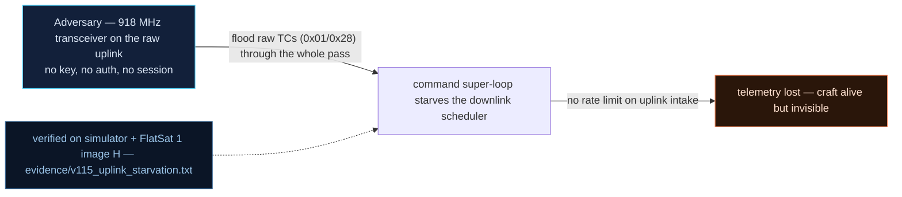

# V-15 — Uplink flood → telemetry loss (DoS without a crash)

| Field | Value |
|---|---|
| ID | V-15 |
| Severity | High — 33 valid-format frames buy an attacker a fully blind spacecraft for minutes with zero crash signature and no privileged access (25\|24\|21) |
| Category | Resource exhaustion / starvation (Availability) |
| Interface | Radio uplink (raw TC, APID 0x01 / 0x28) → command super-loop + downlink scheduler |
| SPARTA | EX-0013.02 · Flooding: Erroneous Input; secondary IMP-0013 Resource Exhaustion or Contention (v4.0 numbering; v3.2 equivalent IMP-0003 Denial) (notional risk 25\|24\|21) |
| PoC | `poc/v115_uplink_starvation.py` — evidence `evidence/v115_uplink_starvation.txt` (`POC OK`) |

## Summary
The command handler reacts to *every* rejected telecommand by blocking on a multi-second
LED animation **and** emitting an AES-wrapped error TM. Thirty-odd junk frames are enough
to occupy the downlink and the command loop past a full beacon period: the operator loses
telemetry for minutes while the craft keeps happily answering pings afterwards. Nothing
crashes, so neither the (absent) watchdog nor the operator's alarms tell anyone an attack
is in progress — the attacker jams the *operator's own* telemetry with legitimate traffic.

## Attack diagram



## Root cause
Two baseline behaviours compose into the vulnerability:
* `worker.cpp` — every error path calls `ledBlink(8, LED_COLOR_RED)` synchronously, and
  `led.cpp:72-79` implements it as `delay(200)` on + `delay(200)` off per blink: 3.2 s of
  blocked command loop per 8-blink error (1.6 s for the 4-blink variants).
* `rdownlink`/`labTmError` — the resulting error TM (APID 0x09) is secure-link AES-wrapped
  even when the triggering frame could not be decrypted in the first place, so a frame the
  craft threw away still costs the operator 38 B of downlink.

The mission loop that paces the 18 s beacon (`BEACON_DEFAULT_MS = 18000`) is the same
thread that runs `ledBlink`, so the blink *is* the outage (course analogy Ch.4.3: the
Socket.IO handler that blocks the event loop).

## Attack mechanism
With the secure link ON (default), a *cleartext* junk frame is a decrypt failure, not a
PING: `APID 0x01` + payload `FF FF … FF` (32 B) → `AES DECRYPT FAIL` → error TM + blink.
One extra frame on an undefined APID (`0x28`) adds an `Error Unknown APID` event. On-air
accounting per the PoC: each error TM = 38 B @ 1200 bps = 0.25 s of TX, plus 1.6–3.2 s of
blocking blink inside the loop — 33 events ≈ 8.4 s of TX plus 53–66 s of stall.

## Exploitation walkthrough
1. Flood 32 clear frames `b"\xFF" * 32` on APID 0x01, count the `AES DECRYPT FAIL` replies:

```
--> TC apid=0x01 via=radio clear payload=ffffffffffffffffffffffffffffffffffffffffffffffffffffffffffffffff
<-- TM apid=0x09 AES len=17
32/32 junk frames -> error TMs (each also AES-wrapped)
```

2. Add one unknown-APID frame (`0x28`) — also answered with an error TM (33 events total).
3. Compute and log the cost:

```
downlink occupied: 8.4 s TX + 53-66 s of blocking blink in the command loop -> 18 s beacon cadence lost, no TM delivered during the stall
```

4. Prove it is a silent DoS, not a crash: after the storm a mission-mode TC still works,
   beacons resume (`dev.advance(3000)` yields three `TM apid=0x01` frames), and STATUS byte
   1 still reads `1` (NOMINAL):

```
=> attacker jams the OPERATOR's own telemetry with 33 valid-format frames
```

## Impact
LEO passes are the scarcest mission resource: one 5–12 min pass carries only a handful of
18 s beacon slots plus the housekeeping/nav TMs. A few hundred junk frames spread over a
pass therefore erase *most* of the operator's data without breaking anything the operator
can see — no reboot, no `POC`-visible anomaly, no red TM the ground can attribute. Because
the state is untouched, the attack is instantly re-armable after each correction, and it
chains naturally with V0-08 (RESETC) or V0-14 (beacon flood) to hide within known noise.

## Mitigations
- Move the LED feedback out of the TC path: on RP2040 a PIO state machine drives WS2812
  blink asynchronously — effectively free silicon, the honest root fix.
- Rate-limit error TMs per source (e.g. one per second, plus a counter field) and send the
  first N bytes of the offending frame instead of a full re-encrypt — saves both loop time
  and 38 B/frame of downlink; trade-off: coarser operator diagnostics.
- Do not AES-wrap error TMs generated by frames that failed decryption — they are already
  authenticated-negative, and wrapping them amplifies the attacker's on-air cost.
- Give the loop a watchdog-style budget per TC (drop the blink after the budget expires)
  and export a "loop stalls" counter in the beacon (the lab exposes it) so the ground can
  see the starvation instead of inferring it — CM0004-style telemetry analytics.

## References
- PoC + evidence: `poc/v115_uplink_starvation.py`, `evidence/v115_uplink_starvation.txt`
- `docs/SPARTA_MAPPING.md` — row V-15 (EX-0013.02, risk 25\|24\|21)
- `../RAPPORT-FIRMWARE-VULNERABLE-FLATSAT.md` §V-15 (Ch.1, Ch.4.3 Socket.IO analogy)
- Wire/cost model: `simulator/flatsat_sim.py` (`_err`, `_dispatch`, `ledBlink` mirror);
  `firmware/worker.cpp` (per-error `ledBlink(8, …)`), `firmware/led.cpp:72-79`
