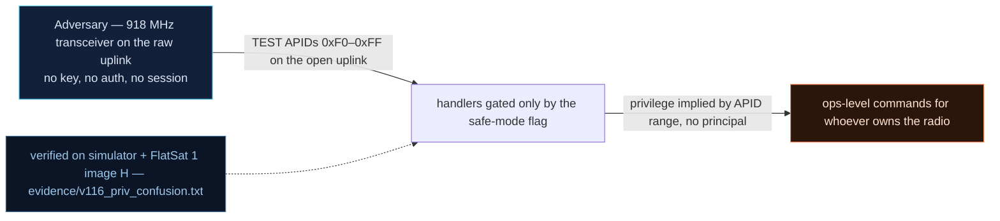

# V-16 — Commands run under implied privileges (OPS-SAT root-CAN analogue)

| Field | Value |
|---|---|
| ID | V-16 |
| Severity | High — the maintenance channel's only gate is a mission state any unauthenticated radio TC can force, so "root" is one junk quaternion away (24\|21\|17) |
| Category | Improper privilege management (CWE-250, implied privileges) |
| Interface | Radio uplink — TEST APID window 0xF0–0xFF, gated by the FDIR safe-mode flag |
| SPARTA | EX-0011 · Exploit Reduced Protections During Safe-Mode; secondary IA-0010 Unauthorized Access During Safe-Mode, REC-0007 (v3.2, notional risk 24\|21\|17; REC-0007 15\|11\|5) |
| PoC | `poc/v116_priv_confusion.py` — evidence `evidence/v116_priv_confusion.txt` (`POC OK`) |

## Summary
The v2 firmware adds a TEST APID window (0xF0–0xFF) — the embedded stand-in for OPS-SAT's
"root-CAN" — and gates it with exactly one condition: *is the craft in safe mode?*. Safe
mode is itself remotely forceable by a single unauthenticated TC (V-22). Whoever can make
the spacecraft tired can therefore run the maintenance commands; TEST TCs carry no
authentication of their own, and the relaxed window cannot be cancelled from the inside
for the full 120 s release period.

## Attack diagram



## Root cause
`extcmds.cpp:115-126` (`extCommandHandler`): APIDs between `SPP_APID_TEST_FIRST` and
`SPP_APID_TEST_LAST` are accepted iff `fdirTestmode()` returns true — and `fdir.cpp:40`
defines `fdirTestmode()` as literally `return s_safe;`. The privilege decision is taken
from *mission state* rather than from *command provenance*: there is no session, MAC, or
key check on the TEST path, so the state machine acts as an unauthenticated privilege
elevator. The same handler answers the TEST TC with `apid | "TEST"` in the clear.

## Attack mechanism
1. Probe the window in NOMINAL: APID `0xF0` → error TM `TESTMODE INACTIVE` (channel closed).
2. Force safe mode over the raw radio: `APID 0x1D` (FDIR config) payload `02` →
   `fdirForceSafe("REMOTE")` → `safeEnter()`, which also drops the secure link, so all
   subsequent replies come back **clear**.
3. Re-issue TEST APIDs `0xF0`, `0xF5`, `0xFF` — each now executes and replies `apid|TEST`.
4. The operator's own escape route is blocked: `APID 0x1D` payload `03` (safe release)
   inside `FDIR_RELEASE_MS = 120000` returns `RELEASE WINDOW`, so the maintenance channel
   stays open for the attacker for at least two minutes per trigger.

## Exploitation walkthrough
1. Locked state first (`check(err == "TESTMODE INACTIVE")`):

```
--> TC apid=0xF0 via=radio AES  payload=-
<-- TM apid=0x09 AES len=18
NOMINAL: TEST APID 0xF0 -> 'TESTMODE INACTIVE'
```

2. One TC flips the privilege context, then the window answers — verbatim from the run:

```
--> TC apid=0xF0 via=radio clear payload=-
<-- TM apid=0xF0 clear len=5
safe mode: TEST APID 0xF0 -> b'\xf0TEST'
safe mode: TEST APID 0xFF -> b'\xffTEST'
```

3. Attempt release inside the window; the PoC notes the maintenance window stays open:

```
release attempt inside the 120 s window -> 'RELEASE WINDOW' (maintenance stays open meanwhile)
```

## Impact
The TEST window is where a real flight unit would keep payload redeploy, EEPROM
maintenance, sensor biasing, or boot-prompt access. Owning it means an adversary can act
as "onboard maintenance" while the craft is safe: the same exposure the course describes
for the Thales CYSAT demo (UID≠0 → frame → root execution). Combined with V-22, the
attacker's sequence is *force tired → own the maintenance channel → downgrade persists*,
all from an unauthenticated raw-radio path, and each cycle costs the mission a full
detumble/120 s release round-trip.

## Mitigations
- Bind the TEST window to *provenance*, not state: require an authenticated GS session
  (CM0031 Authentication) or an SDLS-authenticated TC even while safe — cost: field
  maintenance needs a key on the bench, which is exactly the trade-off the course calls
  "the maintenance-vs-security argument".
- If a no-key recovery path must exist, keep it one-shot: an explicit `TESTMODE_ON` TC
  armed by hash-locked contingency policy (V-20), auto-expiring with the release window.
- Cloak the state so the attacker cannot time the window (CM0006-style cloak, off by
  default here — see V-02/V-22): the safe-mode bit currently leaks in the 8 B beacon.
- Log TEST APID hits into the (optional) TC journal (V-23) so the post-mortem can prove
  who used the maintenance channel.

## References
- PoC + evidence: `poc/v116_priv_confusion.py`, `evidence/v116_priv_confusion.txt`
- `docs/SPARTA_MAPPING.md` — row V-16 (EX-0011, risk 24\|21\|17)
- `../RAPPORT-FIRMWARE-VULNERABLE-FLATSAT.md` §V-16 (Ch.8.1, root-CAN OPS-SAT analogy, CWE-250)
- Implementation: `firmware/extcmds.cpp` (`extCommandHandler` TEST branch),
  `firmware/fdir.cpp` (`fdirTestmode`, `fdirForceSafe`); `simulator/flatsat_sim.py`
  (TEST branch `0xF0 <= apid <= 0xFF`, `FDIR_RELEASE_MS = 120000`)
