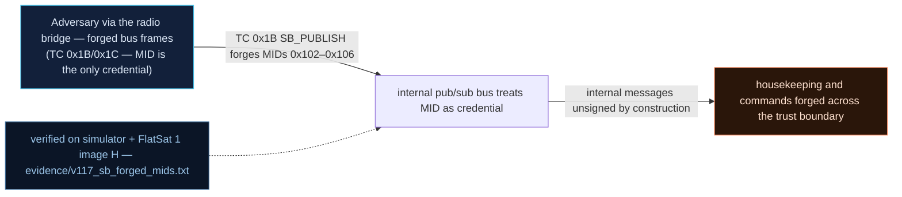

# V-17 — Internal software bus (pub/sub) with forgeable MIDs (cFS SB analogue)

| Field | Value |
|---|---|
| ID | V-17 |
| Severity | High — one unauthenticated TC rewrites attitude rate, sensor presence, heaters, bus voltage and thruster commands; every consumer treats it as truth (no notional-risk triple published for EX-0014.02; secondary LM-0002 24\|21\|17) |
| Category | Improper authentication of internal messages (CWE-287, spoofing / trust-boundary breach) |
| Interface | Radio TC APID 0x1B `SB_PUBLISH` → internal software bus (MID 0x102–0x106) |
| SPARTA | EX-0014.02 · Spoofing: Bus Traffic Spoofing; secondary LM-0002 Exploit Lack of Bus Segregation (24\|21\|17), EX-0012.10 Command & Data Handling Subsystem (v3.2, no notional-risk triple published for EX-0014.02) |
| PoC | `poc/v117_sb_forged_mids.py` — evidence `evidence/v117_sb_forged_mids.txt` (`POC OK`) |

## Summary
v2 adds a miniature cFS software bus (`sb.cpp`): modules exchange data by **Message ID
only**, with no sender identity attached. The radio is wired to that bus as a bridge —
APID `0x1B` publishes any MID — so a raw-radio TC becomes an internal publisher. The
mission model consumes the forged values as authentic: attitude rate, sensor-present mask,
heater state, battery percentage (hence bus voltage) and thruster powers can all be
overwritten from the ground with no authentication, and the resulting telemetry is
byte-identical to the real thing.

## Attack diagram



## Root cause
`sb.cpp:26` (`sbPublish(mid, data, len, src)`) routes on `mid` and stores `src` for
statistics only — the subscriber path never consults it. `mission_model.cpp` reads the
bus-derived state (`mm["rate"]`, `mm["heaters"]`, `mm["pct"]`, `sensor_mask`, `t_thr`)
without any provenance check. The defence mode exists but ships disabled: `sbAuthEnabled`
defaults to false, and the optional 4-byte tag (`c0feee11`) is never required, mirroring
the cFS SB situation where software-bus "applications" are trusted by construction.

## Attack mechanism
Wire format: `APID 0x1B`, payload = **BE u16 MID** ‖ data. Consumed MIDs:

| MID | Data | Effect in `mission_model` |
|---|---|---|
| 0x102 | 3 × LE i16, 0.01 deg/s | `mm["rate"]` ← forged body rates |
| 0x103 | 1 B mask | sensor-present flags (`0x01` BME, `0x02` ACC) |
| 0x104 | `idx, on` | heater switched → ±2.4 W of load |
| 0x105 | 1 B pct | `bus_v = 21.0 + 3.0·pct/100` (40 → 22.2 V) |
| 0x106 | `t0, t1` | thruster powers |

Because the FDIR supervises the very same model state (V-27), publishing is also a way to
drive the safety loop — here we only prove consumption.

## Exploitation walkthrough
1. Lab time base 0.1× (`0x1D 0a0001`), then publish rate `321` on X:
   `0x1B` payload `0102410100000000` → reply `MID 0x102 published, ok=1`; STATUS/FDIR TM
   offset 8 (LE u16, 0.01 deg/s) now reads between 3.0 and 3.6 deg/s.
2. Sensor mask erase and restore — `payload=010300` clears the present bits in STATUS
   byte 2 (`0103 03` puts them back).
3. Heater on, with the power delta visible in the FDIR TM at offset 12:

```
--> TC apid=0x1B via=radio AES  payload=01040101
heater via MID 0x104: power 3.2 -> 5.6 W
```

4. Battery override `010528` (pct = 0x28 = 40) → bus voltage in TM offset 10 lands in
   22.15–22.25 V; thruster pair `01060507` sets powers (5, 7) — asserted via STATUS 5/6.
5. Switch the defence on (`APID 0x25` payload `0401`) and re-run: untagged publish is
   rejected, tagged one accepted:

```
SB auth enforced: 1
--> TC apid=0x1B via=radio AES  payload=0102c0feee11010000000000
```

## Impact
This is the lab's lateral-movement keystone: the radio becomes an internal subscriber with
write rights, so any attacker who can transmit can *launder* control through the bus. The
consequences are physical in the model — +2.4 W heaters against a 40 Wh battery and a
3 W solar budget, a fake 22.2 V bus masking a real brownout, a fake 9 deg/s rate triggering
TUMBLE (V-27) — and forensic: the forged telemetry is indistinguishable from real traffic,
exactly the "semantically valid but false MID" case the course flags as undetectable by
statistical detectors (V-24).

## Mitigations
- Enable `SB_AUTH` (4-byte per-MID tag) as the default; cost: a few bytes per internal
  message and one compare per publish — trivial on RP2040, the honest fix (LM-0002 hygiene).
- Attach provenance at the bridge: mark radio-originated publishes in `sb_stats` and have
  safety-critical consumers (FDIR, ADCS) ignore external-origin values or down-weight them.
- Cross-check redundant sources before actuation (IMU vs. published rate; measured bus_v
  vs. published pct) — cheap firmware, no hardware cost.
- Keep the "defence exists but is off by default" posture visible in TM (as here, `0x25`
  reports it) so operators can prove the configuration instead of assuming it.

## References
- PoC + evidence: `poc/v117_sb_forged_mids.py`, `evidence/v117_sb_forged_mids.txt`
- `docs/SPARTA_MAPPING.md` — row V-17 (EX-0014.02; LM-0002 24\|21\|17)
- `../RAPPORT-FIRMWARE-VULNERABLE-FLATSAT.md` §V-17 (Ch.8.2, cFS SB, CWE-287)
- Implementation: `firmware/sb.cpp` (`sbPublish`, `sbSetAuthEnabled`), `firmware/extcmds.cpp`
  (`hSb`), `firmware/mission_model.cpp`; `simulator/flatsat_sim.py` (`_sb_publish`,
  `FDIR_TILT = 5.0`, bus model `21.0 + 3.0*pct/100`)
