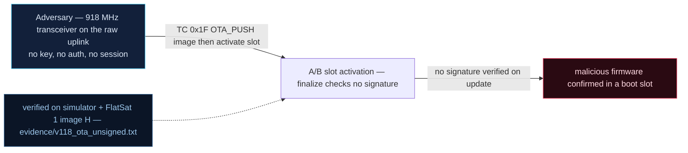

# V-18 — Unsigned OTA image push + slot activation in the 4 MB QSPI flash

| Field | Value |
|---|---|
| ID | V-18 |
| Severity | Critical — an attacker-supplied blob boots as the active firmware with only a CRC-16 in front of it; persistence survives every reset (no notional-risk triple published for EX-0010) |
| Category | Unverified software update / malicious code insertion (CWE-345, CWE-434) |
| Interface | Radio TC APID 0x1F (`OTA_PUSH` / finalize / confirm / status / signature anchor), A/B slots in QSPI NOR |
| SPARTA | EX-0010 · Malicious Code (installed via unverified on-orbit update); secondary IA-0007.02 Malicious Commanding via Valid GS (update path), CM0010 Update Software (v3.2, no notional-risk triple published) |
| PoC | `poc/v118_ota_unsigned.py` — evidence `evidence/v118_ota_unsigned.txt` (`POC OK`) |

## Summary
The 4 MB QSPI NOR holds two 1.5 MB firmware slots plus a metadata sector, reachable over
the radio through new APIDs. The push path verifies a **CRC-16 per chunk** and nothing
else: no signature, no trust anchor by default. The attacker writes his own image, flips
the boot slot, reboots, and then — as the confirming ground station — tells the craft his
firmware is good. The 30 s confirm watchdog that is supposed to protect against bricking
becomes an attacker feature: whoever ACKs first owns the slot. Rollback (re-activating an
older slot) is likewise unenforced: the anti-rollback counter exists but ships disabled.

## Attack diagram



## Root cause
`extcmds.cpp` `hOta()` + `flashstore.cpp` OTA metadata: on finalize the code stores the
image hash (`fnv_digest`) "for reference" but never checks it against a pinned key, and
`sig_required` defaults to false. The A/B state machine itself is sound — `pending_boot`,
`boot_try`, rollback on missing confirm — the flaw is purely that *trust* was reduced to
error detection: CRC-16 (which the attacker computes himself) instead of a signature
(CWE-345). The ed25519 verification hook exists, which makes the missing default
verification a configuration decision rather than an absent feature.

## Attack mechanism
APID `0x1F` payload grammar (from the PoC):
* push chunk: `00 | offset BE u32 | len u8 | crc16-be u16 | body`
* finalize: `01` · confirm: `02` · status: `03` · signature anchor: `06 | 8 B digest | BE u32 | enable u8`

Chain: push 18-byte body `RVUHACKEDIMAGE2026` with CRC `df65` → finalize accepted
(`pending_boot=1`, hash `bf4efd96dd6f8bc7` recorded, **no trust anchor**) → unauthenticated
`RESETC` (APID 0x02) → craft boots slot B (`booted_slot=1`, `boot_try=1`) → attacker sends
confirm → `active=1`.

## Exploitation walkthrough
1. Chunk + finalize over the radio:

```
--> TC apid=0x1F via=radio AES  payload=000000000012df655256554841434b4544494d41474532303236
finalize ok, pending_boot=1, image hash=bf4efd96dd6f8bc7 (no trust anchor)
```

2. `RESETC`, then read the slot state — the craft is running the attacker image:

```
post-reboot: booted_slot=1 active=0 boot_try=1
```

3. Attacker confirms his own firmware; status now reports `active=1` for slot B.
4. Counter-mesure measurement: install a signature anchor
   (`06 3a6e2336b350ecf0 00000008 01`, the FNV digest of `vendor-signature`) and re-push
   `ATTACKER-BLOB-2!!` — finalize is now refused:

```
with sig_required: finalize ok=0 (0 = rejected)
```

## Impact
Unverified on-orbit update is the highest-leverage software bug in the catalog: it converts
any radio-level access into *persistent, boot-time* code execution below the OS, with the
attacker free to keep the old image as a fallback slot (or re-enable rollback, V-38) so
the operator cannot even tell a patch was skipped. In the STORK-1 multi-tenant framing the
course uses, one malicious update compromises every co-hosted payload. Recovery requires
the physical re-flash path — i.e. end-of-mission for a CubeSat.

## Mitigations
- Verify a signature over the whole image before activation. Ed25519 in software costs
  roughly 100–300 ms at boot on this class of MCU (the course's STM32F405 numbers —
  +3 848 B RAM / +19 328 B flash — carry over in scale to RP2040); a static HMAC key is
  the budget option. CM0010 Update Software plus signature verification is the pairing.
- Pin the verification key in a write-once/OTP-like sector, and re-prove the anchor at
  every OTA — the "every update rewrites the anchor" defect the course flags (SPR-221).
- Enable the anti-rollback counter (ARWC) by default; V-38 shows it is TC-writable today.
- Bind the confirm step to an authenticated GS session so the attacker cannot ACK himself,
  and count confirm attempts: `boot_try` already exists as a signal.

## References
- PoC + evidence: `poc/v118_ota_unsigned.py`, `evidence/v118_ota_unsigned.txt`
- `docs/SPARTA_MAPPING.md` — row V-18 (EX-0010; IA-0007.02, CM0010)
- `../RAPPORT-FIRMWARE-VULNERABLE-FLATSAT.md` §V-18 (Ch.6.2/6.3, A/B slots, SUIT counter gap, CWE-345/434)
- Implementation: `firmware/extcmds.cpp` (`hOta`), `firmware/flashstore.cpp` (slot
  metadata, `fnv_digest`, `crc16_ccitt`); `simulator/flatsat_sim.py` (`_ota_cmd`,
  `flash["ota"]` fields `pending_boot`, `booted_slot`, `active`, `boot_try`)
