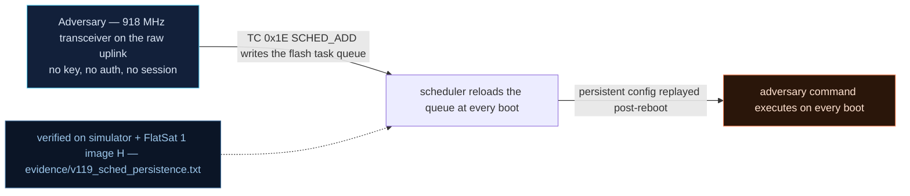

# V-19 — Flash-resident scheduled task queue replayed after any reboot

| Field | Value |
|---|---|
| ID | V-19 |
| Severity | High — one TC plants a repeating command that survives RESETC *and* a full power cycle without touching the firmware image (24\|21\|17) |
| Category | Persistence via configuration data (CWE-269, boot-time replay) |
| Interface | Radio TC APID 0x1E (`SCHED_ADD` / `SCHED_CLR` / dump) → flash config sector |
| SPARTA | PER-0002.02 · Software Backdoor (v3.2, risk 24\|21\|17); secondary EX-0012.05 Scheduling Algorithm |
| PoC | `poc/v119_sched_persistence.py` — evidence `evidence/v119_sched_persistence.txt` (`POC OK`) |

## Summary
The v2 firmware ships a scheduled-telecommand facility: `SCHED_ADD` stores
`{every, apid, payload}` entries in the flash config sector, and the boot path replays them
**without checking where they came from**. An attacker therefore does not need code
execution at all: a single radio TC leaves a repeating action that re-arms itself on every
boot, including after the operator's favourite recovery procedure (RESETC) and after a
brownout/power cycle. The "reset clears everything" assumption — which the whole baseline
crypto story relies on — is quietly broken.

## Attack diagram



## Root cause
`flashstore.cpp:129-170`: `schedAdd()` writes the entry into the persistent table
(`s_sched_persisted = true; /* survives reset: the point of V-19 */`) and
`schedReplayAtBoot()` re-arms every entry at boot; `extcmds.cpp` `hSched()` accepts
`SCHED_ADD` from *any* source, including the raw radio, and the dispatcher re-injects
entries with `source = "internal"` — the origin marker that would let a consumer reject
foreign commands is discarded at replay time. Cap: 16 entries, payload ≤ 64 B; erasure is
`SCHED_CLR`, itself a plain TC (and the attacker can protect it via V-21).

## Attack mechanism
Wire format (`APID 0x1E`): `00 | every BE u32 | apid BE u16 | len u8 | payload`.
The PoC plants `every = 2 s`, `apid = 0x0004` (SET_THRUSTER), payload `01 ff` → *every two
seconds, drive thruster 1 to full*, i.e. a permanent momentum leak (1.2 W of load plus
0.3 deg/s of torque in the model). Sub-command `02` dumps the queue, `01` clears it.
Because the entry lives in flash and the thruster power is volatile SRAM, the reboot
sequence makes the persistence visible: the state rewinds to `t1 = 10` and then the
attacker's command re-appears 2 s later, forever.

## Exploitation walkthrough
1. Plant and verify persistence flag:

```
--> TC apid=0x1E via=radio AES  payload=000000000200040201ff
schedule add ok=1 count=1 persists=1
task executing on schedule (t1=255)
```

2. Soft reset (`RESETC`) — volatile state rewinds, queue does not:

```
after RESETC: t1=10 (volatile state rewound)
planted task ALIVE after reboot (no image change, no flash write beyond the queue sector)
```

3. Full power cycle (`scratch + SRAM die, flash survives`) — the task is *still* replayed
   after 2.5 s, and the queue dump confirms the owner-less entry:

```
--> POWER CYCLE (scratch + SRAM die, flash survives)
queue dump: entries=1 first_apid=0x0004
```

4. `SCHED_CLR` (`payload=01`) then another 2.5 s window: thruster 1 no longer pegged →
   persistence gone only when explicitly erased.

## Impact
Persistence without an image write is the quiet kind: flash diffing, OTA integrity checks
and reboot hygiene all miss it. Operationally the planted task is a slow poison — a
thruster firing every 2 s eats 1.2 W against a 40 Wh battery and a 3 W solar budget,
pumps 0.3 deg/s of rate into the ADCS model until FDIR trips TUMBLE, and re-establishes
itself after every recovery the operator attempts. It is also the perfect partner for
V-20/V-21: a queue entry can trigger safe mode, which then executes the tampered
contingency dictionary.

## Mitigations
- Sign or MAC the schedule sector with an update-time key and validate at replay; drop
  entries that fail (a hash is ~20 lines of CMAC code, already present in `cmac.cpp`).
- Tag entries with their origin at `SCHED_ADD` and refuse radio-originated entries at
  replay, or require a GS session for `SCHED_ADD` (CM0031-style authentication) while
  letting internal FDIR use keep working.
- Announce the queue in telemetry (entries count + apid list, already dumpable via
  sub `02`) and treat *any* non-empty schedule as an operator-review item — CM0004-style
  telemetry analytics with zero hardware cost.
- Cost note: validation adds one CMAC per entry per boot (µs-scale on RP2040 with the
  AES engine), negligible next to the OTA verification cost of V-18.

## References
- PoC + evidence: `poc/v119_sched_persistence.py`, `evidence/v119_sched_persistence.txt`
- `docs/SPARTA_MAPPING.md` — row V-19 (PER-0002.02 ← course PER-0002.02, risk 24\|21\|17)
- `../RAPPORT-FIRMWARE-VULNERABLE-FLATSAT.md` §V-19 (scheduled tasks + FDIR, "CM0044 inversé", CWE-269)
- Implementation: `firmware/flashstore.cpp` (`schedAdd`, `schedReplayAtBoot`),
  `firmware/extcmds.cpp` (`hSched`); `simulator/flatsat_sim.py` (`_sched_cmd`, `_sched_due`,
  internal `_dispatch` with `source="internal"`)
