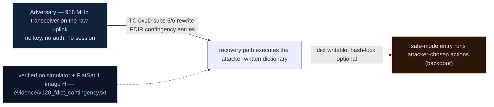

# V-20 — Modifiable FDIR contingency dictionary (the embedded `executable.jar`)

| Field | Value |
|---|---|
| ID | V-20 |
| Severity | High — flash-resident "contingency commands" run on every safe-mode entry with no integrity check until a hash lock is (optionally) burned; the trojan effect outlives safe mode itself (24\|21\|17) |
| Category | Persistence via untrusted search path / backdoor in recovery logic (CWE-427) |
| Interface | TC APID 0x1D subs 5/6/7 (dict set / read / hash-lock) → FDIR safe-entry execution path |
| SPARTA | PER-0002.02 · Software Backdoor; secondary EX-0011 (runs on safe entry), REC-0001.09 Fault Management (v3.2, notional risk 24\|21\|17) |
| PoC | `poc/v120_fdict_contingency.py` — evidence `evidence/v120_fdict_contingency.txt` (`POC OK`) |

## Summary
On entering safe mode the FDIR executes a short list of "contingency" telecommands kept in
flash — the embedded twin of the course's Java supervisor `executable.jar`: started early,
almost always active, and the first thing a tired spacecraft trusts. The list is writable
by TC and, until the operator burns a hash lock, has no integrity check at load time. The
attacker replaces one entry with a command of his choice; from then on, *every* future
safe-mode event — real or forced (V-22/V-27) — executes his payload, indistinguishable
from a maintenance action in the logs.

## Attack diagram



## Root cause
`fdir.cpp:38-49` `safeEnter()` ends with `labExecContingency()` (implemented in
`flashstore.cpp`): it walks `flash["fdict"]` and re-dispatches each `{apid, payload}` with
internal provenance. `extcmds.cpp` `hFdir()` sub 5 (`_fdict_set` in the simulator) lets any
TC write an entry while `fdict_locked` is false, and the lock (sub 7) is *opt-in*: it
hashes the table (FNV digest) and refuses later writes, but ships unlocked — so the
window for trojanning is the mission lifetime. This is the "writable by root, started
early" pattern transferred from the ground station to the flight computer.

## Attack mechanism
Wire grammar on `APID 0x1D`: sub `5 | idx u8 | apid BE u16 | len u8 | payload` = set entry;
sub `6 | idx` = read entry; sub `7` = lock (hash). The PoC reads the shipped entry 0
(`apid=0x04` payload `000000`, the thruster-stop / beacon-10 s default), then plants
entry 2 := `APID 0x0021` (PADDING_CONFIG) payload `01`, which switches TM padding to
leak mode — a persistent RAM-disclosure behaviour (the V-04 leak) armed by a safe-mode
event rather than by a TC the operator can later point at.

## Exploitation walkthrough
1. Read-back of a shipped default, then plant the trojan while unlocked:

```
entry0: apid=0x04 payload=000000
entry2 := APID 0x21 (PADDING_CONFIG) payload 01 -> leak padding
```

2. Burn the lock — and show that post-lock tampering is refused (`ok=0`). The operator
   locks *after* the trojan is already in:

```
lock hash=dac2a7937206ad18 locked=1
```

3. Trigger safe mode over the radio (`0x1D` payload `02`); the dictionary runs on entry and
   the very next beacon carries leaked RAM in its padding:

```
after safe entry beacon padding mode=1 -> 0000000000000000... (RAM leak active)
```

4. Ride out the 120 s release window, exit safe mode — STATUS byte 1 is back to NOMINAL
   (`1`), but `pad_mode` is still 1: **the trojan effect outlived safe mode.**

## Impact
Two properties make this the nastiest persistence primitive in the set. First, timing: the
payload runs exactly when the craft is degraded and the operator is reacting, so its
effects blend into the incident (defense evasion, and no TC of attacker's make appears in
any journal — V-23). Second, durability: the effect is a *state change* (padding mode,
crypto off, thruster set, beacon rate…) that outlives the safe-mode episode, so clearing
it requires knowing which side effect to look for. The hash lock, once burned, is a
one-time programmable-style anchor — and like the course's jar-hash, each future OTA that
rewrites the table must re-anchor it, or the guarantee silently degrades.

## Mitigations
- Burn the dictionary hash (`FDIR_HASH_SET`, sub 7) at integration, not after an incident,
  and store it in a once-writeable sector — the same OTP-style anchoring the course uses
  for the supervisor jar; cost: every legitimate contingency retune needs a sector reset.
- Require an authenticated session to modify entries even while unlocked (CM0031-style),
  and freeze the table once `fdict_locked` is set — already implemented, so the real fix
  is a configuration/default policy change.
- Restrict the entry APID allow-list to a maintenance set (thruster stop, beacon rate) so
  a trojan cannot pick disclosure-class commands such as PADDING_CONFIG.
- Publish the dictionary hash in the beacon so the ground can detect drift passively.

## References
- PoC + evidence: `poc/v120_fdict_contingency.py`, `evidence/v120_fdict_contingency.txt`
- `docs/SPARTA_MAPPING.md` — row V-20 (PER-0002.02, risk 24\|21\|17; secondary EX-0011)
- `../RAPPORT-FIRMWARE-VULNERABLE-FLATSAT.md` §V-20 (Ch.9.2, `executable.jar` analogue, CWE-427)
- Implementation: `firmware/fdir.cpp` (`safeEnter` → `labExecContingency`),
  `firmware/flashstore.cpp` (dictionary + hash lock), `firmware/extcmds.cpp` (`hFdir`);
  `simulator/flatsat_sim.py` (`_fdir_cfg` subs 5/6/7, `flash["fdict"]`, `pad_mode`)
