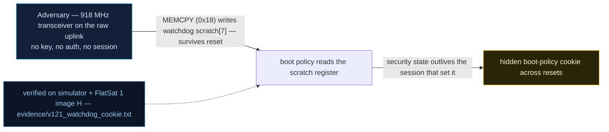

# V-21 — Persistence cookie in the RP2040 watchdog scratch registers

| Field | Value |
|---|---|
| ID | V-21 |
| Severity | Medium — a hidden boot-time policy switch (secure link OFF) that survives soft reboots and leaves no trace after a power cycle; small blast radius, zero forensic surface (no notional-risk triple published for PER-0001) |
| Category | Non-volatile state abuse / hidden boot policy (CWE-326-adjacent: asymmetric lifetime of security state) |
| Interface | `MEMCPY` TC (APID 0x18) → `watchdog->scratch[7]` (0x40058048); boot policy check |
| SPARTA | PER-0001 · Memory Compromise; secondary DE-0003.11 Watchdog Timer (WDT) for Evasion, EX-0012.11 Watchdog Timer (WDT) (v3.2, no notional-risk triple published for PER-0001) |
| PoC | `poc/v121_watchdog_cookie.py` — evidence `evidence/v121_watchdog_cookie.txt` (`POC OK`) |

## Summary
The RP2040's watchdog block exposes eight scratch registers that are **retained across a
watchdog/soft reboot** and lost only on power removal. The v2 boot path reads one of them:
if it holds the magic `PERS` (`0x53524550`), the firmware applies an attacker-chosen policy
— disable the secure link and re-arm the V-19 schedule — before the first TC is parsed.
The attacker writes the cookie with the V-14 write-what-where primitive, resets the craft,
and gets a rebooted spacecraft that *looks* recovered while running with crypto OFF. The
operator's only cleanup is a power cycle, which in orbit means a brownout (V-34).

## Attack diagram



## Root cause
Two design choices compose: `memserv.cpp` `MEMCPY` (APID 0x18) accepts arbitrary
`src/dst/len` bounded only to valid memory — the PPB and peripheral ranges, including
`ADDR_WDT_SCRATCH = 0x4005802C`, are writable — and `firmware.ino`'s boot sequence treats
`watchdog->scratch[]` as a trustworthy policy store (`self.persist_cookie =
(self.scratch[7] == 0x53524550)` in the simulator mirror), applying it with no
authentication and no visibility beyond one status bit. Security state and the reset that
is supposed to clear it do not have the same lifetime.

## Attack mechanism
1. Stage the 4-byte cookie in RAM: `SET_LOG_NAME` (APID 0x1A) with `PERS` + 28 nulls
   puts it at `SYM_LOG_NAME = 0x20002000`.
2. Copy it into the watchdog block with one `MEMCPY` TC: payload
   `00200020488005400400` = src `0x20002000`, dst `0x40058048` (= scratch base + 28 →
   `scratch[7]`), len `0004`.
3. `RESETC` (APID 0x02). Boot sees the magic and flips policy: `boot_count=1`,
   `cookie_flag=1`, secure link OFF, `F2_PERSIST` (0x20) published in STATUS flags2.
4. Power cycle: scratch and SRAM die → cookie gone, crypto silently back ON.

## Exploitation walkthrough
1. Write and reboot — verbatim from the transcript:

```
--> TC apid=0x18 via=radio AES  payload=00200020488005400400
MEMCPY 'PERS' -> scratch7 (0x40058048) ok
RESETC ack: boot_count=1 cookie_flag=1
```

2. Post-reboot policy state:

```
post-reboot flags2=0x20 PERSIST=True secure=False
```

3. Prove the asymmetry — the same TC after a power cycle:

```
after power cycle: secure=True PERSIST=False (scratch is volatile)
```

4. The PoC's own conclusion: *attacker toggles a protection policy whose very existence
   leaves no forensic trace after the next power cycle*.

## Impact
This is the mechanism that breaks "reset = clean slate", the assumption behind every
reboot-based containment decision in the mission. In a pass-bounded LEO operation the
attacker wins a full degraded window per reboot cycle, with the operator explicitly
*unable* to reproduce what they saw: by the time the craft is powered down for inspection,
the evidence — the register holding the policy — has decayed. Combined with V-19 (cookie
re-arms the planted schedule) and V-22 (crypto stays off after safe-mode), it gives a
post-exploitation foothold that survives everything short of unplugging the bus, which the
course lists as the reason the EPS/brownout case (V-34) matters.

## Mitigations
- Do not derive security policy from registers whose lifetime differs from the state they
  gate: either keep the policy in flash (auditable) or re-assert it from an authenticated
  TC after every boot.
- Clear `watchdog->scratch[]` at boot *before* any policy decision, and require a fresh
  authenticated TC to re-arm any boot-time behaviour (the V-19 schedule gate covers it).
- If scratch must be used (legitimate crash-cause bookkeeping), authenticate it: store an
  HMAC over the value with a key that itself does not survive reset.
- Publish the cookie/PERSIST state prominently in telemetry and alarm on
  `PERSIST ∧ ¬secure` — CM0004-style analytics; the lab already emits `F2_PERSIST` so the
  operator-side rule costs nothing on the spacecraft.

## References
- PoC + evidence: `poc/v121_watchdog_cookie.py`, `evidence/v121_watchdog_cookie.txt`
- `docs/SPARTA_MAPPING.md` — row V-21 (PER-0001; DE-0003.11, EX-0012.11)
- `../RAPPORT-FIRMWARE-VULNERABLE-FLATSAT.md` §V-21 (RP2040 scratch technique, CWE-326)
- Implementation: `firmware/memserv.cpp` (MEMCPY), `firmware/firmware.ino` (boot policy);
  `simulator/flatsat_sim.py` (`ADDR_WDT_SCRATCH = 0x4005802C`, `SYM_LOG_NAME = 0x20002000`,
  `persist_cookie = (scratch[7] == 0x53524550)`, `F2_PERSIST`)
