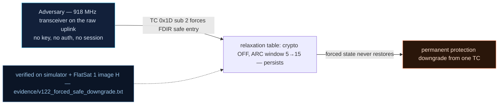

# V-22 — Forced safe mode = protection downgrade (crypto OFF, ARC window 5→15, persists)

| Field | Value |
|---|---|
| ID | V-22 |
| Severity | High — one unauthenticated TC buys ≥120 s of triple-relaxed replay protection plus cleartext telemetry that *stays* after recovery (no notional-risk triple published for DE-0005; secondary EX-0011 24\|21\|17) |
| Category | Protection downgrade via state forcing (embedded SV-CF-4 analogue) |
| Interface | TC APID 0x1D sub 2 (remote safe entry) → FDIR relaxation table + SDLS/ARC state |
| SPARTA | DE-0005 · Subvert Protections via Safe-Mode; secondary EX-0011 Exploit Reduced Protections During Safe-Mode (24\|21\|17), DE-0003.07 Cryptographic Modes (18\|15\|11) (v3.2) |
| PoC | `poc/v122_forced_safe_downgrade.py` — evidence `evidence/v122_forced_safe_downgrade.txt` (`POC OK`) |

## Summary
Safe mode is not only a degraded *attitude* state — it applies a whole relaxation table,
and each entry is one of the course's six EX-0006 vectors: maintenance/test APIDs accepted
(V-16), null-cipher fallback (`AES_CONFIG` off, V0-10), forced weaker mode, **ARC reset
with the replay window widened from 5 to 15**, execution of the tamperable contingency
dictionary (V-20), and a cleartext path that stays reachable. All of it is triggerable
remotely by an attacker (forged quaternions via V-17, "tilt" via thrusters, lost GPS, fake
battery), and the two most dangerous relaxations are **not restored when the craft returns
to NOMINAL**.

## Attack diagram



## Root cause
`fdir.cpp:38-49` `safeEnter()` performs the relaxation directly:
`sdlsSetArcRelaxed(true)` (EX-0006, course sub-code .04) and `labSecureLinkSetEnabled(false)` (EX-0006, course sub-code .02),
then `labExecContingency()`. The exit path, `fdir.cpp:95` `fdirRequestExit()`, clears only
`s_safe` and `sdlsSetArcRelaxed(false)` and re-applies NOMINAL mode — it never calls
`labSecureLinkSetEnabled(true)`. The downgrade is thus a *ratchet*: entering safe mode is a
one-way protection change until someone notices and re-issues `AES_CONFIG`/`SDLS_CONFIG`.
On the SDLS side `sdls_sim.cpp:64` `sdlsWindow()` returns 15 while relaxed — out of a
16-bit counter that means an accept probability of 5/65536 per forged sequence number
nominal versus 15/65536 relaxed, a 3× replay window for the cost of one frame.

## Attack mechanism
1. Nominal baseline: `SDLS_CONFIG` (`APID 0x15`) payload `01 10 05` → SDLS on, ARC 16 bits,
   window 5; STATUS byte 2 bit `0x10` shows `secure=True`.
2. One **unauthenticated** radio TC — `APID 0x1D` payload `02` — enters safe mode.
3. In safe: `secure=False`, `arc_window=15`. The operator cannot undo it on demand:
   release inside `FDIR_RELEASE_WINDOW_MS = 120000` → error `RELEASE WINDOW`, so the
   relaxed state is guaranteed for at least two minutes.
4. After the window the operator releases successfully and the craft is NOMINAL — with the
   AES engine still OFF.

## Exploitation walkthrough
1. Before/after the single TC:

```
nominal: secure=True arc_window=5
in safe: secure=False arc_window=15 (AES engine OFF, replay window relaxed 5 -> 15)
```

2. Forced stay — the release attempt inside the 120 s window:

```
--> TC apid=0x1D via=usb clear payload=03
<-- TM apid=0x09 clear len=15
```

3. Recovery does not restore protection (121 s later, release succeeds, STATUS read back):

```
after recovery: NOMINAL again but secure=False -> downgrade OUTLIVES the safe-mode episode
```

4. The PoC's cost/benefit line: *cost to attacker: 1 TC; benefit: ≥120 s relaxed replay
   window + permanent cleartext telemetry until the operator notices*.

## Impact
The relaxation multiplies into the mission's real budget: within each ≥120 s episode the
attacker can replay captured TCs three times more easily (15/65536 vs 5/65536 accept
chance per guess, and ARC itself is reset on entry), and can read the downlink in the
clear — including the beacon's safe-mode bit, which is *not* cloaked (CM0006 is off by
default), so the attacker sees the window open (REC-0007) and exploits it inside the
<2 min window the course budgets for safe-mode response. Because the AES-off state
persists, the "temporary" downgrade becomes the new steady state; the 43/64 SDLS
associations that already default to Clear (V-08) mean there is no second line of defence
either.

## Mitigations
- Make the relaxation table symmetric: every protection switched off by `safeEnter()` must
  be restored by `fdirRequestExit()` (restore-not-ratchet), or re-negotiated through an
  authenticated handshake before NOMINAL is published.
- Gate remote safe entry (`0x1D` sub 2) behind the GS session/SDLS MAC (CM0031-style
  authentication) — cost: ground-commanded recovery tests need a key on the bench.
- Implement the cloak (CM0006) so the safe-mode bit stops advertising the window; the lab
  already ships `CLOAK` off by default and documents the audit loss as the trade-off.
- Alarm on `¬secure ∧ NOMINAL` in ground analytics (CM0004-style) rather than trusting the
  mode byte — with a 125 s cadence pass this is a one-line operator rule that catches the
  whole class.

## References
- PoC + evidence: `poc/v122_forced_safe_downgrade.py`, `evidence/v122_forced_safe_downgrade.txt`
- `docs/SPARTA_MAPPING.md` — row V-22 (DE-0005; EX-0011 24\|21\|17, DE-0003.07 18\|15\|11)
- `../RAPPORT-FIRMWARE-VULNERABLE-FLATSAT.md` §V-22 (Ch.9.1, the six EX-0006 vectors, SV-CF-4)
- Implementation: `firmware/fdir.cpp` (`safeEnter`, `fdirRequestExit`), `firmware/sdls_sim.cpp`
  (`sdlsWindow`, `s_window = 5`, relaxed 15), `firmware/secure_link.cpp`;
  `simulator/flatsat_sim.py` (`_safe_enter`, `_safe_exit`, `arc_relaxed`, `GS` gate notes)
