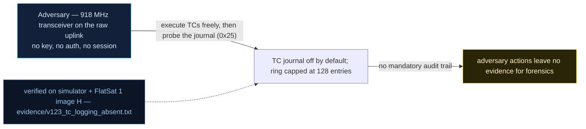

# V-23 — No TC journal by default; the optional log caps at 128 entries

| Field | Value |
|---|---|
| ID | V-23 |
| Severity | Medium — no direct control loss, but it removes the mission's ability to answer "who commanded what", which invalidates the course's ≤3 min attribution objective and launders every other attack (no notional-risk triple published for DE-0003.08) |
| Category | Insufficient logging / auditing gap (CWE-778) |
| Interface | TC path (`worker.cpp` dispatch) → optional flash log sector; read via APID 0x25 (defenses/status) |
| SPARTA | DE-0003.08 · On-Board Values Obfuscation: Received Commands; secondary Overflow Audit Log (DE family), attribution gap (v3.2, no notional-risk triple published) |
| PoC | `poc/v123_tc_logging_absent.py` — evidence `evidence/v123_tc_logging_absent.txt` (`POC OK`) |

## Summary
Every accepted telecommand is executed and forgotten. The flash log sector exists and the
ring-buffer code exists, but logging ships **disabled** (`tclog_enabled = false`), and the
only other trace — `Serial` output — dies with the craft at every reboot. Post-incident,
inside a pass or after one RESETC, the operator has no on-board record: not of the
mode-change TCs, not of the TEST-window hits (V-16), not of the dictionary edit (V-20).
When logging *is* enabled it is a 128-entry circular buffer that a few dozen junk frames
roll over, so the evidence destroys itself under exactly the traffic conditions an attack
creates.

## Attack diagram



## Root cause
`worker.cpp` dispatch path appends each TC to the journal only when
`flash["tclog_enabled"]` is set (APID `0x25` sub `0`, flag `DEF_LOG_ENABLE = 0x40`), and
caps the ring at 128 records — over-cap entries are `pop(0)`-ed while `tclog_evicted`
counts the losses. Two design faults compose: a *default-off* security feature (the course
calls this the P_detect = 0 case, Ch.9.2) and an *attacker-writable* audit trail with no
priority protection: the flood that constitutes the attack is also the flood that erases
the proof. Record format is complete, though: `ms u32-LE | apid u16-BE | seq u16-BE |
len u8 | payload`.

## Attack mechanism
1. Baseline check (`APID 0x25` sub `1` = status): `defenses=0x80` (only `DEF_ANOMALY_EN`)
   and `log_entries=0` → journal OFF.
2. Execute five suspicious TCs (`APID 0x0D` SET_MISSION_MODE, payload `02`, over the radio)
   — the status read afterwards still reports zero entries.
3. Turn logging on (`0x25` payload `00 C0` = LOG_ENABLE|ANOMALY), then uplink 130 frames
   (`0x01`, payload `01`): the ring saturates at 128 and starts evicting.

## Exploitation walkthrough
1. Absence of attribution, straight from the transcript:

```
defenses=0x80 log_entries=0 -> journal OFF
5 mode-change TCs executed, nothing recorded (no attribution)
```

2. With logging enabled, the cap and the eviction counter are visible in the same status
   reply:

```
after 130 TCs: entries=128 evicted=3
```

3. A journal dump (`0x25` sub `2`, `start u16-BE`, `count u8`) shows the *oldest surviving*
   record already past the attacker's first frames — seq 13 of 130:

```
entry 0: t=5000 ms apid=0x0001 seq=13 payload=01
entry 1: t=5000 ms apid=0x0001 seq=14 payload=01
```

4. PoC conclusion: *forensics possible ONLY when the optional journal is on, and even then
   a flood evicts the evidence within minutes*.

## Impact
The course's incident-response objective (SV-IT-2: attribute a command within 3 minutes,
Ch.7.1) is unmeetable on this firmware: attribution requires a record, and the record is
either absent (default), volatile (Serial), or self-overwriting. Practically, this is the
force multiplier for every persistence and confusion finding in the catalog — a V-20
contingency trojan, a V-21 boot cookie, or a V-16 TEST-window command all leave a
*behaviour* the operator eventually notices and no *cause* they can point to, which is
also how the attacker keeps the engagement inside the course's P_detect = 0 window.

## Mitigations
- Ship the journal ON: it costs one flash sector and a CMAC-free append per TC; write
  wear is the real budget (Pico QSPI endurance) — mitigate by batching or by writing only
  security-relevant APIDs (TEST window, 0x1D/0x1E/0x1F, mode changes).
- Protect the audit trail from the attack: a *minimum-retention* partition (never evicted
  while full → refuse new records and raise an alarm) beats silent eviction; the
  `evicted` counter should be an alarm, not a status field.
- Add provenance and a monotonic sequence to each record so gaps are provable even after
  overflow (the `seq` field exists — the ARC counter makes gaps detectable if retained).
- Downlink journal deltas opportunistically during passes (CM0012-style log analysis is
  only possible if logs leave the craft); cost: a few hundred bytes per pass of telemetry.

## References
- PoC + evidence: `poc/v123_tc_logging_absent.py`, `evidence/v123_tc_logging_absent.txt`
- `docs/SPARTA_MAPPING.md` — row V-23 (DE-0003.08; attribution gap)
- `../RAPPORT-FIRMWARE-VULNERABLE-FLATSAT.md` §V-23 (Ch.7.1 SV-IT-2 ≤3 min, Ch.9.2 P_detect=0, CWE-778)
- Implementation: `firmware/worker.cpp` (journal append), `firmware/flashstore.cpp`
  (log sector), `firmware/extcmds.cpp` (`hDefenses`); `simulator/flatsat_sim.py`
  (`flash["tclog"]`, 128-entry cap, `tclog_evicted`, `DEF_LOG_ENABLE = 0x40`, `_defenses`)
