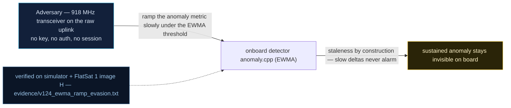

# V-24 — On-board EWMA anomaly detector evaded by a slow ramp

| Field | Value |
|---|---|
| ID | V-24 |
| Severity | Medium — not a control-plane bug but the reason control-plane bugs go unnoticed: a 2.3× rate growth in 200 s produces no alarm while a single step of the same size does (no notional-risk triple published for DE-0003.12) |
| Category | Detection evasion / weak statistical model (staleness by construction) |
| Interface | On-board detector (`anomaly.cpp`) fed by the mission model; config via TC APID 0x1D (subs 4/8), status in APID 0x1D TM bytes 15/16 |
| SPARTA | DE-0003.12 · Poison AI/ML Training for Evasion (detector tuning/staleness); secondary Targeted Deception of Onboard Sensors (DE family) (v3.2, no notional-risk triple published) |
| PoC | `poc/v124_ewma_ramp_evasion.py` — evidence `evidence/v124_ewma_ramp_evasion.txt` (`POC OK`) |

## Summary
The v2 firmware ships the course's "impoverished LSTM": a hand-tuned EWMA/EWV detector on
four channels (virtual tilt, TC rate, mean power, bus voltage) with one multiply per
sample, ~10 µs, and an alarm rule `|x − µ| > z·σ`, z ∈ [2.5, 10]. The model is faithful to
the course in its weakness too: the exponentially weighted mean *tracks* a slow trend, so
an attacker who creeps — +1 TC/s every 10 s, ending at more than double the trained rate —
never exceeds the smoothed residual, while the *same* absolute change delivered as a step
alarms immediately.

## Attack diagram



## Root cause
`anomaly.cpp` `anomalyFeed()`: `mu += ANOM_ALPHA*diff; var = (1−ANOM_ALPHA)*(var +
ANOM_ALPHA*diff²)` with `ANOM_ALPHA = 0.05`. With α = 0.05, µ lags the signal by roughly
1/α samples (≈20 s of samples): a drift of one unit per 10 samples keeps `resid = x − µ`
bounded near `drift/α` while σ grows from the same small diffs — the z-ratio stays under
the threshold forever. There is no absolute/threshold channel and no trend (CUSUM/slope)
term, so "slowly wrong" is definitionally invisible — the same failure mode the course
attributes to its impoverished LSTM's contextual anomalies (P(evasion) ≈ 0.31/pass). The
tunable z floor is 2.5 (`anomalySetZ`, `1D 08 19` = 2.5), and the PoC uses it — the
evasion is *not* an artefact of a lenient threshold.

## Attack mechanism
1. Enable detection (`0x25` payload `00 80` = `DEF_ANOMALY_EN`) and lower z to the 2.5
   floor (`0x1D` payload `08 19`).
2. Train with 40 s of noisy but stationary TC traffic (15 ± 2 TC/s), then acknowledge
   training artefacts (`0x1D` sub `4`).
3. Ramp: +1 TC/s every 10 s for 200 s (15 → 35 TC/s, i.e. ×2.3). Sample the FDIR TM at
   +60/+120/+200 s: alarm byte (offset 15) stays 0.
4. Step the *same* channel to 45 TC/s in one second: alarm = 1, channel = 1 (TC rate).

## Exploitation walkthrough
1. After training and throughout the ramp, the detector stays quiet:

```
after training: alarm=0
ramp t+60 s (rate 21 TC/s): alarm=0
ramp t+200 s (rate 35 TC/s): alarm=0
```

2. The step, one second later, is caught — proving the detector works and that the ramp's
   silence was evasion, not absence of monitoring:

```
step to 45 TC/s: alarm=1 channel=1
```

3. The PoC quantifies the budget: *command-rate attacks (credential stuffing, scripted
   floods) must creep in under ~0.05 σ/s to stay invisible*.

## Impact
Every rate-based attack in this catalog gets a stealth mode: the V-15 uplink flood can be
spread over passes instead of burst, V-33-style momentum spam and heater drain (V-34) can
creep a few percent per pass, and V-17's *semantically false but structurally valid* MID
publishes are invisible to a residual detector by nature — the course's P_detect = 0 story
again. The operational cost of the blindness is concrete: drift accumulates against a
40 Wh battery and a 3 W solar budget, and against a 5.0 deg/s FDIR tilt line, until a
threshold — not the detector — fires, at which point the mission pays a safe-mode episode
with its 120 s release window and detumble recovery.

## Mitigations
- Add a slow-trend term alongside the EWMA: CUSUM or a slope check on µ itself catches
  drifts that the residual test cannot; this is arithmetic, not ML — affordable on M0+.
- Keep absolute safety thresholds in the detector (tilt, bus V, W/s) so a creeping value
  still crosses a line even while the residual stays small — partial overlap with FDIR
  (5.0 deg/s) already covers two channels.
- Feed *event* channels the ramp attacker must touch (TEST-window hits, dictionary edits,
  schedule adds) rather than only analog rates — harder to creep.
- Retrain/reset the baseline at eclipse entry and after safe-mode exit: the α = 0.05
  window makes the baseline stale across the 35 s eclipse boundary, which an attacker can
  also exploit as cover; trade-off: more false alarms, so pair with the absolute limits.

## References
- PoC + evidence: `poc/v124_ewma_ramp_evasion.py`, `evidence/v124_ewma_ramp_evasion.txt`
- `docs/SPARTA_MAPPING.md` — row V-24 (DE-0003.12)
- `../RAPPORT-FIRMWARE-VULNERABLE-FLATSAT.md` §V-24 (Ch.12.2, ≤5 %/pass drift, P(évasion)≈0.31)
- Implementation: `firmware/anomaly.cpp` (`anomalyFeed`, `ANOM_ALPHA 0.05`, `anomalySetZ`),
  `firmware/fdir.cpp` (`fdirAckAnomaly`); `simulator/flatsat_sim.py` (`_feed_anomaly`,
  `anom_z`, channels `[tilt, tc_seen, power_w, bus_v*100]`, FDIR TM bytes 15/16)
