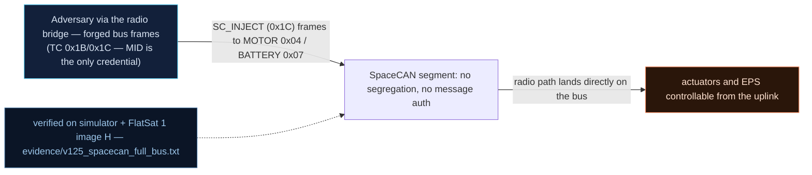

# V-25 — Full unauthenticated SpaceCAN bus exposed over the radio bridge

| Field | Value |
|---|---|
| ID | V-25 |
| Severity | High — jam, spoof, node disconnect and buffer overflow on the actuator bus, all from raw radio TCs with zero frame authentication (24\|21\|17) |
| Category | Lack of bus segregation / missing message authentication on internal bus (lateral movement) |
| Interface | Radio TC APID 0x1C `SC_INJECT` → simulated SpaceCAN segment (nodes MOTOR 0x04, BATTERY 0x07) |
| SPARTA | LM-0002 · Exploit Lack of Bus Segregation; secondary EX-0013.01 Valid Commands, EX-0014.02 Bus Traffic Spoofing (v3.2, notional risk 24\|21\|17) |
| PoC | `poc/v125_spacecan_full_bus.py` — evidence `evidence/v125_spacecan_full_bus.txt` (`POC OK`) |

## Summary
The radio-to-SpaceCAN bridge (V-16's `SC_INJECT`) does not merely *forward* commands: it
exposes every CAN-layer attack class that the course lists for shared buses, because the
injected frames carry no origin, no authentication, and no rate budget. From the raw radio
the attacker can command the motor node directly, spoof the battery node's state of charge
into a safe-mode, jam the segment with arbitration flooding, drive a node BUS-OFF with
malformed traffic, and overflow the fragment-reassembly context — the same TID-114/TID-412
family the course demonstrates on a physical bench.

## Attack diagram



## Root cause
`spacecan.cpp` `spacecanRadioInject()` (and its siblings `spacecanRadioFlood`,
`spacecanRadioReassemblyOverflow`, `spacecanResetNode`) call the normal bus dispatch path
as if the frame had arrived from an onboard emitter; `scDispatchFrame()` trusts the
11-bit ID's function field (`cid & 0x780 == 0x280`) and node id, applies the payload, and
never asks who injected it. Error containment is standard CAN bookkeeping — +8 TEC per
malformed frame, BUS-OFF at 256 — but it is *not* a security control: 32 attacker frames
trigger it deliberately, and `spacecanResetNode()` (mode 3) clears it unauthenticated.
The reassembly path is the classic overflow: 43 fragments × 6 B = 258 bytes past a
`ctx->buffer[256]`, corrupting `last_update_ms` behind it.

## Attack mechanism
Wire format on `APID 0x1C`: `mode u8 | [can_id BE u32 | dlc u8 | data] | …`
* **Jam/BUS-OFF**: 32 frames `00 00000284 01 99` — node 0x04, dlc 1, function byte `0x99`
  ≠ `0x01` → +8 TEC each; 32×8 = 256 → BUS-OFF, motor node silently disconnected (its
  status reply reports bus-off mask `0x01` and TEC encoded LE: low byte `0x00`, high byte
  `0x01`).
* **Takeover**: node reset (`03 00000284 00`), then `00 00000284 02 017b` → thruster 0
  power = 123, visible in STATUS byte 5.
* **Spoof**: `00 00000287 02 0105` on the battery node → pct = 5 → `bus_v = 21.0 +
  3.0·5/100 = 21.15 V` (reported 21.14 after the ×100 truncation) → below the 22.0 V
  FDIR line → `BUS_UNDERV` safe mode.
* **Congestion**: mode `1` with 60 frames → ≥5 frames in a 1 s window ⇒ starvation flag.
* **Overflow**: mode `4` → reassembly corruption flag raised.

## Exploitation walkthrough
1. Baseline: `SET_THRUSTER` to zero, STATUS byte 5 = 0, then the junk storm; the motor node
   is BUS-OFF and ignores an otherwise valid command:

```
--> TC apid=0x1C via=radio AES  payload=00000002840199
after junk storm: busoff mask=0x01 err=0
```

2. Unauthenticated node reset + direct motor control: `st.u8(5) == 123`.
3. Battery spoof driving the safety loop:

```
spoofed charge=5 -> bus=21.14 V safe=1
```

4. Congestion (`mode=1, count=60`) reports starvation, mode `4` reports the reassembly
   overflow; the PoC's summary line:

```
=> every CAN-layer attack class (jam/spoof/replay/overflow) is reachable from the raw radio, unauthenticated
```

## Impact
This collapses the internal/external boundary the spacecraft's safety case rests on: the
virtual ADCS/EPS nodes are the physical effectors in the model, so the radio holder can
stop a thruster from responding (BUS-OFF requires a reset the attacker can also issue),
fake a flat battery to force safe mode (V-22 downgrade), or drown the bus so that
legitimate C&DH traffic misses its deadlines — during a 120 s safe-mode episode that is the
difference between recovery and a missed pass. The physical-bus lesson of Ch.8.1 transfers
exactly: on FlatSat the bridge is radio; on a real bus it is the J3 header or a compromised
node.

## Mitigations
- Authenticate bridge frames: SpaceCAN already carries an 8-bit *message index* field —
  use it as a MAC/counter slot (CMAC is already in the firmware, `cmac.cpp`); cost: a few
  bytes per frame and a µs-scale verify on RP2040.
- Origin-tag injected frames at the bridge and have actuator nodes (or the dispatch layer)
  reject external-origin commands above a budget — i.e. bus segregation (LM-0002 fix),
  which mostly costs flexibility for bench maintenance.
- Rate-limit and quarantine radio-side injection (per-second budget; error frames cost
  more budget than valid ones) — cheap, but changes bus timing guarantees, so version it.
- Move node reset behind the GS session, and alarm on TEC growth so BUS-OFF is a reported
  event rather than a silent disconnect.

## References
- PoC + evidence: `poc/v125_spacecan_full_bus.py`, `evidence/v125_spacecan_full_bus.txt`
- `docs/SPARTA_MAPPING.md` — row V-25 (LM-0002, risk 24\|21\|17)
- `../RAPPORT-FIRMWARE-VULNERABLE-FLATSAT.md` §V-25 (Ch.8.1, TID-114/TID-412, bus-off/reassembly numbers)
- Implementation: `firmware/spacecan.cpp` (`spacecanRadioInject`, `scDispatchFrame`,
  `spacecanResetNode`), `firmware/extcmds.cpp` (`hScInject`); `simulator/flatsat_sim.py`
  (`_sc`, `_sc_dispatch`, TEC +8/256, `sc["congested"]`, reassembly 258 > 256,
  `FDIR_BUS_SAFE_V = 22.0`)
