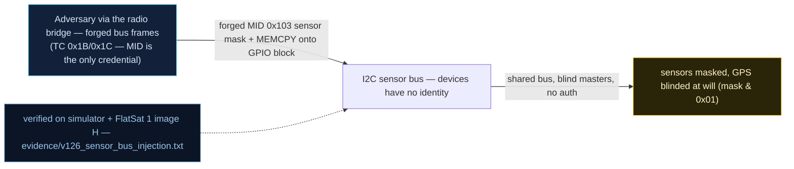

# V-26 — Radio→I2C bridge: sensor mask rewrite and GPS blinding over exposed physical buses

| Field | Value |
|---|---|
| ID | V-26 |
| Severity | Medium — blinds navigation and erases science telemetry with one TC each, and the effect is invisible (frames simply stop); RAM-only, so a power cycle heals it (24\|21\|17) |
| Category | Unauthenticated shared bus / missing device identity verification (CWE-297) |
| Interface | Software-bus MID 0x103 (sensor present mask) + `MEMCPY` TC (APID 0x18) onto the GPIO block 0x40014000; I2C sensor bus on header J3 |
| SPARTA | LM-0002 · Exploit Lack of Bus Segregation; secondary EX-0014.03 Sensor Data, EX-0012.01 Registers (v3.2, notional risk 24\|21\|17) |
| PoC | `poc/v126_sensor_bus_injection.py` — evidence `evidence/v126_sensor_bus_injection.txt` (`POC OK`) |

## Summary
Two short paths turn the sensor subsystem into an attacker-facing interface. First, the
sensor *present* mask is writable through the software bus (MID 0x103, V-17), and telemetry
generation is gated by that mask — write `0` and the BME280/accelerometer frames stop
leaving the craft without any error anywhere. Second, the GPS shares the GPIO/pin-mux
address space that the memory service happily pokes: one byte at `0x40014000` kills the
UART, navigation goes to `sats=0, lat=0`, and because GS mode requires a navigation fix,
the *legitimate* ground station is locked out while the attacker's raw-radio path keeps
working. The course's hardware framing is the same one: the J3 header breaks the I2C bus
out of the board, so "internal bus" and "attacker bus" are the same wires on a bench.

## Attack diagram



## Root cause
`sensors.cpp` never re-verifies device identity: the BME280 `CHIP_ID` "whoami" check runs
only at boot, so `MISSION_FLAG_BME_OK` (and the present bits in STATUS byte 2) stay true
behind a ghost slave — the optional `DEF_I2C_WHOAMI` defence flag (`0x08` in `mission.h` / sim, `DEF_I2C_WHOAMI =
0x08`) ships off. The telemetry scheduler emits APID 0x08 only for present sensors, so a
mask write silently removes the data path. In parallel, `memserv.cpp`'s `MEMCPY` allows
arbitrary 1-byte writes into the RP2040 GPIO block, which is exactly how V-14's
write-what-where reaches peripherals: no allow-list, no source check.

## Attack mechanism
1. `APID 0x1B` payload `010300` → MID 0x103, mask `0x00`: STATUS byte 2 bits `0x01`
   (BME) / `0x02` (ACC) cleared. No mission TM (`0x08`) is emitted afterwards.
2. `010303` restores the mask and the mission TM returns within the next window.
3. Stage a byte: `SET_LOG_NAME` (APID 0x1A) with `K` + 31 nulls → `SYM_LOG_NAME =
   0x20002000`.
4. `MEMCPY` (`APID 0x18`) payload `00200020004001400100` = src `0x20002000`, dst
   `ADDR_GPIO = 0x40014000`, len `0001` — the GPS UART pins lose their function, the
   navigation chain dies (status `0x10`, only the always-on powered bit left; `sats=0`).
5. The GS gate now refuses the operator: `GS_MODE` (0x11) → `GS MODE GPS REQUIRED`
   (range-lock/`GS_RADIUS_M = 35000` is evaluated on navigation that no longer exists).

## Exploitation walkthrough
1. Mask erase, and the silence it causes over 15 s of mission time:

```
--> TC apid=0x1B via=radio AES  payload=010300
15 s window with mask=0: mission TM frames = 0
```

2. Blinding the navigation with one written byte:

```
--> TC apid=0x18 via=radio AES  payload=00200020004001400100
GET_NAV after GPIO poke: status=0x10 sats=0 lat=0
```

3. `GS MODE GPS REQUIRED` on the operator's `0x11 01` — blinding works both ways; after
   `powercycle()` the fix bit (`0x08`) is back, confirming the effect is RAM-only.

## Impact
The attack is a *quiet* denial: there is no error TM, no alarm, no missing heartbeat — the
operator simply stops receiving science data and cannot open the GS gate, while the
attacker keeps full radio access. For a mission whose value is per-pass science volume,
zeroing the sensor mask for the duration of a pass is a direct loss of experiment data,
and GPS blinding also disables any navigation-dependent recovery step, extending whatever
safe-mode episode the attacker triggered elsewhere (V-22/V-27). The ghost-BME280 variant is
the collection-side twin: fabricated temperature/pressure on address 0x76 (the firmware only
scans 0x76) is accepted as genuine, so the corrupted data is not merely missing but wrong.

## Mitigations
- Turn on `DEF_I2C_WHOAMI` (re-read `CHIP_ID` every poll, alarm on mismatch) — a few
  bus transactions and bytes of code, no hardware cost; the residual risk is an attacker
  who emulates the ID, which argues for bus-level authentication (CM0005-style physical
  bus protection) as the expensive end of the spectrum.
- Treat mask changes as events: alarm and journal any `SB`/`0x103` write and any
  present-bit transition, so silence becomes reported rather than inferred.
- Allow-list `MEMCPY` destinations (or exclude the GPIO/PPB ranges unless an authenticated
  debug mode is on) — this one check also closes V-14's peripheral variants and V-21's
  watchdog cookie, at the cost of losing the lab's own persistence primitives.
- Gate the radio→bus bridge itself behind the GS session (CM0031-style authentication),
  accepting that bench maintenance then needs the key.

## References
- PoC + evidence: `poc/v126_sensor_bus_injection.py`, `evidence/v126_sensor_bus_injection.txt`
- `docs/SPARTA_MAPPING.md` — row V-26 (LM-0002, risk 24\|21\|17)
- `../RAPPORT-FIRMWARE-VULNERABLE-FLATSAT.md` §V-26 (Ch.8/8.2, J3 header, ghost BME280 on 0x77→0x76, CWE-297)
- Implementation: `firmware/sensors.cpp` (boot-only CHIP_ID check, `sensor_mask`),
  `firmware/memserv.cpp` (MEMCPY), `firmware/sb.cpp` (MID 0x103); `simulator/flatsat_sim.py`
  (`ADDR_GPIO = 0x40014000`, `_gps_status_byte`, `DEF_I2C_WHOAMI = 0x08`, `GS_RADIUS_M = 35000`)
