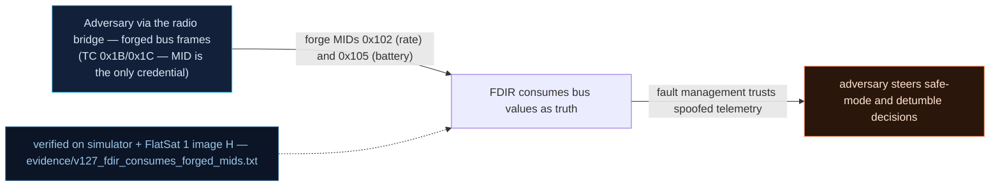

# V-27 — FDIR consumes forged MIDs: the attacker launders control of the safety loop

| Field | Value |
|---|---|
| ID | V-27 |
| Severity | High — a single unauthenticated TC both *enters* safe mode and, by refreshing the forged trigger, *holds* it indefinitely: mission resume becomes attacker-scheduled (no notional-risk triple published for EX-0014.03; secondary DE-0001 24\|21\|17) |
| Category | Spoofing feeding fault management / lateral movement into the control loop |
| Interface | Software-bus MIDs 0x102 (rate) and 0x105 (battery) → FDIR supervision (`fdir.cpp`) → ADCS/EPS virtual model |
| SPARTA | EX-0014.03 · Spoofing: Sensor Data; secondary DE-0001 Disable Fault Management (24\|21\|17), EX-0012.08 ADCS (v3.2, no notional-risk triple published for EX-0014.03) |
| PoC | `poc/v127_fdir_consumes_forged_mids.py` — evidence `evidence/v127_fdir_consumes_forged_mids.txt` (`POC OK`) |

## Summary
The safety loop reads the same software-bus values as everything else (V-17), so the
FDIR cannot tell a forged attitude rate from gyro data: there is no source authentication
on the bus that feeds it. Composing V-17 (forgeable MIDs) with V-22 (safe mode = protection
downgrade) gives the mission-level lateral-movement story of the course — supervision →
CAN → ADCS — with two escalating capabilities: *enter* safe mode at will, and then *deny
release* by re-publishing the false condition, which turns a self-healing safety function
into an attacker-owned switch.

## Attack diagram



## Root cause
`fdir.cpp` `fdirTick()` supervises `missionModelGet()` state: `mm.tilt_dps > FDIR_TILT_ALARM_DPS`
(5.0 deg/s) sustained `> 2000 ms` → `safeEnter("TUMBLE")`; `mm.bus_voltage <
FDIR_BUS_SAFE_V` (22.0 V) → `safeEnter("BUS_UNDERV")`. Those fields are written by
`sb.cpp` `sbPublish()` from MIDs 0x102/0x105 with no provenance test. The exit path,
`fdirRequestExit()`, *re-reads the same model state* (`TRIGGER ACTIVE`), so the condition
that granted the attacker entry also lets him block the way out — a supervision loop whose
inputs are attacker-writable has no privileged exit criterion. Note the self-consistency
trap: the model integrates the forged rate into its Euler angles, so "does the rate match
the attitude history?" does not catch it either.

## Attack mechanism
1. Lab time base 0.1× (`APID 0x1D` payload `0a0001`), read the FDIR status TM
   (`0x1D` sub `0`): tilt at payload offset 8 (LE u16, 0.01 deg/s), bus V at 10, power at
   12, trigger counter at offset 4 (BE u32).
2. Publish one forged rate: `APID 0x1B` payload `0102 840300000000` = MID 0x102, X = 900
   → 9.00 deg/s. Wait 3 s (> the 2 s sustain window).
3. The FDIR trips TUMBLE: `safe=1`, triggers `0→1`, STATUS flags2 (tail byte) gets
   `F2_SAFE = 0x02`. (The read-back shows 8.97 deg/s: the model's baseline 0.01 damping,
   applied per 100 ms tick at the 0.1× time base, removes 0.001 deg/s per tick — 0.03 over
   the 3 s window.)
4. Now hold it: publish MID 0x105 with pct `10` → `bus_v = 21.0 + 3.0·10/100 = 21.3 V`
   (< 22.0 V), ride out the 120 s release window, refresh the forged reading, and request
   release → `TRIGGER ACTIVE`.

## Exploitation walkthrough
1. Forged entry — verbatim:

```
--> TC apid=0x1B via=radio AES  payload=0102840300000000
tilt=8.97 deg/s safe=1 triggers 0->1
```

2. `F2_SAFE` asserted in STATUS, and the PoC's diagnosis:

```
FDIR cannot distinguish forged rate from real gyro data -- no source authentication on the bus feeding the safety loop
```

3. Release denial after the window (refreshed `0x105` at pct 10), and the conclusion:

```
=> attacker controls when the mission resumes: deny release by re-publishing the false low-voltage reading
```

## Impact
Each held episode costs the mission a 120 s release window *plus* the detumble recovery
the physical model still has to pay for (rates were really torqued while "tumbling"), and
the protection downgrade of V-22 is re-armed on every entry, so a patient attacker can
farm safe-mode entries for replay-window and cleartext exposure at zero risk of detection
by the detector (V-24). Most importantly, safe mode — the system the safety case treats as
the trusted fallback — becomes the attacker's control surface: he chooses when science
resumes, and the operator's only counter-move is an authenticated TC that clears a trigger
the spacecraft believes it can measure.

## Mitigations
- Authenticate the bus (V-17's `SB_AUTH`) and, more specifically, make FDIR inputs
  trusted-source-only: gyro/IMU telemetry from the driver path, never from a radio-side
  publish. Cheap logic, cost is architectural discipline.
- Require *authenticated evidence of health* to release, not merely a fresh reading of the
  same model state: e.g. release allowed only when the trigger condition is clear *and* an
  authenticated operator TC (or signed beacon sample) attests it.
- Cross-source plausibility at the supervisor: rate vs. reaction-wheel/thruster history,
  bus V vs. measured solar current and battery coulomb count — a spoof that is
  self-consistent in one variable rarely is in all of them (CM0004-style analytics on the
  ground side too).
- Alarm (and journal — V-23) on FDIR trigger *source* and on trigger-count growth, so a
  farmable safe-mode loop is visible across passes rather than per-episode.

## References
- PoC + evidence: `poc/v127_fdir_consumes_forged_mids.py`, `evidence/v127_fdir_consumes_forged_mids.txt`
- `docs/SPARTA_MAPPING.md` — row V-27 (EX-0014.03; DE-0001 24\|21\|17, EX-0012.08)
- `../RAPPORT-FIRMWARE-VULNERABLE-FLATSAT.md` §V-27 (Ch.8.1/8.2 supervision → CAN → ADCS chain)
- Implementation: `firmware/fdir.cpp` (`fdirTick`, `safeEnter`, `fdirRequestExit`),
  `firmware/sb.cpp` (`sbPublish`), `firmware/mission_model.cpp`;
  `simulator/flatsat_sim.py` (`FDIR_TILT = 5.0`, `FDIR_BUS_SAFE_V = 22.0`,
  `FDIR_RELEASE_MS = 120000`, `_fdir_cfg` sub 0 TM offsets 4/8/10/12, `F2_SAFE = 0x02`)
