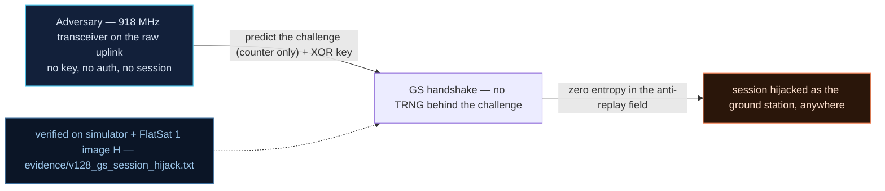

# V-28 — GS session hijack via predicted challenge (no TRNG) + hardcoded XOR key

| Field | Value |
|---|---|
| ID | V-28 |
| Severity | High — full ground-station privilege from arithmetic alone: the attacker computes the challenge *before* asking for it and never listens to the handshake (no notional-risk triple published for EX-0003) |
| Category | Predictable authentication challenge / weak challenge–response (missing entropy source) |
| Interface | Radio TC APID 0x11 (`GS_MODE`) / 0x12 (`GS_ACCESS` handshake); `GS_STATUS` APID 0x13 |
| SPARTA | EX-0003 · Modify Authentication Process; secondary IA-0008.01 Rogue Ground Station, DE-0004 Masquerading (v3.2, no notional-risk triple published) |
| PoC | `poc/v128_gs_session_hijack.py` — evidence `evidence/v128_gs_session_hijack.txt` (`POC OK`) |

## Summary
GS authentication is a two-phase challenge/response: the craft publishes a 32-bit
challenge, the requester answers `challenge XOR key`. The key is hardcoded (V0-06,
`GS_XOR_KEY = 0xC0DEFACE` in the image); the challenge, the part that is supposed to be
fresh, is a pure function of *public* inputs — mission `millis()`, GPS latitude/longitude,
satellite count, minute-of-hour — with **no TRNG/ROSC entropy anywhere on the path**. An
attacker who has read the image and knows the spacecraft position to within a second of
mission time predicts the challenge offline and completes the handshake without capturing
a single telemetry frame: the 5-minute session (300 s) then belongs to them.

## Attack diagram



## Root cause
`worker.cpp:251` (`_gs_gen_challenge` in the simulator twin):

```
seed = (millis << 1) ^ 0xA55A33CC
seed ^= lat_e7 ;  seed ^= (lon_e7 << 7) ;  seed ^= ((ms/1000 % 60) << 24) ;  seed ^= (sats << 16)
seed = 0x13579BDF if seed == 0
```

Every operand is either a constant in the firmware image or an item the craft *broadcasts*
(beacon timestamp, V-02; nav TM, APID 0x0E). The RP2040 has no hardware RNG, and the usual
free substitute — a ring-oscillator entropy source — is not used, so "challenge" here means
"number both sides can compute". There is also no cryptographic binding of the challenge to
the requester, and the response check `resp != challenge ^ GS_XOR_KEY` is the entire
protocol (course Ch.7.2 / attack 05, where the same weakness is exploited with a captured
handshake — here it does not even need one).

Bench note (hardware parity): on the real board the seed's time term is the
*ground-station-synced mission clock* — `groundStationGenerateChallenge()` uses
`labLastLabSyncMs()` (the craft's last `LAB_STATUS` sync, with `millis()` as the cold
fallback) and derives the UTC term from it, because the bench craft has no NMEA feed and its
GPS state is frozen (`utcSecond = 0`, lat/lon 0). That synced clock is exactly what the
attacker's ground station tracks, so the prediction is *the same value on both
transports* — the attack is unchanged, and on hardware it is if anything cleaner (the
attacker never needs the frozen nav bytes at all). See
`docs/HARDWARE-USB-TEST.md` §4bis.10.

## Attack mechanism
1. Read navigation once (`APID 0x0E`): `lat_e7`, `lon_e7`, `sats` — values the craft itself
   publishes and which change slowly along the ground track.
2. Open the GS gate: `APID 0x11` payload `01`; advance mission time to a target instant
   (`t = 42000 ms` in the run — the beacon timestamp in TM makes mission time observable).
3. Compute the expected challenge for that instant with the leaked formula, then run the
   handshake *blind*: phase 0 request (`APID 0x12` payload `00`), phase 1 answer
   (`APID 0x12` payload `01 | resp BE u32`), with `resp = 0x302717AC ^ 0xC0DEFACE =
   0xF0F9ED62`.
4. Session opens (`GS_SESSION_MS = 300000`), so gate-restricted TCs now execute for the
   attacker — the PoC kills the AES engine (`APID 0x0A` payload `00`, cleartext).

## Exploitation walkthrough
1. Prediction before request, and the match (verbatim from the capture):

```
attacker predicts challenge 0x302717AC for t=42000 ms (seed formula leaked from the image, no TRNG on RP2040 path)
--> TC apid=0x12 via=radio AES  payload=00
actual challenge: 0x302717AC -> prediction exact: True
```

2. Answer phase from the prediction alone — `0x302717AC ^ 0xC0DEFACE = 0xF0F9ED62`:

```
--> TC apid=0x12 via=radio AES  payload=01f0f9ed62
```

3. Hijacked session state, read back over USB:

```
GS_STATUS byte 0x2F: session+gate bits set for the attacker's session
=> no cryptographic binding of challenge to requester: full GS privilege from arithmetic + eavesdropped metadata
```

## Impact
GS mode is the privilege root for a long list of findings — the V-08 SDLS configuration,
OTA activation (V-18), schedule clearing (V-19), safe-mode policy and the ARC/`SDLS_CONFIG`
knobs of V-22 — so a predicted challenge converts a passive radio into a *legitimate
ground station* for 300 s per attempt. The defence-in-depth that is supposed to stop a
rogue GS — the 35 km range lock (`GS_RADIUS_M = 35000`) evaluated on GPS — is itself
spoofable (V-05), which is exactly the GPS-spoof → range-lock dissolve → XOR-auth chain of
V-36. Timing-wise, one pass is enough: prediction is offline arithmetic, so the attacker
spends radio time only on four frames.

## Mitigations
- Add real entropy: a ROSC-based collector on RP2040 is ~50 lines plus a startup health
  test (the SP 800-90B style repetition-count check is enough for this use); the challenge
  must be a nonce, not a timestamp function. Cost: a few µs per handshake.
- Replace XOR-with-static-key by a MAC: the SDLS path (AES-CMAC + ARC) is already
  implemented in `cmac.cpp`/`sdls_sim.cpp` — the cheap fix is a default policy of
  authenticated SAs rather than new crypto (and note 43/64 associations already default to
  Clear, V-08).
- Bind the challenge to the requester and to a purpose (challenge ‖ session id ‖ TC
  counter inside the MAC) so a predicted value cannot be replayed into another context.
- Keep challenge TTL short (60 s, `GS_CHALLENGE_MS`) *and* make time uncertainty useless:
  with an entropy source, knowing mission time to the second buys nothing; today ±20 s of
  `millis` (from V-02's beacon) is the entire secret.

## References
- PoC + evidence: `poc/v128_gs_session_hijack.py`, `evidence/v128_gs_session_hijack.txt`
- `docs/SPARTA_MAPPING.md` — row V-28 (EX-0003; IA-0008.01, DE-0004)
- `../RAPPORT-FIRMWARE-VULNERABLE-FLATSAT.md` §V-28 (Ch.7.2 attacks 05, `CHALLENGE_MODE=2`, 300 s session)
- Implementation: `firmware/worker.cpp` (`groundStationGenerateChallenge`, seed
  formula), `firmware/secure_link.cpp`
  /`sdls_sim.cpp`; `simulator/flatsat_sim.py` (`_gs_gen_challenge`, `GS_XOR_KEY = 0xC0DEFACE`,
  `GS_SESSION_MS = 300000`, `GS_CHALLENGE_MS = 60000`, `GS_RADIUS_M = 35000`)
