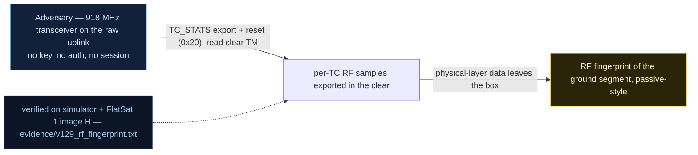

# V-29 — Per-TC RF Sample Export for Passive Fingerprinting

| Field | Value |
|---|---|
| ID | V-29 |
| Severity | Medium — unauthenticated export of RF-layer metadata enables craft identification and detector training, but does not touch mission control. |
| Category | Reconnaissance / information disclosure (RF side channel) |
| Interface | Radio uplink — TC `0x20` TC_STATS (export + reset), clear-text TM `0x20` |
| SPARTA | REC-0005 · Eavesdropping (primary); REC-0005.01 Uplink Intercept Eavesdropping, DE-0003.04 Command Receivers Received Signal Strength (SPARTA v3.2; no notional risk listed for this row) |
| PoC | `poc/v129_rf_fingerprint.py` — evidence `evidence/v129_rf_fingerprint.txt` (`POC OK`) |

## Summary

The firmware keeps a 64-deep ring window of RF measurements (RSSI, SNR,
frequency error) taken on every received telecommand and will export its
aggregate statistics over a raw, unauthenticated command — and it will also
*reset* the window on request. The attacker can therefore self-measure his
own signal (antenna/pointing tuning), read the accumulated profile of any
operator's TCs, and scrub the evidence. The exported feature vector is
exactly what the course's logistic-regression (TinyML, 69.5 µs inference on
the M0+) RF detector trains on, so the same hook serves defenders — read raw
off the wire.

## Attack diagram



## Root cause

`extcmds.cpp` (v2 extension services): the TC_STATS handler samples the
transceiver per received TC and answers any `0x20` request — no GS session,
no source check, response sent **clear**. Hardware honesty: RSSI/SNR/freq-
error come from the real SX1262 LoRa transceiver on the RP2040 board; the
simulator models these samples (`TC_STATS_DEFAULTS`).

## Attack mechanism

On-the-wire steps (all via raw radio):

1. `TC 0x20 payload=01` — reset the capture window (ack `[scid,1,1,0]`).
2. Fire N telecommands (`0x01`, `0x04`, …) — each one appends an
   RSSI/SNR/frequency-error sample to the 64-slot ring.
3. `TC 0x20 payload=-` — read the 18-byte clear TM: sample count at
   payload[2], then LE i16 fields: avg RSSI @3, avg SNR×10 @5, **avg
   frequency error @7**, min RSSI @9, max RSSI @11; CRC-defense flag @13,
   last APID @14, TM counter @16.
4. The mean frequency error is the crystal (XO) calibration offset — stable
   to 0 Hz drift across windows — a per-craft fingerprint inside an identical
   constellation.
5. `TC 0x20 payload=01` again — the *attacker* may also reset the window.

## Exploitation walkthrough

1. Baseline: window reset, 40 attacker TCs sent on APID 0x01, one export read.

```
[   0.027] window: 41 samples  rssi avg=-70 min=-80 max=-61 dBm
[   0.027] frequency error mean -80 Hz -> crystal calibration fingerprint (identifies THIS craft in a constellation)
```

2. The PoC unpacks the TM with the exact offsets above and asserts the
   64-deep ring captured the burst (`39 <= n <= 41`) and that
   `min <= avg <= max` (internally consistent stats).
3. Stability test: reset, 60 more TCs (APID 0x04, `payload=0001`), second
   export — the fingerprint does not move:

```
[   0.042] window2 (60 TCs): rssi avg=-70 freq_err mean=-80 Hz (drift |dFe|=0 Hz)
```

4. Scrub test: `0x20 payload=01` accepted from the same unauthenticated
   source — the attacker can erase history (`reset accepted`).
5. Conclusion logged by the PoC: the export *is* the course LR detector's
   feature vector, readable raw.

## Impact

- **Craft identification:** the −80 Hz mean frequency error pins *this*
  spacecraft in a constellation of identical builds.
- **Detector bootstrap:** the export hands the defender (or an attacker
  profiling the defender) a live training/inference feed for the course
  TinyML LR detector (69.5 µs inference, 0.940 accuracy) — no wideband
  capture station needed.
- **Self-tuning:** an attacker measures his own uplink as the craft sees it.
- **Forensic loss:** the unauthenticated reset lets an intruder wipe the RF
  window before the operator reads it. Cost per query: 18 B on the uplink,
  one command.

## Mitigations

- Gate TC_STATS export behind GS mode/authentication (a handful of
  comparisons in the `0x20` handler); keep it clear-text-readable only for
  the authenticated operator.
- Make the window reset GS-gated or at least TC-journaled
  (`DEFENSES_CONFIG` log bit `0x40`, SPARTA CM0032 On-board Intrusion
  Detection & Prevention) so scrubbing is itself evidence.
- Rate-limit the export so a squatting adversary cannot stream the window.
- CubeSat cost note: sampling already happens in the TC path; gating costs
  no additional hardware — only a policy check and a few bytes per response.

## References

- `poc/v129_rf_fingerprint.py` / `evidence/v129_rf_fingerprint.txt`
- `RAPPORT-FIRMWARE-VULNERABLE-FLATSAT.md`, V-29 (§4 — COL/REC, Ch.5.2/5.3)
- `docs/SPARTA_MAPPING.md` row V-29 (SPARTA v3.2)
- `simulator/flatsat_sim.py` — `TC_STATS_DEFAULTS`, APID `0x20` handler
