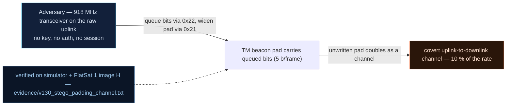

# V-30 — Steganographic Channel Inside TM Padding (5 bits – 10 % of the Rate)

| Field | Value |
|---|---|
| ID | V-30 |
| Severity | High — a mission-invisible drain carried the SDLS link key off the craft through the legitimate beacon, and it survives beacon cloaking. |
| Category | Exfiltration / covert (steganographic) channel |
| Interface | TC `0x22` COVERT_ENQ + TC `0x21` PADDING_CONFIG; TM `0x01` beacon padding bytes 21:63 |
| SPARTA | EXF-0004 · Out-of-Band Communications Link, covert variant (primary); EXF-0003.02 Downlink Exfiltration (SPARTA v3.2; no notional risk listed for this row — EXF-0001 class shows 22\|19\|14) |
| PoC | `poc/v130_stego_padding_channel.py` — evidence `evidence/v130_stego_padding_channel.txt` (`POC OK`) |

## Summary

Telemetry frames are fixed-length, and their padding is not required to be
inert: `PADDING_CONFIG mode=2` fills the beacon's 43 padding bytes
(`payload[21:64]` of the 64-byte beacon) by draining a 1 KiB "covert queue"
fed by the unauthenticated `COVERT_ENQ` command. Bytes queued over the
uplink reappear on the legitimate 1 Hz downlink without changing any mission
value, frame counter or housekeeping field — a side channel that an auditor
watching valid telemetry cannot see, and that even the `DEF_CLOAK` defense
does not close.

## Attack diagram



## Root cause

`covert.cpp` implements the 1 KiB FIFO and its drain hooks; the beacon
builder in `worker.cpp`/`rdownlink.cpp` consumes up to 43 bytes per frame in
padding mode 2. The `DEF_CLOAK` flag (`anomaly.cpp` defenses table, bit
`0x02`) only zeroes beacon bytes **8:21** (mode/flags/bus/tilt/timestamp),
never the padding region. Hardware honesty: the beacon is a real LoRa frame
on the lab's SX1262 downlink; the queue itself is ordinary SRAM.

## Attack mechanism

1. `TC 0x22 payload=<bytes>` — enqueue on the covert FIFO; the clear ack
   returns the queue length as a **big-endian u16 at payload[2:4]**.
2. `TC 0x21 payload=02` — set beacon padding mode 2 = covert-FIFO drain.
3. Arm the 1 s beacon (`TC 0x05 payload=01` via USB), then read each
   64-byte beacon: `payload[21:64]` (43 B/frame) is the channel.
4. Exfiltrated in the PoC run: the literal key material
   `EXFIL::SDLS_KEYTABLE::00*128NULL::LINKKEY=PWNsatLabKey1234::EOT`
   (63 B) — drained over two beacons (43 B + 20 B).
5. Defense probe: `TC 0x25 payload=0082` (`DEF_CLOAK 0x02 |
   DEF_ANOMALY_EN 0x80`) — metadata zeroed, padding drain unaffected.

## Exploitation walkthrough

1. Baseline queue read (empty), then queue a 63-byte message; ack confirms
   `queued (63 B)`.
2. Switch padding mode to 2 and pump two 1.1 s advances:

```
[   0.005] recovered from beacon padding: b'EXFIL::SDLS_KEYTABLE::00*128NULL::LINKKEY=PWNsatLabKey1234::EOT'
[   0.005] channel: 32 B/s on the 1 s beacon (vs ~64 B/s total beacon rate -> ~66% of beacon payload, mission-invisible)
```

3. The PoC asserts 100 % byte-for-byte recovery (`exfil == MSG`).
4. Turn cloaking on and re-run with `SECOND-HOP` queued — the defense gap:

```
[   0.009] with DEF_CLOAK: metadata bytes 8:21 zeroed, padding still carries b'SECOND-HO' -> defense gap
```

5. Cloaking is left at the anomaly-only default (`0x25 payload=0080`).

## Impact

- **Measured throughput:** 63 B recovered across two 1 s beacons ≈ 32 B/s,
  about 66 % of the beacon payload — inside the course's 10 %-of-rate
  calibration (≈ 60 B/pass at LoRa SF7, report Ch.10.2; the course S-band
  scale of 732 KiB/pass re-based for LoRa).
- **What left the craft:** the SDLS link key string — under V0-02 the key is
  also in the image, but the channel exfiltrates *live RAM values* (see the
  V-04 padding leak) with no mission delta at all.
- **Audit-proof:** frame counters and housekeeping stay consistent, and the
  shipped `DEF_CLOAK` countermeasure does not cover the drain.

## Mitigations

- Gate `PADDING_CONFIG mode=2` and `COVERT_ENQ` behind GS mode; refuse mode
  2 while `DEF_CLOAK` is asserted (close the flag/padding mismatch).
- Fill padding with fresh RNG output instead of a queue when the queue is
  empty and alert on sustained non-random padding (CM0032 On-board Intrusion
  Detection & Prevention hook).
- Full-beacon encryption (SPARTA CM0002 COMSEC) raises the bar but is not a
  fix while the link key is hardcoded (V0-02) — the eavesdropper decrypts.
- CubeSat cost note: RNG fill costs microseconds of TRNG time per beacon;
  the gating is a policy check — no hardware changes.

## References

- `poc/v130_stego_padding_channel.py` / `evidence/v130_stego_padding_channel.txt`
- `RAPPORT-FIRMWARE-VULNERABLE-FLATSAT.md`, V-30 (§4.I — EXF, Ch.10.2)
- `docs/SPARTA_MAPPING.md` row V-30 (SPARTA v3.2)
- `simulator/flatsat_sim.py` — APID `0x21`/`0x22` handlers, `_beacon()`
  padding drain, `DEF_CLOAK` masking
