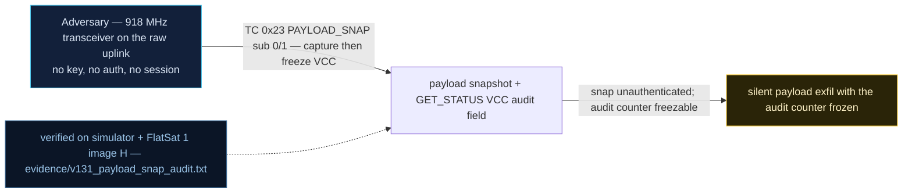

# V-31 — Unauthorized Payload Snap + Bypassable VCC Audit Counter

| Field | Value |
|---|---|
| ID | V-31 |
| Severity | Medium — anyone can capture sensor+state data while the payload is unarmed and freeze the only audit trail, making captures unattributable; no direct control-plane loss. |
| Category | Unauthorized data acquisition + audit-integrity bypass |
| Interface | TC `0x23` PAYLOAD_SNAP (sub 0 capture / 1 freeze / 2 drain), TC `0x22` covert queue; GET_STATUS `0x0C` VCC field (LE u16 @8) |
| SPARTA | DE-0003.01 · On-Board Values Obfuscation: Vehicle Command Counter (VCC) (primary); EXF-0003.02 Downlink Exfiltration (data capture) (SPARTA v3.2; no notional risk listed for this row) |
| PoC | `poc/v131_payload_snap_audit.py` — evidence `evidence/v131_payload_snap_audit.txt` (`POC OK`) |

## Summary

`PAYLOAD_SNAP` takes an instant "pseudo-image" — a 32-byte pack of live
sensor readings and vehicle state — with the payload explicitly **not
armed**, and stages it in the covert queue for later exfiltration over the
legitimate downlink. The one designed audit trail is the forward counter
(VCC / `payloadForwardCount`), which *is* incremented per capture… until the
attacker uses the same command family's debug sub-command to **freeze** it.
Subsequent captures then occur with a stuck counter: invisible to audit.

## Attack diagram



## Root cause

`extcmds.cpp` — the `0x23` handler performs the capture with no arming check
and no authentication, and accepts sub 1 (`VCC_FREEZE`, a debug bit that
defaults off) from the same raw-radio channel that performs the captures.
`covert.cpp` holds the capture counter (`s_vcc`) and staging FIFO beside the
drain hooks, so the audit counter lives entirely inside the attacker's
command perimeter. Hardware honesty: the "payload" is the virtual snap
model; sensors are the real BME280/LIS2DH12 on the RP2040 board where
present, otherwise modeled values.

## Attack mechanism

1. Read GET_STATUS (`0x0C`): payload[2] flag bit `0x20` shows the payload is
   unarmed; VCC = LE u16 at payload[8].
2. `TC 0x23 payload=00` — capture. The 35-byte clear TM answers
   `[scid, 0, frozen]` followed by the **IMG1 blob at payload[3:35]**:
   magic `IMG1` @0, timestamp u32 @4, temp i16@8 (×100), pressure @10,
   light @12, humidity @14, tilt @16, **bus_v u16 @18 (×100)**, battery @20,
   TM counter @21, VCC @23, eclipse @25, safe @26, tag `PWN` @27:30, power
   @30. The blob is also appended to the 1 KiB covert queue.
3. `TC 0x23 payload=0101` — freeze the VCC counter (sub 1, flag 1).
4. Five more captures: VCC stays put; the queue keeps growing.
5. `TC 0x23 payload=02` — drain up to 64 bytes of staged captures back over
   the covert channel.

## Exploitation walkthrough

1. Pre-check: payload NOT armed; capture anyway:

```
[   0.001] snap IMG magic=b'IMG1' temp=25.04C bus=24.00V flags eclipse=0 safe=0 tag=b'PWN'
```

2. Audit trail verified once (one increment per capture, 32 B staged):

```
[   0.002] audit trail: forward counter 0 -> 1, capture staged in covert queue (32 B)
```

3. Freeze, then five uncounted captures:

```
[   0.005] after freeze: 5 more captures, counter stuck at 1
```

4. Drain — staged captures leave through the covert channel (V-30 path):

```
[   0.005] drained 64 bytes from covert queue: b'IMG1\x88\x13'...
```

5. The PoC asserts `b"IMG1" in` the drained bytes: exfil confirmed while the
   audit counter never moved.

## Impact

- Full state snapshot (temperature, bus voltage, eclipse/safe flags,
  counters, build tag `PWN`) on demand, unarmed-payload, unauthenticated.
- 1 KiB covert queue = 32 staged captures per covert drain cycle — the
  course's audit-delta demonstration (N_cap producing +N/VCC ratios such as
  33.3 %) becomes trivially reproducible, then *hideable*: after a freeze
  the ratio goes to 0/N.
- Attribution collapse: the VCC is the only trace tying captures to
  radio activity, and it is writable by the same perimeter (foreshadowed by
  the V-14 write-what-where).

## Mitigations

- Refuse `PAYLOAD_SNAP` unless the payload is armed **and** the request came
  through an authenticated GS session.
- Make `VCC_FREEZE` an operator-only setting (USB/GS-gated, journal every
  toggle via the optional TC log, `DEFENSES_CONFIG` bit `0x40`); an audit
  counter the subject can pause is not an audit counter.
- Cross-check VCC against the queue-length field returned by `0x22`/`0x23`
  acks and alarm on divergence (CM0032 On-board Intrusion Detection &
  Prevention). Cost: one comparison per capture — negligible on RP2040.

## References

- `poc/v131_payload_snap_audit.py` / `evidence/v131_payload_snap_audit.txt`
- `RAPPORT-FIRMWARE-VULNERABLE-FLATSAT.md`, V-31 (§4.I — EXF, Ch.10.1)
- `docs/SPARTA_MAPPING.md` row V-31 (SPARTA v3.2)
- `simulator/flatsat_sim.py` — `_snap()` IMG1 layout, `covert_q`, `_tm_status()`
