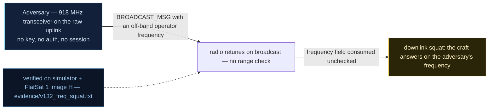

# V-32 — Downlink Frequency Squat via BROADCAST_MSG (Radio Squatting)

| Field | Value |
|---|---|
| ID | V-32 |
| Severity | Medium — one unauthenticated broadcast frame re-points the recorded downlink frequency and costs the operator the pass; fully blocked by the shipped FREQ_LOCK allow-list. |
| Category | Configuration manipulation / loss-of-contact (denial) |
| Interface | TC `0x06` BROADCAST_MSG (operator-frequency field, BE u16); GET_STATUS `0x0C` `last_freq` (LE u16 @10); defense TC `0x25` |
| SPARTA | DE-0003.06 · On-Board Values Obfuscation: Telemetry Downlink Modes (primary); IMP-0008 State or Mode Manipulation (v4.0); IMP Denial (lost contact) (SPARTA v3.2; no notional risk listed for this row) |
| PoC | `poc/v132_freq_squat.py` — evidence `evidence/v132_freq_squat.txt` (`POC OK`) |

## Summary

`BROADCAST_MSG` carries a two-byte operator-frequency field in front of the
echoed message, and the craft transmits the broadcast **on that frequency**
while latching it as the "last used" downlink frequency. There is no range
check and no authentication on the field (the report tags it CWE-284): any
raw-radio frame can re-point the downlink — a squatter hijacks the contact
frequency and the ground station loses the vehicle until someone re-tunes.
The only trace is the forward counter moving by one.

## Attack diagram



## Root cause

`worker.cpp` — the BROADCAST_MSG dispatch (shared with the V0-03 length
underflow) parses `freq = BE u16` from the TC payload and assigns
`last_freq = freq` unconditionally before echoing. `rdownlink.cpp` transmits
the echo on the requested frequency. The optional `DEF_FREQ_LOCK` bit
(`0x04`, defenses table in `anomaly.cpp`/`extcmds.cpp`) post-checks the
value against the {916} allow-list but ships **off** by default. Hardware
honesty: the frequency switch is real — the lab board has two SX1262 LoRa
transceivers; the "contact" here is the ground receiver's tuning, and a
wrong frequency is a genuinely lost pass.

## Attack mechanism

1. `TC 0x06 payload=04d2` + `SQUATTER-WAS-HERE` (hex
   `53515541545445522d5741532d48455245`) — BE u16 `0x04d2` = **1234 MHz**.
   Accepted; the craft echoes and records `last_freq = 1234`.
2. GET_STATUS (`0x0C`) shows `last_freq` LE u16 @10 moved 916 → 1234, and
   VCC (@8) incremented once — the whole audit trail.
3. Defense test: `TC 0x25 payload=0084` (`DEF_FREQ_LOCK 0x04 |
   DEF_ANOMALY_EN 0x80`); a squat to 435 MHz (`01b3…`) is refused with the
   `FREQ LOCK` error TM (APID 0x09) and `last_freq` does not move.
4. A whitelisted broadcast (`0394` = 916) is accepted again — the allow-list
   keeps legitimate use intact.

## Exploitation walkthrough

1. Nominal state read:

```
[   0.001] nominal downlink freq=916 MHz, forward count=0
```

2. Squat and verify (PoC asserts `last_freq == 1234`, VCC +1):

```
[   0.003] after squat: last_freq=1234 MHz -> operator must re-tune or lose the pass (no auth on the frequency field)
```

3. Enable FREQ_LOCK, replay the attack at 435 MHz — rejected (`FREQ LOCK`)
   and the field holds at 1234.
4. Whitelist sanity check:

```
[   0.006] allowed frequency (916) accepted: last_freq=916
```

## Impact

- **Per-pass denial:** a legitimate ground station tuned to the planned
  frequency receives nothing; recovering the contact requires re-tune or a
  reset, potentially losing the whole pass window.
- **Cheap and repeatable:** a single 4+ byte frame per squat; spamming the
  field between passes keeps the operator chasing.
- **Near-zero attribution:** only the VCC delta records the event, and the
  TC journal is off by default (V-23).
- Chaining: combined with V-35's flood, the craft is shouting on a frequency
  nobody is listening to.

## Mitigations

- Ship `FREQ_LOCK` **on** by default (the defense exists and demonstrably
  works; the vulnerability is its default-off state) with an 8-entry
  allow-list as designed in the report.
- Authenticate the operator-frequency field itself — a broadcast anyone can
  echo should not be allowed to move radio configuration (SPARTA CM0031
  Authentication).
- Log frequency changes into the optional TC journal (`DEFENSES_CONFIG` bit
  `0x40`) and alarm on off-list values via the anomaly detector (CM0032).
- CubeSat cost note: a u16 range check and one flag; zero hardware cost.
  The real cost is operational (a locked radio needs a procedure for
  legitimate frequency relocation).

## References

- `poc/v132_freq_squat.py` / `evidence/v132_freq_squat.txt`
- `RAPPORT-FIRMWARE-VULNERABLE-FLATSAT.md`, V-32 (§4.I — EXF, Ch.2.2,
  attaques 03; CWE-284)
- `docs/SPARTA_MAPPING.md` row V-32 (SPARTA v3.2)
- `simulator/flatsat_sim.py` — APID `0x06` handler, `DEF_FREQ_LOCK` branch
