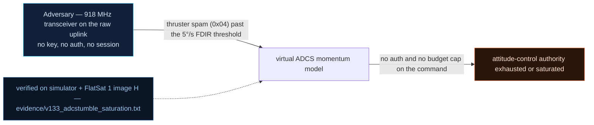

# V-33 — Virtual ADCS: Thruster Momentum Spam + Detumble Saturation (Measurable 5°/s Threshold)

| Field | Value |
|---|---|
| ID | V-33 |
| Severity | High — 30 valid (unauthenticated) thruster TCs trip a TUMBLE safe-mode, and the 0.25 deg/s² B-dot authority hands the attacker the recovery timeline. |
| Category | Physical mission impact / control-authority attack |
| Interface | TC `0x04` SET_THRUSTER over raw radio; FDIR_CONFIG `0x1D` sub 0 (status) / 9 (detumble) / 10 (lab time base) via USB |
| SPARTA | EX-0012.08 · Modify On-Board Values: Attitude Determination & Control Subsystem (primary, notional risk 19\|14\|9); EX-0013.01 Valid Commands (25\|24\|21); IMP Degradation (SPARTA v3.2) |
| PoC | `poc/v133_adcstumble_saturation.py` — evidence `evidence/v133_adcstumble_saturation.txt` (`POC OK`) |

## Summary

Every `SET_THRUSTER` telecommand is accepted from the raw radio and injects
an unmitigated impulse into the integrated attitude state — the "10 Hz
spam" pattern from the course. Thirty one-byte TCs add ~9 deg/s of tumble
and trip the 5°/s FDIR into safe-mode. The interesting part is recovery: the
simulated B-dot detumble torque saturates at **0.25 deg/s²** (exactly the
course's saturation mechanism), and passive damping is 25× weaker, so the
attacker controls how many minutes of mission time are lost simply by
choosing how much momentum to dump in.

## Attack diagram



## Root cause

`mission_model.cpp` integrates the attitude state (rates + Euler angles,
published as tilt via FDIR sub 0 and in the beacon) and adds
`rate += 0.3·pw/255` per thruster TC — no per-window momentum budget, no
command-rate limit (`worker.cpp` dispatch of `0x04`, shared with V0-04).
`fdir.cpp` trips `TUMBLE` safe-mode when tilt > `FDIR_TILT` (5.0 deg/s) is
sustained for more than 2000 ms. Detumble damping is capped
(`damp = min(0.6·rate, 0.25)`), i.e. a saturated torque budget. Hardware
honesty: ADCS/tumble are **virtual models** driven by operator-grade TCs on
the real RP2040 board; a real LIS2DH12 accelerometer measures physical board
movement for the tangible demo, but there are no magnetorquers or wheels.

## Attack mechanism

1. `TC 0x1D payload=0a0001` (sub 10, BE u16 = 1 → **0.1× lab time base**) so
   mission time advances slowly under `advance()` control.
2. Baseline: sub 0 status — safe flag at payload[2], tilt as LE u16 at
   payload[8] (×100): 0.00 deg/s.
3. Spam 30 × `TC 0x04 payload=00ff` (axis 0, full power) over the radio, one
   TC each — each adds +0.3 deg/s to the integrated rate.
4. Poll status every second: the >2000 ms over-threshold window trips safe.
5. Recovery runs: `0x1D payload=0900` (detumble OFF) measures passive
   damping; `0901` (detumble ON) measures the saturated B-dot rate.

## Exploitation walkthrough

1. Baseline check (`stable`): nominal tilt under the 5.00 deg/s threshold.

```
[   0.001] nominal tilt 0.00 deg/s, FDIR threshold 5.00 deg/s
```

2. After the 30-TC spam, tilt crosses the gate and FDIR latches safe:

```
[   0.010] after spam: tilt 0.00 -> 9.02 -> 9.03 deg/s, safe=1
```

3. Passive damping measured over 20 s of lab time:

```
[   0.011] passive damping: 9.02 -> 8.82 deg/s = 0.010 deg/s^2
```

4. Detumble measured over 10 s — pinned at the saturation cap, and >10× the
   passive rate (the PoC asserts both):

```
[   0.011] detumble B-dot: 8.57 -> 6.07 deg/s = 0.250 deg/s^2 (saturated torque budget)
```

5. PoC verdict: `30 cheap TCs = minutes of mission time lost to detumble`.

## Impact

- **Weaponized FDIR:** 30 two-byte TCs (≈ 60 B of uplink) trade for ~36 s
  of detumble per 9 deg/s at the measured 0.25 deg/s² — and >15 min on
  passive damping alone; spam more momentum, pay proportionally.
- **Attacker-owned timeline:** detumble is the only real recovery
  (10× passive), so the operator cannot shortcut it; the attack repeats
  after every recovery.
- **Detectable but inevitable:** the trip itself is visible to the attacker
  through the chatty beacon (V-02 safe flag), enabling closed-loop spam.
- Course mapping: SV-MA-2/3 momentum dumping, measured 5°/s threshold,
  re-based from the course's 3.9 s→5°/s real-torque experiment.

## Mitigations

- Require GS-mode authentication for `SET_THRUSTER` (removes the raw-radio
  impulse source entirely) and rate-limit it even when armed — a
  per-epoch Δv/momentum budget is a counter, not hardware (SPARTA CM0042
  Robust Fault Management: the fault system must not be usable against the
  craft).
- Ramp commands (pulse-counted thruster firings) instead of level-set power.
- Keep B-dot authority, but pair safe-mode entry with an attitude
  *prediction* so the operator sees the recovery ETA (mission-planning
  cost, no mass).
- CubeSat cost note: real magentorquers/wheels would raise recovery
  authority; the lab shows the *control* fix (auth + budget) is free.

## References

- `poc/v133_adcstumble_saturation.py` / `evidence/v133_adcstumble_saturation.txt`
- `RAPPORT-FIRMWARE-VULNERABLE-FLATSAT.md`, V-33 (§4.J — IMP, Ch.11.1)
- `docs/SPARTA_MAPPING.md` row V-33 (SPARTA v3.2)
- `simulator/flatsat_sim.py` — `_workers_tick()` rate integration, B-dot cap
  0.25, `FDIR_TILT = 5.0`, `_fdir_cfg` subs 0/9/10
