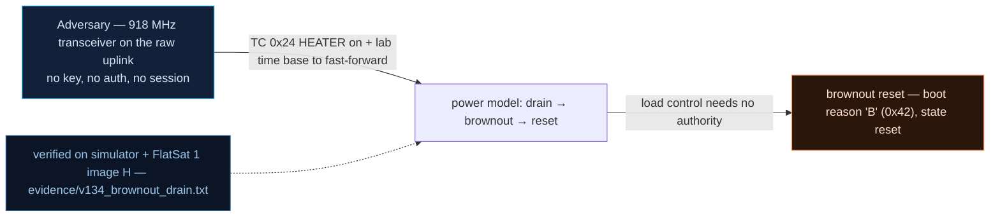

# V-34 — Heater/Eclipse Power Drain → Brownout Reset (Boot Reason 'B', 0x42)

| Field | Value |
|---|---|
| ID | V-34 |
| Severity | High — a heater-TC drain forces a full power reset that wipes ARC replay counters, crypto settings and the V-21 persistence cookie; a state-reset weapon chained into V-07/V-21. |
| Category | Power denial (impact) + security-state reset |
| Interface | TC `0x24` HEATER over raw radio; FDIR_CONFIG `0x1D` (status + lab time base); boot-reason marker on TM `0x02` |
| SPARTA | EX-0012.09 · Modify On-Board Values: Electrical Power Subsystem (primary, notional risk 19\|14\|9); IMP Degradation/Denial; state-reset chain into V-07/V-21 (SPARTA v3.2) |
| PoC | `poc/v134_brownout_drain.py` — evidence `evidence/v134_brownout_drain.txt` (`POC OK`) |

## Summary

Four virtual heaters (`HEATER`, one 2-byte TC each) draw 2.4 W apiece
against a 40 Wh battery that solar (3 W peak, 0 W in eclipse) cannot cover.
Run into eclipse, the 24 V rail sags through the FDIR under-voltage safe
threshold (22 V) and the battery empties; below 21 V the craft brownouts and
reboots with **boot reason 'B' (0x42)**. Because the volatile security state
(SDLS ARC, crypto on/off, the watchdog-scratch persistence cookie) lives in
SRAM, the brownout is simultaneously a denial event and an **attacker-
controlled factory-reset of security state**.

## Attack diagram



## Root cause

`mission_model.cpp` models the EPS (load, solar, eclipse cycle, SoC,
`bus_v = 21 + 3·pct/100`, brownout below 21 V) and `worker.cpp` handles the
reset with `brownout_reset()`, which rebuilds boot state and **wipes the
watchdog scratch registers** — taking the V-21 cookie and `F2_PERSIST` bit
with it. `HEATER` is dispatched from the raw radio with no authorization.
Hardware honesty: EPS/eclipse/battery/brownout are **virtual models** driven
by operator-grade TCs on the RP2040 board — there is no 24 V rail, no real
heaters, and no per-branch current sensing (the same I-meas gap as the
course EPS).

## Attack mechanism

1. Plant the V-21 cookie first: `0x1A` "PERS" + `0x18` MEMCPY of
   `SYM_LOG_NAME → ADDR_WDT_SCRATCH + 28, 4 B`, then `0x02` soft reboot —
   `PERSIST` is set and the crypto state the attacker configured survives.
2. Compress the orbit: `0x1D payload=0a1999` (sub 10, BE u16 = 6553 →
   **655.3× lab time base**) so eclipse and drain stress arrive in seconds.
3. Turn on all four heaters: `0x24 payload=0i01` (i = 0..3) — load jumps
   from 0.8 W idle toward 4×2.4 W + base.
4. Safe-mode clears loads, so the PoC **re-arms every heater each 2 s**
   (100 B/s of TC spam) to keep the battery discharging.
5. Watch FDIR sub 0 status: bus voltage (LE u16 @10, ×100), power (LE u16
   @12, ×100), safe flag (u8 @2) — until the `0x02` boot-reason frame with
   payload[3] = `0x42` ('B') appears.

## Exploitation walkthrough

1. Cookie planted and crypto OFF under it (pre-conditions assert).
2. Drain loop telemetry as the battery empties:

```
[   0.002] t+2 s: bus=23.70 V power=12.8 W safe=0
[   0.003] t+18 s: bus=21.46 V power=10.4 W safe=1
```

3. Under-voltage safe-mode (22 V) arrives first, then the rail collapses:

```
[   0.003] BROWNOUT RESET ('B' boot-reason ack) at +24 s
```

4. Post-reset state check — the security wipe:

```
[   0.004] post-reset: secure=True flags2=0x00 PERSIST=False boot_count=0
```

5. The PoC asserts `secure` reverted to boot default **ON** (attacker's
   crypto-off downgrade lost) **and** `not (flags2 & 0x20)` — the V-21
   watchdog cookie is gone:

```
[   0.004] => power drain is also a STATE-RESET weapon: it rewinds ARC replay counters and erases forensic boot markers
```

## Impact

- **Deterministic denial:** with permanent-stress orbit + 4 heaters, the
  40 Wh battery drains in minutes of compressed (or hours of real) time; the
  operator sees repeated boot-reason-'B' resets and lost passes.
- **State-reset weapon:** the brownout rewinds the SDLS anti-replay counter
  (V-07), clears GPS overrides and crypto state, and erases the V-21
  persistence cookie and boot counters — an attacker can replay pre-brownout
  captures afterward.
- **Invisible to fault management:** no branch current measurement means the
  drain looks like a battery anomaly, not an attack (the course's EPS gap).

## Mitigations

- Require authentication on `HEATER` (and on `FDIR_CONFIG` sub 10, which is
  what compresses the timeline here).
- Persist security state that must survive power loss (ARC, boot markers)
  to flash or a brownout-detect-protected write (RP2040 BOD capture) —
  SPARTA CM0044 Cyber-safe Mode: known-good authenticated state on reset.
- Add branch current sensing / load-aware anomaly detection so a 4-heater
  step correlates with recent TCs (CM0032).
- CubeSat cost note: real BOD + NVM writes cost flash wear; branch ADC
  channels cost mass and money — priced here as *design decisions*.

## References

- `poc/v134_brownout_drain.py` / `evidence/v134_brownout_drain.txt`
- `RAPPORT-FIRMWARE-VULNERABLE-FLATSAT.md`, V-34 (§4.J — IMP, Ch.11.2)
- `docs/SPARTA_MAPPING.md` row V-34 (SPARTA v3.2)
- `simulator/flatsat_sim.py` — `_workers_tick()` power model,
  `brownout_reset()`, boot-reason `0x42` frame, `_fdir_cfg` sub 10
