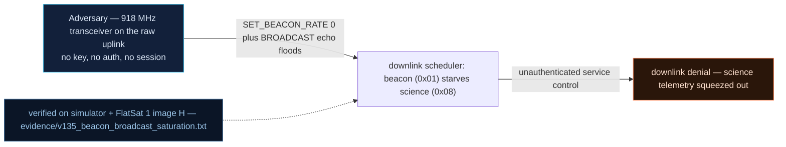

# V-35 — Beacon/Broadcast Downlink Saturation (Unauthenticated `service_control` Analogue)

| Field | Value |
|---|---|
| ID | V-35 |
| Severity | High — one unauthenticated TC drowns mission telemetry at a measured 200:1 beacon ratio (0.2 % of downlink bytes left for science), with an unrate-limited broadcast echo storm stacking on top. |
| Category | Downlink saturation / mission denial (resource exhaustion) |
| Interface | TC `0x05` SET_BEACON_RATE (0 = flood), TC `0x06` BROADCAST_MSG echo; TM `0x01` beacon vs TM `0x08` science |
| SPARTA | EX-0013.01 · Flooding: Valid Commands (primary, notional risk 25\|24\|21); DE-0002 Disrupt or Deceive Downlink; IMP Denial (SPARTA v3.2) |
| PoC | `poc/v135_beacon_broadcast_saturation.py` — evidence `evidence/v135_beacon_broadcast_saturation.txt` (`POC OK`) |

## Summary

`SET_BEACON_RATE(0)` — intended as a nominal cadence control — makes the
craft emit a 64-byte beacon on **every 100 ms mission tick**, and because
the beacon only starts ticking once the rate command *changed* it (the
baseline quirk), the flood is armed by a two-TC sequence. The operator's
science telemetry (TM `0x08`, 20 B every ~14 s) collapses to a rounding
error on the downlink, and each broadcast TC additionally echoes a full
62-byte message with no rate limiting. This is the FlatSat analogue of the
course's unauthenticated `service_control` DoS tier, and unlike V0-03/V-15
it is a *reversible* denial: the craft stays alive, just deafening.

## Attack diagram



## Root cause

`worker.cpp`: the `0x05` handler stores `interval = d[0]·1000` without a
lower bound (`0` is accepted verbatim) and sets the `beacon_changed` latch;
`rdownlink.cpp` then emits the 64-byte beacon every tick while
`interval == 0`. The broadcast handler echoes each accepted `0x06` payload
with no bandwidth arbitration against the periodic-TM queue. Hardware
honesty: the downlink is the real SX1262 LoRa link, but the "airtime"
saturation is counted over the simulator's mission-time scheduler — on the
board this is real channel occupancy at the configured SF/BW.

## Attack mechanism

1. `TC 0x05 payload=01` — arm/refresh the beacon latch (1 s cadence).
2. `TC 0x05 payload=00` — set rate 0 → **beacon every 100 ms tick**.
3. Advance 20 s of mission time and split the TM stream by APID.
4. Measured: beacons = 200, mission TM = 1 → ratio 200:1; mission byte
   share = 0.2 % (PoC asserts `share < 10`).
5. Amplifier: 20 × `TC 0x06 payload=0394` + `X·62` (70-byte frames on freq
   916) — all 20 echoes queued behind the flood, no rejections.

## Exploitation walkthrough

1. The two-TC arm sequence and the 20 s window (flood visible directly in
   the transcript as a wall of `TM apid=0x01 AES len=64` lines):

```
[   0.000] --> TC apid=0x05 via=usb AES  payload=01
[   0.000] --> TC apid=0x05 via=usb AES  payload=00
[   0.001] --> advance(20000 ms)
```

2. The quantified drowning:

```
[   0.226] 20 s window: beacons=200 mission-TM=1 ratio=200:1
[   0.226] mission TM byte share: 0.2% of the downlink
```

3. The echo storm on top of the flood:

```
[   0.264] +20 broadcast echoes (20 x 70 B) queued behind the flood
```

4. PoC assertions: `beacon every 100 ms tick`, `mission telemetry share <
   2 %`, and `echo storm accepted with no rate limiting` — all `POC OK`.

## Impact

- **Effective loss of TM:** at 0.2 % mission share a ground station must
  capture ~500 frames to recover one science packet; in pass terms the
  course's "432,000 bytes lost per pass" becomes *near-zero science TM for
  N passes* while the vehicle looks healthy on the beacon.
- **Cheap and unauthenticated:** the trigger is two 1-byte TCs; neither
  `SET_BEACON_RATE` nor `BROADCAST_MSG` requires GS mode (and GS mode is
  itself defeatable — V-36 GPS spoof, USB debug `GS_MODE 0`).
- **Three DoS tiers visible together:** V0-14 (this reversible flood),
  V-15 (uplink starvation), V0-03/V0-15 (crash without watchdog).

## Mitigations

- Clamp `SET_BEACON_RATE` to a minimum interval (reject 0 or reinterpret it
  as "default"); rate-change is a control action → require GS
  authentication (CM0002/CM0031 class).
- Bandwidth-arbitrate the TM queue: cap beacon frames per second and drop
  or coalesce broadcast echoes when the queue is saturated.
- Alarm on beacon-rate deviation on the ground side (the operator knows the
  nominal cadence — V-06 shows it is also the attacker's best sensor).
- CubeSat cost note: purely firmware-side; the only cost is an extra
  parameter check and queue-management logic.

## References

- `poc/v135_beacon_broadcast_saturation.py` /
  `evidence/v135_beacon_broadcast_saturation.txt`
- `RAPPORT-FIRMWARE-VULNERABLE-FLATSAT.md`, V-35 (§4.J — IMP, Ch.4.3)
- `docs/SPARTA_MAPPING.md` row V-35 (SPARTA v3.2)
- `simulator/flatsat_sim.py` — `SET_BEACON_RATE` branch, `_beacon()`,
  periodic TM scheduler in `_workers_tick()`
