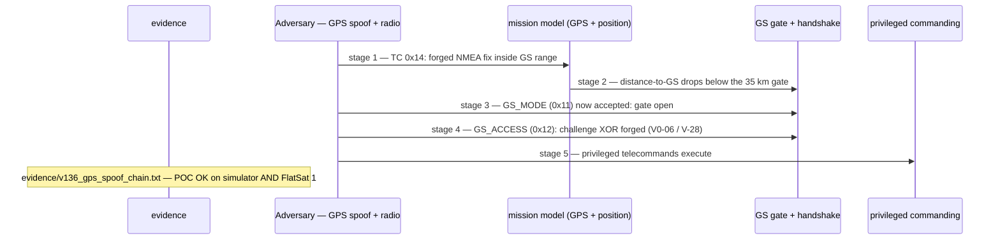

# V-36 — GPS Spoof → GS Gate Bypass Chain (Full Initial Access)

| Field | Value |
|---|---|
| ID | V-36 |
| Severity | High — complete unauthenticated initial-access chain: PNT spoof dissolves the range gate, the static XOR key completes the handshake, privileged TCs follow. |
| Category | Initial access chain (sensor spoof → auth bypass → control) |
| Interface | TC `0x14` GPS_OVERRIDE (NMEA analogue), `0x11` GS_MODE, `0x12` GS_ACCESS, `0x0D` SET_MISSION_MODE; GS_STATUS `0x13`; defense TC `0x25` (GPS_PLAUS) |
| SPARTA | EX-0014.04 · Spoofing: Position, Navigation, and Timing (PNT) Spoofing (primary); IA-0008.01 Rogue Ground Station; EX-0003 Modify Authentication Process; EX-0014.03 Sensor Data (SPARTA v3.2; no notional risk listed for this row) |
| PoC | `poc/v136_gps_spoof_chain.py` — evidence `evidence/v136_gps_spoof_chain.txt` (`POC OK`) |

## Summary

The GS (ground-station) gate — the craft's only "commands require a real
station" control — arms only when the vehicle computes itself within 35 km
of the station, and that position comes from a source with no checksum and
no source authentication (V0-05). The PoC walks the whole chain: spoof the
craft **9500 km away** to lock the gate out, spoof it **back** into the
footprint, hand-answer the static XOR challenge (`0xC0DEFACE`), and execute
privileged commands — all from an unauthenticated uplink. The optional
plausibility defense (reject hops > 500 km/s) is measured on the way: the
instantaneous 9500 km hop is refused, but the *same* hop spread over 60 s
(≈ 158 km/s) walks straight through.

## Attack diagram



## Root cause

Three design decisions compose: (1) the GPS/NMEA path accepts overrides
with no integrity check (`sensors.cpp` parsing, `extcmds.cpp:130` `hGpsOverride` — the `0x14` handler; `_ext` is the simulator twin)
handler); (2) `worker.cpp` gates `GS_MODE` arming and session validity on
`_gs_within(nav)` — the *same* spoofable position (`GS_RADIUS_M = 35000`);
(3) `GS_ACCESS` answers with `challenge XOR GS_XOR_KEY`,
offline-computable (V0-06). Hardware honesty: on the bench the fix arrives
via `GPS_OVERRIDE` (virtual PNT model), while the physical lab spoofs the
real u-blox on L1/UART — parsing verifies nothing on either path.

## Attack mechanism

1. `TC 0x14 payload=<le32 lat_e7, le32 lon_e7, le32 alt, u8 sats>` =
   `00564415 a0004353 801a0600 09` → Tokyo (35.68°, 139.69°), 9 sats.
   Ack TM `0x0E` echoes the fix — adopted, no checksum demanded.
2. `TC 0x11 payload=01` (arm GS mode) → error TM: **`GS RANGE LOCK`** — the
   arming itself is range-gated, so out-of-footprint keeps the gate closed.
3. Defense probe: `TC 0x25 payload=0090` (`DEF_GPS_PLAUS 0x10 |
   DEF_ANOMALY_EN 0x80`); an instant Tokyo→Arizona hop (≈ 9500 km) is
   **rejected** (`gps["reject"] += 1`).
4. `advance(60000)` then the *same* hop: 9500 km in 60 s ≈ **158 km/s < 500
   km/s** → accepted; GS_STATUS `0x13` distance (u16 LE: `u8(4)<<8 | u8(3)`; the PoC prints it byte-swapped — harmless only because the value is 0/0xFFFF) reads 0
   m — inside the 35 km gate.
5. Arm GS mode (works now); plain `0x0C` poll → `GS AUTH REQUIRED`; `0x12
   payload=00` yields the challenge (LE u32 at payload[5]); reply `0x12
   payload=01` + BE u32 `challenge ^ 0xC0DEFACE`; finally `0x0D payload=02`
   = privileged SET_MISSION_MODE(PAYLOAD).

## Exploitation walkthrough

1. Spoofed fix adopted, and the gate refuses to arm while out of range:

```
[   0.000] spoofed fix: Tokyo (lat_e7=356800000) accepted without any checksum or source authentication
[   0.001] GS_MODE(ON) -> 'GS RANGE LOCK': the arming itself is range-gated
```

2. The 500 km/s plausibility gate stops only the instant hop; the 60 s
   spread defeats it and brings the craft back into footprint:

```
[   0.002] with plausibility gate: reject counter=1 (position held in Tokyo)
[   0.023] 9500 km in 60 s accepted -> vehicle back inside the footprint (GS range field now 0 m)
```

3. Gate closed to strangers, then opened by the XOR handshake:

```
[   0.026] GS AUTH REQUIRED on a plain GET_STATUS -> session needed
[   0.028] chain complete: NMEA spoof -> range dissolved -> XOR auth -> PAYLOAD mode armed, all from an unauthenticated uplink
```

4. PoC asserts every link: `GS RANGE LOCK`, `reject >= 1`, acceptance of the
   158 km/s hop, `GS AUTH REQUIRED`, handshake result `1`, mode `2` — `POC OK`.

## Impact

- **The security model's keystone is sensor data:** one unauthenticated TC
  family (or an RF spoofer at the GPS antenna) turns the GS "physical
  presence" control into attacker-chosen truth; privileged commanding follows.
- **Defense measured, not assumed:** the enabled `GPS_PLAUS` gate refused
  the instantaneous 9500 km hop but accepted the same hop staged over 60 s
  at 158.3 km/s; its 500 km/s threshold is ~65× above LEO ground-track
  plausibility (~7.6 km/s), so even switched on it is loose.
- **Chaining multiplier:** with V-28 (predictable challenge) the handshake
  becomes passive; with V-35 the attacker floods the downlink authenticated.

## Mitigations

- Tighten the plausibility threshold to a physically sane bound and
  cross-check fixes against the propagator's predicted pass (the ESTCube
  ICP approach from the course, Ch.7) — pure CPU cost on the RP2040; RF
  anti-spoof (multi-antenna/null-steering) is the expensive trade-off.
- Treat fix-vs-TLE disagreement as an anomaly feed for the detector
  (CM0032 / DE-0003.12) rather than trusting either source alone.
- Replace XOR auth with a CMAC challenge-response and fresh nonce
  (CM0031/CM0033 class; also fixes V-28).

## References

- `poc/v136_gps_spoof_chain.py` / `evidence/v136_gps_spoof_chain.txt`
- `RAPPORT-FIRMWARE-VULNERABLE-FLATSAT.md`, V-36 (§4.J — IMP / IA-0008, Ch.7, attaques 04/05)
- `docs/SPARTA_MAPPING.md` row V-36 (SPARTA v3.2)
- `simulator/flatsat_sim.py` — `_ext` `0x14` plausibility check (`> 500`),
  `GS_RADIUS_M`, `GS_XOR_KEY`, `_gs_gate_open`
