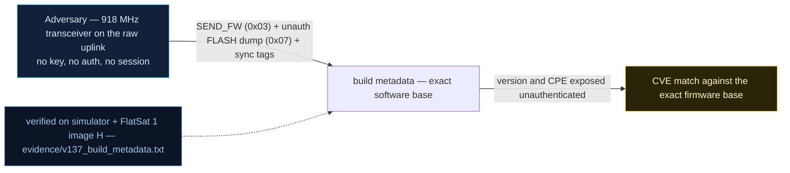

# V-37 — Build Metadata Leaks the Exact Software Base

| Field | Value |
|---|---|
| ID | V-37 |
| Severity | Medium — individually a low-impact leak, but it pins this exact open-source fork and version with zero effort, turning the public bug catalogue into the attacker's engagement plan. |
| Category | Supply chain / software inventory reconnaissance |
| Interface | TC `0x03` SEND_FW (version TM), TC `0x07` unauthenticated FLASH dump; periodic TM `0x01` sync tag and `0x3FF` idle banner |
| SPARTA | REC-0001.01 · Gather Spacecraft Design Information: Software Design (.02 Firmware) (primary); EXF-0003.02 Signal Interception: Downlink Exfiltration; REC-0002.01 Identifiers (SPARTA v3.2; no notional risk listed for this row) |
| PoC | `poc/v137_build_metadata.py` — evidence `evidence/v137_build_metadata.txt` (`POC OK`) |

## Summary

Three ambient leaks identify the flight software exactly: `SEND_FW` returns
the version triple over the raw radio; `FLASH` (APID `0x07`) dumps the whole
256-byte application image — unauthenticated — with its embedded build
strings intact; and the craft periodically broadcasts fork-signature frames
(`"HackTheWorld!"` on APID `0x3FF`, a `"Pwnsat"` sync tag inside beacons).
The embedded banner even carries a typo (`Whte Rabit`) that acts as a
fingerprint pinning *this* fork — not merely the upstream base. The
attacker greps the repository, matches it to the public vulnerability
catalogue (this report), and skips discovery entirely.

## Attack diagram



## Root cause

`worker.cpp`: the `0x03` handler answers with the version bytes in the clear
response path; the `0x07` dump streams 16 × 24 B frames of `IMAGE_DATA`
(16-byte chunks with a crc8 each) with no gate; the periodic workers emit
the idle banner every 30 s and the sync tag every 20 s. The strings are
compile-time artifacts of the fork ("2020 Follo The Whte Rabit",
`GPST`/`NMEA` parser tags); the report additionally lists the USB product
string `Pwnsat - Flatsat` (stock Raspberry Pi Pico USB enumeration) and the boot banner as the
same class of leak (Ch.6.1). Hardware honesty: all strings sit in the real
QSPI NOR image on the RP2040; the dump path, not the storage, is the flaw.

## Attack mechanism

1. `TC 0x03 payload=-` → TM `[scid, v_low, v_mid, v_high, 0]`; the PoC
   prints `version TM: 1.0.0`.
2. `TC 0x07 payload=-` → 16 continuation frames; for each data frame the
   PoC concatenates `payload[7:23]` (7-byte header + 16 data bytes + crc8):
   **256 image bytes** recovered.
3. Grep the image for candidate fingerprints: `b"2020 Follo"`,
   `b"Whte Rabit"`, `b"GPST"`, `b"NMEA"` — the "Follow the Whte Rabit"
   banner (with its telltale misspelling) is present.
4. `advance(31000)`: harvest the periodic artifacts — idle TM
   `b'HackTheWorld!'` (APID `0x3FF`) and the `b'Pwnsat'` sync tag inside
   the beacon APID.
5. Map base + fork + version → pull the matching CVE/vulnerability list.

## Exploitation walkthrough

1. Version over the raw radio, then the full dump:

```
[   0.001] version TM: 1.0.0 (SEND_FW)
[   0.013] image bytes dumped: 256
```

2. Fork-pinning strings recovered from the image:

```
[   0.013] embedded build strings recovered: [b'2020 Follo', b'Whte Rabit']
```

   (The PoC notes the `Rabit` typo is a build fingerprint identifying this
   exact fork.)
3. Periodic identity broadcasts, no command required:

```
[   0.015] periodic artifacts: idle TM [b'HackTheWorld!'], sync tag [b'Pwnsat']
```

4. PoC assertions: `full image dumped unauthenticated` (`len >= 240`) and
   both strings present — `POC OK`.

## Impact

- **Discovery collapsed to a lookup:** software base, fork, and version are
  public per downlink; per the report, the attacker then "pulls the matching
  bug catalogue (this report)".
- **Constellation-scale cost asymmetry:** 256 B + two banners per craft
  versus a full reverse-engineering engagement on the defender's side.
- **Amplifies everything else:** V0-01 (SEND_FW CPE match), V-01 (inventory)
  and V-38 (rollback) all become targeted rather than exploratory — the
  attacker knows which fixed CVEs to expect *and* which to try to restore.

## Mitigations

- Gate `FLASH` dump and version detail behind GS mode; return an opaque,
  **hashed** build-id to unauthenticated pollers.
- Make builds reproducible and sign a minimal manifest — the report's
  SUIT-lean design: 48-byte magic + version + counter + signature, with the
  signature check off by default but available — exposed via `SEND_FW` as
  an `HW/SW ID` field (this also underpins the V-38 rollback defense; SPARTA
  CM0010 Update Software, CM0021 signature verification).
- Strip fork banners from flight images (`HackTheWorld!`, `Pwnsat`, the
  rabbit string) — a linker/`#ifdef` hygiene task, zero runtime cost; SPARTA
  CM0013 covers this build/deployment-environment hygiene.
- CubeSat cost note: the manifest costs ~48 B of flash and one CMAC verify
  (~tens of µs on RP2040 with the AES engine); banner stripping is free.

## References

- `poc/v137_build_metadata.py` / `evidence/v137_build_metadata.txt`
- `RAPPORT-FIRMWARE-VULNERABLE-FLATSAT.md`, V-37 (§4.K — CM/Supply, Ch.6.1)
- `docs/SPARTA_MAPPING.md` row V-37 (SPARTA v3.2)
- `simulator/flatsat_sim.py` — APID `0x03`/`0x07` handlers, `IMAGE_DATA`
  (rabbit banner inside the hex image), idle/sync TM schedule
