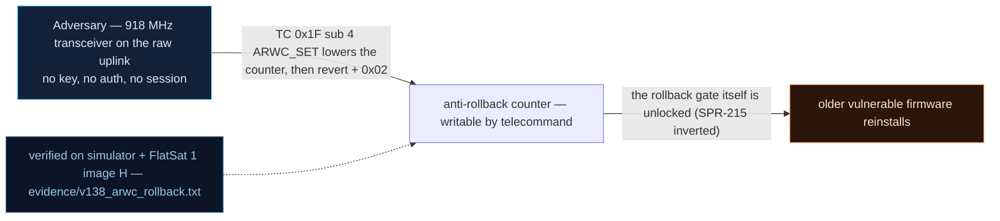

# V-38 — Anti-Rollback Counter Writable by TC (SPR-215 Inverted)

| Field | Value |
|---|---|
| ID | V-38 |
| Severity | High — patch level is unenforceable: one TC zeroes the ARWC even with enforcement ON, and one reboot brings back every fixed CVE. |
| Category | Supply chain / patch-management integrity (rollback protection bypass) |
| Interface | TC `0x1F` OTA (sub 3 status / 4 ARWC_SET / 5 revert / 0 image push / 1 finalize / 2 confirm), TC `0x02` RESETC |
| SPARTA | EX-0009.03 · Exploit Code Flaws: Known Vulnerability (COTS/FOSS) (primary, notional risk 24\|21\|17); CM0010 Update Software (countermeasure defeated); IMP-0007 Native Functionality Abuse (v4.0) (SPARTA v3.2) |
| PoC | `poc/v138_arwc_rollback.py` — evidence `evidence/v138_arwc_rollback.txt` (`POC OK`) |

## Summary

The dual-slot OTA machinery ships an anti-rollback counter (ARWC) intended
to stop the vehicle from re-running older, vulnerable firmware — the SPR-215
property inverted (here the *protection itself* is the flawed design). The
counter lives in flash, but `ARWC_SET` rewrites it **without any
authorization, even while enforcement is enabled**. The attacker zeros the
counter, reverts to the old slot (or pushes an old image through the same
CRC-only pipeline, V-18), reboots, confirms — and the pre-patch CVE catalogue
is live again.

## Attack diagram



## Root cause

`flashstore.cpp` — the OTA metadata sector (slots, pending/confirmed state,
ARWC) is rewritten straight from TC data; the code comment is explicit
("writable without any authorisation — the monotonic anchor is…"), and the
enforce flag only gates *image acceptance*, never the counter write itself.
`extcmds.cpp` `0x1F` dispatch: sub 4 (`ARWC_SET`) stores the big-endian u32
from the payload with no comparison to the previous value (no monotonic
floor) and no GS-session check; sub 1 (finalize) computes FNV hash and only
compares a signature if `sig_required` (default 0) — no version floor.
Hardware honesty: the flash here is the real 4 MB QSPI NOR on the RP2040;
the lab models slot semantics in that storage.

## Attack mechanism

1. Status read `0x1F payload=03` → TM `[scid,3,active,pending,try,booted]` +
   **ARWC as BE u32 @6:10** + enforce @10 + sig_required @11. Fresh state:
   `ARWC=7 enforce=0 sig_req=0 active_slot=0`.
2. Turn enforcement on: `0x1F payload=0701` (sub 7).
3. Zero the counter from the radio: `0x1F payload=04 00000000` — accepted;
   status now `ARWC=0 (enforce bit=1)`.
4. Revert slot: sub 5 (`payload=05`) → active slot back to A.
5. Push an old image: sub 0 frame `00` + offset BE u32 0 + len `0x12` +
   crc16 `5d4c` + body `OLD-VULNERABLE-IMG`; finalize sub 1 accepted — no
   version floor exists.
6. `RESETC (0x02)` reboots into the pending slot B; confirm sub 2 makes it
   permanent.

## Exploitation walkthrough

1. Baseline and enforcement, then the counter write over the radio:

```
[   0.001] ARWC=7 enforce=0 sig_req=0 active_slot=0
```

2. The bypass — the counter moves *while* enforcement is on:

```
[   0.002] after attacker write: ARWC=0 (enforce bit=1)
```

3. Revert + old-image push + reboot; the stale image boots with the counter
   still on the floor:

```
[   0.005] booted_slot=1 pending=1 -> old image runs, ARWC still 0
```

4. `0x1F payload=02` (confirm) → `active_slot=1`: the old, vulnerable slot is
   ACTIVE permanently. PoC verdict:

```
[   0.007] => patch level is unenforceable: every fixed CVE comes back with one TC + one reboot
```

## Impact

- **One TC + one reboot per downgrade:** the entire remediation history of
  the fleet can be unwound from an unauthenticated radio position that
  reaches the OTA APID (or trivially from USB debug, V0-12).
- **Countermeasure defeat, not just vulnerability:** SPARTA CM0010 (Update
  Software) is nominally implemented yet provides no security value while
  the anchor is writable; combined with V-18 (CRC-16-only images) there is
  no second line of defense by default (`sig_required=0`).
- **Fleet-scale regression:** every fixed CVE in the report becomes
  re-exposable, and the operator may not even notice — the boot banners
  (V-37) of old images are identical to the attacker's.

## Mitigations

- Make the counter **monotonic**: when `enforce=1`, reject writes of
  `new < old` (a two-instruction fix), and require GS session for any
  `ARWC_SET` regardless.
- Anchor the floor in hardware: one OTP/eFuse anchor per sector (the
  report's "hard version", erasable once) — every OTA burns an anchor step.
- Enable image signatures by default (`sig_required=1`) with the signed
  manifest of V-37 so finalize enforces a version floor cryptographically,
  not just by counter (CM0010 + CM0021).
- CubeSat cost note: the monotonic check is free; the real cost is operational — every OTA burns a budgeted anchor step.

## References

- `poc/v138_arwc_rollback.py` / `evidence/v138_arwc_rollback.txt`
- `RAPPORT-FIRMWARE-VULNERABLE-FLATSAT.md`, V-38 (§4.K — CM/Supply, Ch.6.3)
- `docs/SPARTA_MAPPING.md` row V-38 (SPARTA v3.2)
- `firmware/flashstore.cpp`, `firmware/extcmds.cpp` (ARWC handlers);
  `simulator/flatsat_sim.py` — `_ota_cmd` subs 0–7, `crc16_ccitt`
