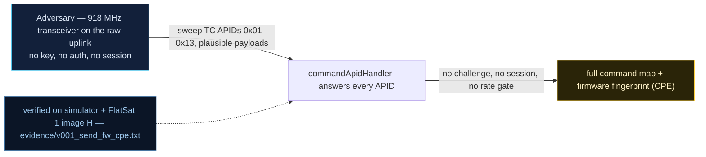

# V0-01 — Unauthenticated APID enumeration (CPE fingerprint)

| Field | Value |
|---|---|
| ID | V0-01 |
| Severity | Medium — no direct control or payload leak, but it hands an attacker the complete command map and error vocabulary before any authentication exists |
| Category | Missing authentication (unprotected reconnaissance surface) |
| Interface | Radio uplink — SPP TC APIDs 0x01–0x13; error telemetry on APID 0x09 |
| SPARTA | REC-0001.01 · Gather Spacecraft Design Information: Software Design; secondary REC-0002.01 Identifiers, REC-0001.02 Firmware (v3.2, notional risk 6\|4\|2 quoted against REC-0002) |
| PoC | `poc/v001_send_fw_cpe.py` — evidence `evidence/v001_send_fw_cpe.txt` (`POC OK`) |

## Summary
An attacker with a cheap 918 MHz transceiver sweeps every telecommand APID on the
raw uplink. The flight software answers each probe — with an ACK, a dump, or a named
error string — with zero challenge, session, or rate gate. The response *shape* is a
device fingerprint (CPE-style) that identifies the firmware and steers every follow-on
attack.

## Attack diagram



## Root cause
Baseline defect kept verbatim from upstream firmware v1.0.3: `commandApidHandler`
dispatches TC APIDs with no guard — the catalog counts 18 commanding APIDs that answer
without authentication. The SPP primary header is parsed unconditionally
(`spp_unpack_packet`, mirrored in `simulator/flatsat_sim.py` `spp_unpack`), and the
dispatcher emits APID 0x09 error frames whose strings (`FLASH WINDOW LOCKED`,
`DEBUG USB ONLY`, `Error Unknown APID`) disclose which handler exists and what gate it
applies.

## Attack mechanism
Each probe is a minimal SPP frame: 6-byte big-endian primary header
`[ident|seqc|length]` where `ident = (type<<12)|(sec_hdr<<11)|APID`, `seqc = (flags<<14)|seq`,
`length = payload_len-1`. The PoC sends one frame per APID in 0x01..0x13 with a
plausible payload (e.g. `0000` for 0x04, `039274657374` for 0x06 BROADCAST).
Outcomes observed: direct ACK TMs (0x01, 0x03, 0x06, 0x0A–0x0F, 0x11–0x13), a 16-frame
flash dump burst from 0x07, silent execution for fire-and-forget TCs 0x04/0x05, and
named-error TMs from 0x08/0x09/0x0B/0x10. 17 of 19 probed APIDs answered with no auth
state whatsoever — a full command map in ~20 ms of uplink.

## Exploitation walkthrough
1. Sweep loop: for `apid` in 0x01..0x13, send `dev.tc(apid, payload, via="radio")`
   (payload table in the PoC; secure-link wrap uses the key from V0-02, but *no
   authentication state* is required or presented).
2. Record which APIDs produced TMs and which error strings came back:

```
probe 0x0B -> TMs ['0x09'] errors=['FLASH WINDOW LOCKED']
probe 0x10 -> TMs ['0x09'] errors=['DEBUG USB ONLY']
probe 0x13 -> TMs ['0x13'] errors=[]
responding APIDs (17): ['0x1', '0x2', '0x3', '0x6', '0x7', '0x8', '0x9', '0xa', '0xb', '0xc', '0xd', '0xe', '0xf', '0x10', '0x11', '0x12', '0x13']
```

3. The PoC asserts `len(responding) >= 12`; the sweep returns 17, i.e. the entire
   baseline TC surface (including the GS auth family 0x11–0x13) is enumerable before
   any gate triggers.
4. The named errors map each APID to a firmware subsystem (flash window, debug
   config, ground-station mode), which is exactly the "software/firmware design
   information" the SPARTA REC techniques describe.

## Impact
Zero-risk, zero-credential reconnaissance that fits inside any 5–15 min LEO pass
(the whole sweep is sub-second). It converts blind uplink noise into a targeted
command list: the attacker knows 0x06 crashes on a 1-byte payload (V0-03), 0x0A
toggles crypto (V0-10), and 0x11–0x13 guard privileged control (V0-06) before the
satcraft has ever seen them.

## Mitigations
- Default-deny APID policy at the dispatcher: answer unknown/unauthorized APIDs with a
  single generic error, never named strings (cheap; costs debuggability for operators).
- Require SPARTA CM0031-style Authentication (challenge or SDLS MAC) before *any*
  command, including queries — the honest cost is that reconnaissance-by-telemetry then
  also needs the key, and lost-bit robustness must be re-tested on the LoRa link.
- Rate-limit and log TC APID variety per pass; a 17-APID sweep in 20 ms is anomalous
  vs. an operator's few commands per pass (needs a small per-pass histogram, trivial in
  SRAM).

## References
- PoC + evidence: `poc/v001_send_fw_cpe.py`, `evidence/v001_send_fw_cpe.txt`
- `docs/SPARTA_MAPPING.md` — baseline table row V0-01
- `../RAPPORT-FIRMWARE-VULNERABLE-FLATSAT.md` §2 baseline v1.0.3 catalog, row V0-01
  (`commandApidHandler`, course attack chapter 00); wire formats: `simulator/flatsat_sim.py`
