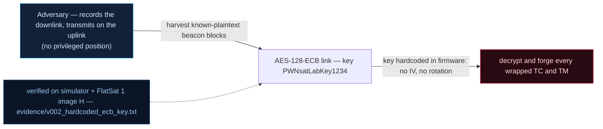

# V0-02 — Hardcoded AES-128-ECB link key `PWNsatLabKey1234`

| Field | Value |
|---|---|
| ID | V0-02 |
| Severity | Critical — the whole link security model reduces to one ASCII string readable in the firmware image; anyone with the image reads all telemetry and writes valid commands |
| Category | Crypto misuse (hardcoded static key, no IV, no rotation) |
| Interface | Radio uplink + downlink — the AES-128 "secure link" wrapping TC and TM |
| SPARTA | REC-0001.03 · Gather Spacecraft Design Information: Cryptographic Algorithms; secondary PER-0004 Replace Cryptographic Keys (v3.2, no notional-risk triple published for these IDs) |
| PoC | `poc/v002_hardcoded_ecb_key.py` — evidence `evidence/v002_hardcoded_ecb_key.txt` (`POC OK`) |

## Summary
The baseline secure link encrypts both directions with AES-128-ECB under the static key
`"PWNsatLabKey1234"`. Because the firmware image is obtainable (it is open-source
upstream, and SWD/USB dumping is available on the bench), every "encrypted" frame is
public to anyone holding the image — the attacker speaks the link natively.

## Attack diagram



## Root cause
Baseline defect kept from v1.0.3: `secure_link.cpp` stores the 16-byte key in the image
(`.text`/rodata, no secure element on the RP2040), uses ECB with no IV and no rotation,
and applies the same key to telemetry and telecommand. The simulator exposes the exact
constant (`LINK_KEY = b"PWNsatLabKey1234"`), and the wrap format is
`BE16(plain_len) || plain || zero-pad-to-16`, then raw ECB (function
`aes_ecb_encrypt_wrap` / `sl_decode`).

## Attack mechanism
1. Recover the key from the firmware image (strings).
2. Decrypt any intercepted TM: strip the 6-byte SPP header (always in clear, see
   V0-11), ECB-decrypt 16-byte blocks, read the BE16 length prefix.
3. Forge TCs: ECB-encrypt a valid wrap and send it as a normal command — the
   spacecraft has no other credential, so ciphertext *is* identity.

## Exploitation walkthrough
1. The PoC prints the recovered key and requests wrapped status telemetry:
   `dev.tc(0x0C, b"", via="radio")` → `TM apid=0x0C AES len=27`.
2. Decrypting it with the image key yields the full GET_STATUS layout — evidence:

```
key recovered from firmware image: b'PWNsatLabKey1234'
decrypted GET_STATUS payload: 01011f1f120a0a0800009403050000000000050101ea0700000100
attacker holding the firmware image speaks the link natively
```

   Byte 0 is `0x01` (spacecraft id), byte 1 `0x01` mode NOMINAL, bytes 5–6 thruster
   powers `0a 0a`, bytes 10–11 little-endian downlink freq `0x0394` = 916 MHz.
3. The PoC then encrypts a TC (APID 0x03 SEND_FW) with the same key; the craft accepts
   it (`TM apid=0x03 AES len=5`), proving bidirectional native speech.

## Impact
Confidentiality and authenticity of the entire radio link collapse at once: mission
telemetry, mode changes, and commanding are all available to any pass-window eavesdropper
for the whole mission lifetime, with no revocation path (static key, no OTAR in the
baseline). Every downstream auth story in this firmware inherits this key.

## Mitigations
- Inject a per-craft key at launch (not in the image) and rotate via an authenticated
  OTAR step (SPARTA PER-0004 is exactly the abuse this enables). Cost: a trusted key
  loading procedure on the bench, no BOM change.
- Move from ECB to a mode with IV/counter per frame (the v2 firmware already offers a
  CTR path, `DEF_TM_CTR`); RP2040 has no AES accelerator, so budget a few ms per block
  of software AES — acceptable at these data rates.
- Honest limit: without a secure element the key still lives in RAM; the goal is to
  raise the bar from "read the source" to "probe a running board".

## References
- PoC + evidence: `poc/v002_hardcoded_ecb_key.py`, `evidence/v002_hardcoded_ecb_key.txt`
- `docs/SPARTA_MAPPING.md` — baseline table row V0-02
- `../RAPPORT-FIRMWARE-VULNERABLE-FLATSAT.md` §2 baseline v1.0.3 catalog, row V0-02
  (`secure_link.cpp`, course attack chapter 01); wire formats: `simulator/flatsat_sim.py`
