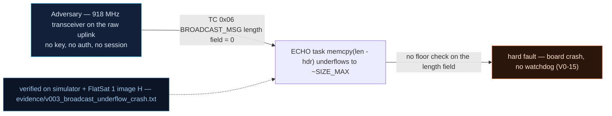

# V0-03 — BROADCAST_MSG integer underflow → memcpy(SIZE_MAX) crash

| Field | Value |
|---|---|
| ID | V0-03 |
| Severity | High — a single uplinked byte kills the C&DH worker; chained with V0-15 (no watchdog) it is permanent mission loss on orbit |
| Category | Memory safety (unsigned integer underflow → unbounded copy) / Availability |
| Interface | Radio uplink — TC APID 0x06 BROADCAST_MSG |
| SPARTA | EX-0009.01 · Exploit Code Flaws: Flight Software; secondary IMP-0003 · Denial (v4.0 equivalent: IMP-0013 Resource Exhaustion or Contention) (v3.2, notional risk 24\|21\|17) |
| PoC | `poc/v003_broadcast_underflow_crash.py` — evidence `evidence/v003_broadcast_underflow_crash.txt` (`POC OK`) |

## Summary
`BROADCAST_MSG` computes the message length as `payload_total - 2` in unsigned
arithmetic. A 1-byte payload underflows the length to `SIZE_MAX`, the following
`memcpy` walks off memory and HardFaults the worker. With no application watchdog
(V0-15), the craft goes permanently silent until someone power-cycles the board.

## Attack diagram



## Root cause
Baseline defect kept from v1.0.3 at `worker.cpp:1791-1798` (`msg_len = payload_total -
2`). The 2 bytes subtracted are the downlink-frequency field the handler reads first;
the code never validates `payload_total >= 2`. The simulator mirrors this exactly: with
a short payload the length goes negative and `state = "CRASHED"` models the SIZE_MAX
`memcpy` HardFault (`flatsat_sim.py`, `_dispatch`, APID 0x06 branch).

## Attack mechanism
The attacker sends APID 0x06 with any payload shorter than 2 bytes — the PoC uses the
single byte `0x07`. The handler derives the frequency from the short field
(`freq = d[0] << 8`), then `msg_len = 1 - 2` underflows. No ACK for APID 0x06 is ever
emitted, and the craft stops responding on every APID, because the worker thread — the
whole command loop — is dead. The LoRa uplink has CRC disabled upstream, so even the
"typo" variant of this frame is a realistic accidental arrival.

## Exploitation walkthrough
1. Poison the broadcast: `dev.tc(0x06, b"\x07", via="radio")` (APID 0x06, payload `07`).
   Response frames: `[]` — no ACK at all.
2. Confirm device death and persistence, then recover only by power cycle:

```
--> TC apid=0x06 via=radio AES  payload=07
response frames: []
--> TC apid=0x01 via=radio AES  payload=-
--> advance(60000 ms)
--> TC apid=0x01 via=radio AES  payload=-
--> POWER CYCLE (scratch + SRAM die, flash survives)
--> TC apid=0x01 via=radio AES  payload=-
<-- TM apid=0x01 AES len=5
```

3. The PoC asserts: no 0x06 ACK, `sim.state == "CRASHED"`, PING silent immediately and
   again after 60 s, and PING ACK (`01 41 43 4b 00`) only returns after
   `dev.powercycle()`.

## Impact
On orbit there is no hand at the USB-C plug: a crash without a watchdog (V0-15) means
the *entire remaining mission* — every future 5–15 min pass, every experiment — dies to
one uplinked byte, reachable by any passer-by with a matched LoRa modem (sync word
0x12 is the private-standard default). Even in the lab it costs a manual intervention.

## Mitigations
- Validate `payload_total >= 2` (and an upper bound) before the subtraction — a
  two-line fix with zero performance cost; add a fuzz-on-boot self-check harness.
- Arm the RP2040 hardware watchdog and treat this handler as the regression test
  (see V0-15); WDT bites cost one reboot, not the mission.
- Optional: uplink sanity gate — reject frames shorter than the minimum legal TC after
  the SPP length field disagrees with the received byte count (small parsing cost per TC).

## References
- PoC + evidence: `poc/v003_broadcast_underflow_crash.py`, `evidence/v003_broadcast_underflow_crash.txt`
- `docs/SPARTA_MAPPING.md` — baseline table row V0-03
- `../RAPPORT-FIRMWARE-VULNERABLE-FLATSAT.md` §2 baseline v1.0.3 catalog, row V0-03
  (`worker.cpp:1791-1798`, course attack chapter 02); wire formats: `simulator/flatsat_sim.py`
