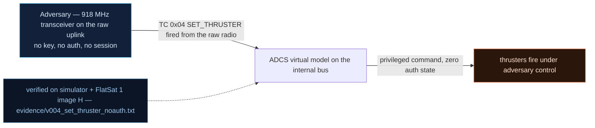

# V0-04 — SET_THRUSTER accepted from the raw radio, no authentication

| Field | Value |
|---|---|
| ID | V0-04 |
| Severity | High — unauthenticated actuation: one TC wastes propellant/power and can pump attitude error toward the FDIR tumble threshold |
| Category | Missing authentication (privileged command) |
| Interface | Radio uplink — TC APID 0x04 (thrusters are the virtual ADCS model on the internal bus; FlatSat has no real ADCS hardware) |
| SPARTA | EX-0005.02 · Exploit Hardware/Firmware Corruption: Malicious Use of Hardware Commands; secondary EX-0012.07 Propulsion Subsystem, IMP-0007 Native Functionality Abuse (v4.0) (v3.2, no notional-risk triple published for these IDs) |
| PoC | `poc/v004_set_thruster_noauth.py` — evidence `evidence/v004_set_thruster_noauth.txt` (`POC OK`) |

## Summary
`SET_THRUSTER` (APID 0x04) executes straight from the raw radio with no GS session, no
range gate, no credential — even though the firmware has a ground-station gating family
(APIDs 0x11–0x13) for other command flows. Any attacker on the uplink can command
thruster power, converting radio range into physical authority over attitude.

## Attack diagram



## Root cause
Baseline defect kept from v1.0.3: the dispatcher case for APID 0x04 (catalog row:
"APID 0x04") assigns `t_thr[id] = power` and injects the corresponding angular momentum
into the mission model without consulting the GS gate or a session. In the simulator
mirror (`flatsat_sim.py`, `_dispatch`, APID 0x04) the payload is `[id, power]` with
`id ∈ {0,1}`; the only other gate is `id <= 1`. The GS gate (`_gs_allowed`) only bites
when `gs_mode` has been turned on, which is not the boot default.

## Attack mechanism
The attacker uplinks `SET_THRUSTER` with payload `01 c8` = thruster 1 at power 200.
The dispatch path stores the power (bytes 5–6 of the GET_STATUS TM) and applies
`rate[id] += 0.3 * power / 255` to the (virtual) rate model. Repeated/one-sided firings
ramp the tilt estimate; the baseline FDIR trips safe mode above tilt 5.0, so an
unauthenticated stream of "valid" firings is also an attitude-denial primitive.
No acknowledgment requirement, no state precondition: the command fires while the
mission mode is whatever it happens to be.

## Exploitation walkthrough
1. Fire thruster 1 from the raw radio: `dev.tc(0x04, bytes([1, 200]), via="radio")`
   (payload hex `01c8`).
2. Read the truth back over USB with GET_STATUS (`dev.tc(0x0C, b"", via="usb")`),
   whose payload carries thruster powers at bytes 5–6 (defaults `0x0a`/`0x0a`):

```
--> TC apid=0x04 via=radio AES  payload=01c8
--> TC apid=0x0C via=usb AES  payload=-
<-- TM apid=0x0C AES len=27
GET_STATUS: thruster powers t0=10 t1=200
```

3. The PoC asserts `s.u8(6) == 200`: the unauthenticated radio TC took actuator
   effect — thruster 1 at 200 vs. baseline 10.

## Impact
Propellant/power are the finite mission currencies: each commanded firing consumes
model load (+1.2 W per active thruster in the mission model) and perturbs attitude,
burning the FDIR's patience. During an experiment-heavy sequence, an attacker firing
once per pass quietly degrades pointing and battery margin; spamming drives a TUMBLE
safe-mode (cf. v2 finding V-33) within a single 5–15 min pass.

## Mitigations
- Put propulsion-class TCs behind the GS session gate (CM0031 Authentication — session
  required, not just the shared V0-02 key); cost: commands stall when the GS gate's GPS
  dependency misbehaves, so design an operator override.
- Rate-limit and duty-cycle thruster TCs per pass, with a per-pass energy budget the
  FDIR enforces (cheap counters).
- Require an armed-state precondition (mode ∈ {2,3}) for firing, so NOMINAL cruises are
  not actuator-attackable; honest trade-off: constrains legitimate calibration passes.

## References
- PoC + evidence: `poc/v004_set_thruster_noauth.py`, `evidence/v004_set_thruster_noauth.txt`
- `docs/SPARTA_MAPPING.md` — baseline table row V0-04
- `../RAPPORT-FIRMWARE-VULNERABLE-FLATSAT.md` §2 baseline v1.0.3 catalog, row V0-04
  (APID 0x04, course attack chapter 03); wire formats: `simulator/flatsat_sim.py`
  (hardware honesty: ADCS/thrusters are virtual models driven by operator-grade TCs)
