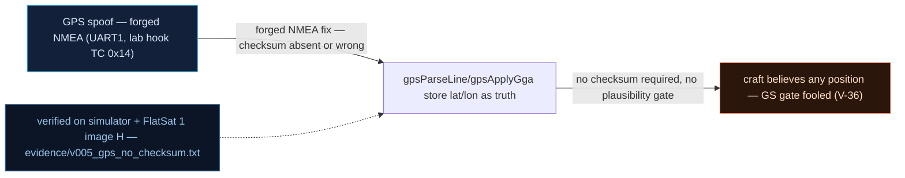

# V0-05 — GPS position accepted with no checksum and no plausibility gate

| Field | Value |
|---|---|
| ID | V0-05 |
| Severity | High — position is the trust anchor for the GS access gate, so a forged fix chains directly into privileged control (cf. V-36 full chain) |
| Category | Missing input validation (unauthenticated sensor data trusted as truth) |
| Interface | GPS UART (NMEA sentences on UART1); lab injection hook via TC APID 0x14 (GPS_OVERRIDE) |
| SPARTA | EX-0014.04 · Spoofing: Position, Navigation, and Timing (PNT) Spoofing; secondary EX-0014.03 Sensor Data (v3.2, no notional-risk triple published for these IDs) |
| PoC | `poc/v005_gps_no_checksum.py` — evidence `evidence/v005_gps_no_checksum.txt` (`POC OK`) |

## Summary
The GPS chain trusts whatever position the receiver reports: no NMEA checksum
verification, no position-jump plausibility. An attacker who drives the UART (physical)
or the L1 signal (SDR spoofer — already demonstrated upstream in
`04_gps_spoofing_rf.py`) dictates the craft's believed location, and with it the
geographic gate used for ground-station authentication.

## Attack diagram



## Root cause
Baseline defect kept from v1.0.3 in `sensors.cpp`: parsed NMEA fields are stored as the
navigation truth without validating the `*CK` checksum against the sentence body, and
without comparing fix rate against a max-velocity envelope. The v2 lab model injects
exactly what a UART/RF spoof delivers, via APID 0x14 whose payload is
`<iiiB(lat_e7, lon_e7, alt_cm, sats)>` little-endian (13 bytes); the default state has
no plausibility defense armed (`def_flags` ships only `DEF_ANOMALY_EN`).

## Attack mechanism
1. Baseline fix sits near the station: lat 36.1, lon −115.2 (Las Vegas area).
2. The attacker forges a fix: Tokyo (35.68, 139.69) with an absurd satellite count of 3
   and no checksum — payload `00564415 a0004353 801a0600 03` (`356800000`,
   `1396900000`, `400000`, `3`).
3. The craft accepts a trans-oceanic instantaneous jump (thousands of km), echoes an
   0x0E confirmation, and GET_NAV thereafter reports the forged numbers verbatim.

## Exploitation walkthrough
1. Read the true baseline: `dev.tc(0x0E, b"", via="usb")` →
   `before: lat_e7=361000000 lon_e7=3142967296` (the longitude is −115.2e7 rendered
   unsigned).
2. Inject the forged sentence: `dev.tc(0x14, struct.pack("<iiiB", 356800000,
   1396900000, 400000, 3), via="radio")`; the PoC asserts the device raises **no error**
   at all.
3. Re-read nav — evidence transcript:

```
before: lat_e7=361000000 lon_e7=3142967296
--> TC apid=0x14 via=radio AES  payload=00564415a0004353801a060003
<-- TM apid=0x0E clear len=18
after forged sentence: lat_e7=356800000 sats=3
```

4. The PoC asserts `nav.le32(3) == 356800000`: the forged latitude is trusted verbatim,
   and a nonsense satellite count (3 in Tokyo for a Las Vegas receiver) goes unremarked.

## Impact
Believed position gates GS authentication (`GS RANGE LOCK` / `_gs_within`): spoof the
fix and the attacker dissolves or redirects the geographic gate at will (the v2 chain
finding V-36 does exactly this to reach privileged control). Even unchained, every
nav-dependent service — beacon nav TM, eclipse/ops assumptions, per-pass scheduling —
silently runs on attacker-supplied geography for the rest of the 5–15 min pass and
beyond (the override is held for 300 s in the lab model).

## Mitigations
- Verify the NMEA `*CK` XOR checksum in `sensors.cpp` before accepting a sentence
  (≈10 lines, no cost).
- Add a velocity/plausibility envelope (reject jumps beyond LEO max rate between fixes);
  the v2 `DEF_GPS_PLAUS` flag shows the design — cost: legitimate rapid maneuvers or
  receiver warm-resets need a tolerance window.
- Cross-check GNSS against independent attitude/sun sensors where the BOM allows; honest
  CubeSat limit: at L1 with a small antenna, sophisticated spoofer detection is out of
  reach — the goal is to make naive forgery loud, not impossible.

## References
- PoC + evidence: `poc/v005_gps_no_checksum.py`, `evidence/v005_gps_no_checksum.txt`
- `docs/SPARTA_MAPPING.md` — baseline table row V0-05
- `../RAPPORT-FIRMWARE-VULNERABLE-FLATSAT.md` §2 baseline v1.0.3 catalog, row V0-05
  (`sensors.cpp`, course attack chapter 04); wire formats: `simulator/flatsat_sim.py`
