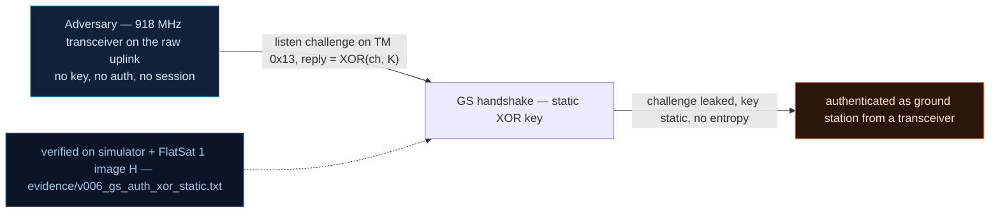

# V0-06 — GS authentication: challenge XOR static key (and the challenge leaks)

| Field | Value |
|---|---|
| ID | V0-06 |
| Severity | High — a passive eavesdropper completes the "handshake" offline and obtains the privileged GS session; only a weak crypto scheme stands between the raw radio and commanding-gating |
| Category | Weak authentication scheme (crypto misuse: static XOR key, predictable challenge, challenge leaked in telemetry) |
| Interface | Radio — TC APIDs 0x11 (GS_MODE) / 0x12 (GS_ACCESS); TM APIDs 0x12 (GS_ACCESS) / 0x13 (GS_STATUS) |
| SPARTA | EX-0003 · Modify Authentication Process (weak scheme); secondary IA-0008.01 Rogue Ground Station, DE-0004 Masquerading (v3.2, no notional-risk triple published for these IDs) |
| PoC | `poc/v006_gs_auth_xor_static.py` — evidence `evidence/v006_gs_auth_xor_static.txt` (`POC OK`) |

## Summary
Ground-station mode gating (the baseline's only "authentication") asks the claimant for
`response = challenge ^ 0xC0DEFACE`. The XOR key is a static compile-time constant, the
challenge is generated from `millis()`-and-GPS without a TRNG, and — fatally — the
challenge is transmitted **in the clear inside the very telemetry that answers the
request**. Anyone listening can compute the response and walk in.

## Attack diagram



## Root cause
Baseline defect kept from v1.0.3 (`worker.cpp`): `response = challenge ^ 0xC0DEFACE`
with a static key; the challenge seed is
`((now_ms<<1) ^ 0xA55A33CC) ^ lat_e7 ^ (lon_e7<<7) ^ (utc<<24) ^ (sats<<16)` —
all public or observable, no hardware entropy (the RP2040 ROSC is unqualified and
unused here). `_tm_gs_access` then appends the live challenge (`<I` at TM offset 5) and
`_tm_gs_status` publishes it too, so the eavesdropper doesn't even need to predict it.

## Attack mechanism
1. Turn GS mode on (TC 0x11 payload `01`) — needs a GPS fix inside the 35 km station
   radius (the attacker can arrange that per V0-05).
2. Phase 0: TC 0x12 payload `00` requests a challenge. TM 0x12 layout:
   `[SC, phase, auth_state, gs_status, gps_status] || <I challenge || <H session_s ||
   <H challenge_s]` — the challenge appears at bytes 5–8, leaked: `0x1F26789C`.
3. Phase 1: compute `0x1F26789C ^ 0xC0DEFACE = 0xDFF88252`, uplink TC 0x12 payload
   `01` + BE32 `dff88252`. The craft sets `auth_state=0x01` and opens a 300 s session.

## Exploitation walkthrough
1. `dev.tc(0x11, b"\x01", via="radio")` → GS mode TM 0x11 (AES wrapped len 9).
2. `dev.tc(0x12, b"\x00", via="radio")` → TM 0x12 (len 13); PoC reads `acc.le32(5)`.
3. `dev.tc(0x12, b"\x01" + struct.pack(">I", chal ^ 0xC0DEFACE), via="radio")`:

```
challenge LEAKED in telemetry: 0x1F26789C
--> TC apid=0x12 via=radio AES  payload=01dff88252
<-- TM apid=0x12 AES len=13
phase1 auth_state=1 (0x01=session established)
```

4. The PoC asserts `auth_state == 0x01` and `sim._gs_session_active()` — the eavesdropper
   with the XOR key from the firmware image now holds a privileged session.

## Impact
The GS gate is the boundary between "can talk" and "can command the sensitive family"
(GS_MODE off, config toggles). With a one-listen-one-compute replay, a rogue station
masquerades as the legitimate ground segment for the 300 s session — and since the
challenge is *seeded* from public values, an offline-computing attacker needs no listen
at all (the v2 finding V-128 exploits exactly this to hijack sessions).

## Mitigations
- Replace the XOR scheme with a real keyed MAC over fresh nonce (AES-CMAC is already
  implemented in the link core; ~2 extra blocks of software AES per handshake —
  negligible against a 5–15 min pass).
- Never echo the challenge in the claimant-facing TM (remove it from 0x12/0x13 or send
  only after authentication); feed the RP2040 ROSC/TRNG-equivalent into challenge
  generation (CM0031 Authentication in SPARTA terms).
- Bind the session to something harder to replay than a computed word (e.g. per-session
  key confirmation); honest cost: handshake traffic grows, LoRa airtime is scarce.

## References
- PoC + evidence: `poc/v006_gs_auth_xor_static.py`, `evidence/v006_gs_auth_xor_static.txt`
- `docs/SPARTA_MAPPING.md` — baseline table row V0-06
- `../RAPPORT-FIRMWARE-VULNERABLE-FLATSAT.md` §2 baseline v1.0.3 catalog, row V0-06
  (`worker.cpp`, course attack chapter 05); wire formats: `simulator/flatsat_sim.py`
