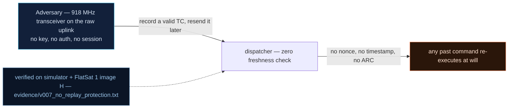

# V0-07 — No anti-replay protection on telecommands

| Field | Value |
|---|---|
| ID | V0-07 |
| Severity | High — a captured frame re-executes byte-for-byte forever; with the V0-02 key public, replay is the cheapest way to re-fire privileged-looking actions (25\|24\|21 notional risk confirms) |
| Category | Missing replay protection (freshness) |
| Interface | Radio uplink — all SPP TC APIDs |
| SPARTA | EX-0001.01 · Replay: Command Packets; secondary EXF-0001 Replay (observational) (v3.2, notional risk 25\|24\|21) |
| PoC | `poc/v007_no_replay_protection.py` — evidence `evidence/v007_no_replay_protection.txt` (`POC OK`) |

## Summary
The received SPP sequence number is logged and never compared. An attacker who records
one uplink frame — even one that was encrypted — can resend it verbatim later and the
command executes again, at any time, indefinitely. Mission state can be rewound,
modes re-forced, actuators re-fired without knowing any key.

## Attack diagram



## Root cause
Baseline defect kept from v1.0.3 (`commandHandlerInternal`, `spp.cpp`): the
`sequence_count` field of the received SPP primary header is stored but never validated
against a window; there is no per-SA anti-replay counter (ARC), no timestamp, no nonce.
The "secured" secondary header in the baseline is an unverified counter echo, and the
primary header — including the sequence field — is always in the clear, so a replay
doesn't even require the crypto.

## Attack mechanism
1. Capture any uplink frame off the air (the sync word is the known default 0x12).
2. Resend it unchanged. The PoC builds one representative frame directly with
   `fs.spp_pack(0x0D, aes_ecb_encrypt_wrap(LINK_KEY, b"\x02"), 42)`:
   header bytes `10 0d 40 2a 00 0f` (type=1, APID 0x0D, flags=1, **seq=42**, length=16)
   followed by the 16-byte ECB-wrapped payload `0x02` (SET_MISSION_MODE → PAYLOAD).
3. Both the original and the replay carry seq 42; both execute — no comparison happens
   anywhere in the receive path.

## Exploitation walkthrough
1. Transmit the frame once via `dev._xfer(raw, "radio")` →
   `Tm(apid=0x0D len=4 0102013f)` (SC 0x01, mode 0x02 PAYLOAD, payload_armed 0x01,
   flags 0x3f).
2. Transmit the *same bytes* again:

```
<-- TM apid=0x0D AES len=4
<-- TM apid=0x0D AES len=4
first  use -> [Tm(apid=0x0D len=4 0102013f)]
replay use -> [Tm(apid=0x0D len=4 0102013f)]
```

3. The PoC asserts both executions ACK and that `sim.mode == 0x02`: the mission mode is
   PAYLOAD, re-forced by a frame replayed with an *unchanged sequence number*.

## Impact
Replay turns every recorded operational moment into an attacker weapon: a captured
mode change can be re-fired mid-experiment, a thruster firing replayed while the
operator believes the sequence is over. It also destroys attribution/audit — the craft
cannot distinguish "operator fired it" from "someone replayed it" — and the recorded
frames never expire, so the window is the entire mission, not one 5–15 min pass.

## Mitigations
- Enforce a monotonically-increasing sequence window per link state (SDLS-style ARC
  with a small replay window — the v2 firmware adds exactly this; note the v2
  implementation's own weaknesses: 16-bit volatile counter, window 5, see V-07).
- Include a fresh nonce/timestamp inside the encrypted payload so replays fail even
  against the cleartext header path; cost on LoRa: a few bytes per TC, plus
  time-sync/error handling for stale operator clocks.
- Persist the high-water sequence across reboots so a RESETC (V0-08) cannot rewind the
  window and re-open replay.

## References
- PoC + evidence: `poc/v007_no_replay_protection.py`, `evidence/v007_no_replay_protection.txt`
- `docs/SPARTA_MAPPING.md` — baseline table row V0-07
- `../RAPPORT-FIRMWARE-VULNERABLE-FLATSAT.md` §2 baseline v1.0.3 catalog, row V0-07
  (`commandHandlerInternal`, `spp.cpp`, course attack chapter 06); wire formats:
  `simulator/flatsat_sim.py` (`spp_pack`, `sl_decode`)
