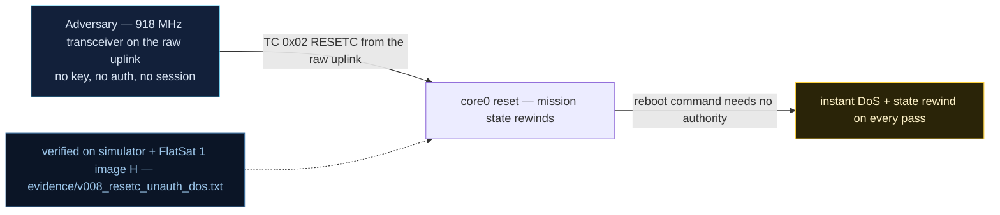

# V0-08 — RESETC unauthenticated → one-TC reboot DoS, mission state rewound

| Field | Value |
|---|---|
| ID | V0-08 |
| Severity | Medium — each hit costs boot time and rewound mission state, and an attacker can replay one frame to deny an entire 5–15 min pass; recovery is automatic, unlike V0-03 |
| Category | Missing authentication / Availability |
| Interface | Radio uplink — TC APID 0x02 RESETC |
| SPARTA | EX-0005.02 · Malicious Use of Hardware Commands; secondary DE-0002 Disrupt or Deceive Downlink (.01 Inhibit Ground System Functionality) (v3.2, no notional-risk triple published for these IDs) |
| PoC | `poc/v008_resetc_unauth_dos.py` — evidence `evidence/v008_resetc_unauth_dos.txt` (`POC OK`) |

## Summary
`RESETC` reboots the craft with no authentication: one frame on the raw radio and the
C&DH restarts. The beacon quietly carries a boot counter (offset 20 — see V-02), but no
alarm or ground procedure consumes it, so a DoS
campaign — or a replayed reset dropped in the middle of a critical uplink sequence —
leaves no visible trace beyond a confused sequence flow.

## Attack diagram



## Root cause
Baseline defect kept from v1.0.3: APID 0x02 dispatches to `watchdog_reboot()` with no
session/credential check (the only gate in the design, GS mode, is off by default).
The simulator mirror (`flatsat_sim.py`, `_tm_resetc`) shows the semantics precisely:
ACK `[SC, boot_count+1, cookie_bit, 0x52]` then `_soft_reboot()` — SRAM dies, watchdog
scratch and flash survive; the soft boot counter lives only in scratch and resets to
zero on power cycle, and no TM publishes it, so replays cannot be noticed.

## Attack mechanism
1. Send APID 0x02 over the raw radio — the PoC deliberately does **not** present any
   session credential: the frame is still AES link-wrapped (`encrypt=True` — the *link*
   key is public knowledge, V-02), but RESETC sits outside the *authenticated* path; a
   validly wrapped RESETC likewise needs no session — its only precondition is that it
   decrypts.
2. The craft reboots within milliseconds and answers the PoC's next liveness PING one
   second later (the model ACKs the reset and soft-reboots inline), but mission mode
   rewinds to 0x01 NOMINAL: any PAYLOAD-armed state, pending
   sequence position, and RAM-resident configuration are gone.
3. Repeat at will (or replay one captured frame all pass): each cycle costs boot time,
   missed uplink slots, and a rewound sequence-flow — enough to jam a pass.

## Exploitation walkthrough
1. Three consecutive raw-radio resets, each followed by a liveness PING one second
   later (the real transcript, `evidence/v008_resetc_unauth_dos.txt`):

```
--> TC apid=0x02 via=radio AES  payload=-
<-- TM apid=0x02 clear len=4
--> advance(1000 ms)
--> TC apid=0x01 via=radio AES  payload=-
<-- TM apid=0x01 AES len=5
reset #1 issued from raw radio; craft back: True (boot count was 0)
```

2. The PoC tolerates the ACK/error racing the reset (`ack may race the reset`), and
   asserts the craft is alive again after each cycle.
3. Final GET_STATUS over USB confirms the state rewind — evidence:
   `mode after resets: 0x01 (NOMINAL again, state lost)` (`s.u8(1) == 0x01`).

## Impact
Denial-per-frame: during a 5–15 min pass the attacker only needs to land one 0x02 every
boot cycle to keep the craft in a reboot loop — no downlink, no commanding, experiment
timeline lost for the pass. Because mode rewinds to NOMINAL, an experiment the operator
armed pre-pass silently loses its PAYLOAD state mid-orbit. The boot counter only
appears as a quiet beacon byte (offset 20) that no procedure consumes, so the
operator's practical clue is a suspiciously reset sequence-flow counter.

## Mitigations
- Gate RESETC behind the GS session (CM0031 Authentication) or require a
  confirm-after-reboot handshake before accepting back-to-back resets (cheap: reject a
  second RESETC within N seconds of boot, tracked in watchdog scratch).
- Alarm on the boot-counter rate — the beacon already publishes it (offset 20, V-02),
  nothing consumes it; mirror it into GET_STATUS too so resets are observable on the
  operator's primary tile. A GET_STATUS addition is a TM layout change, so version it.
- Persist a "reason + counter" stamp in flash for post-factum audit; cost: a flash write
  per reset, keep it rate-limited to avoid wear.

## References
- PoC + evidence: `poc/v008_resetc_unauth_dos.py`, `evidence/v008_resetc_unauth_dos.txt`
- `docs/SPARTA_MAPPING.md` — baseline table row V0-08
- `../RAPPORT-FIRMWARE-VULNERABLE-FLATSAT.md` §2 baseline v1.0.3 catalog, row V0-08
  (APID 0x02, `watchdog_reboot`, course attack chapter 07); wire formats:
  `simulator/flatsat_sim.py` (`_tm_resetc`, `_soft_reboot`)
