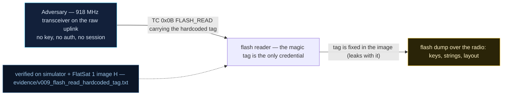

# V0-09 — FLASH_READ guarded only by a hardcoded magic tag

| Field | Value |
|---|---|
| ID | V0-09 |
| Severity | Medium — leaks the entire secret ops blob over the downlink to anyone holding the firmware image; confidentiality loss, no control loss |
| Category | Hardcoded credential / missing authentication (information disclosure) |
| Interface | TC APID 0x0B FLASH_READ; TM APID 0x0B (radio or USB) |
| SPARTA | REC-0001.02 · Gather Spacecraft Design Information: Firmware; secondary EXF-0003.02 Signal Interception: Downlink Exfiltration (v3.2, no notional-risk triple published for these IDs) |
| PoC | `poc/v009_flash_read_hardcoded_tag.py` — evidence `evidence/v009_flash_read_hardcoded_tag.txt` (`POC OK`) |

## Summary
The flash "window" holding operational secrets is unlocked by a two-value magic pair —
`window_id = 0xA5`, `unlock = 0xC35A` — compiled into the image. Anyone who can read
the firmware can read the secret blob off the downlink: ops configuration, maintenance
notes, and the lab flag, chunk by chunk.

## Attack diagram



## Root cause
Baseline defect kept from v1.0.3 (`worker.cpp:123-131`): the FLASH_READ handler compares
the request's window byte against the constant `0xA5` and a big-endian unlock tag
against `0xC35A`, then serves flash window bytes. There is no session, no challenge, no
per-craft secret — the "lock" is obfuscation whose key sits in `.text`, dumpable over
SWD/USB on the bench or readable in the open-source fork.

## Attack mechanism
TC 0x0B payload layout (little-endian struct + BE tag):
`[window_id u8][offset u16 LE][length u8][unlock u16 BE]` — e.g. `a5 0000 20 c35a`
(read 32 bytes at offset 0). TM 0x0B replies `[SC][off u8][off_hi u8][len] || blob ||
crc8`. The gates are exactly the two constants: a wrong window id (`a4...`) or wrong
tag (`...1234`) returns `FLASH WINDOW LOCKED`; the correct pair serves data. Looping
offset 0,32,64,96 drains the 126-byte blob in four round-trips.

## Exploitation walkthrough
1. Negative probes — `payload=a4000020c35a` (wrong id) and `a50000201234` (wrong tag)
   both yield error TM 0x09 `FLASH WINDOW LOCKED`.
2. Unlock with the constants from the image and walk the window:
   `a5000020c35a`, `a5200020c35a`, `a5400020c35a`, `a5600020c35a` (each → `TM apid=0x0B
   AES len=37`, the last 35).
3. Reassemble `payload[4:-1]` of each reply — evidence transcript:

```
dumped blob (126 B):
b'OPS:STORE_FORWARD=ENABLED\r\nOPS:PAYLOAD_WINDOW=0420Z\r\nMAINT:FLASH_WINDOW=A5:C35A\r'
b'\nFLAG=PWNSAT{flash_window_store_and_forward}\r\n'
```

4. The PoC asserts the secret `FLAG=PWNSAT{flash_window_store_and_forward}` appears —
   exfiltrated with nothing but the image's own constants.

## Impact
Everything stored "safely" in the flash window ships to any listener with a transceiver
and the source: here the flag, realistically per-craft keys, window plans, calibration
secrets. It is also a persistence-recon amplifier — an implant that writes to the same
window is later read back through the same free door. Cost to the attacker: four TC/TM
round-trips, well inside one pass.

## Mitigations
- Gate FLASH_READ behind the GS session (CM0031 Authentication) rather than a magic
  constant; cost: legitimate bench dumps then need the session too (keep a USB-side
  production-only path, physically gated, cf. V0-12).
- If a tag must remain for compatibility, store it per-craft in a non-image region and
  burn-once it (RP2040 has no OTP-lite cost concern at 4 flashes; honest limit: the
  RP2040 flash is readable over SWD anyway — this is deterrence, not protection).
- Encrypt the window contents under an injected key (ties into V0-02 remediation) so a
  raw dump yields ciphertext.

## References
- PoC + evidence: `poc/v009_flash_read_hardcoded_tag.py`, `evidence/v009_flash_read_hardcoded_tag.txt`
- `docs/SPARTA_MAPPING.md` — baseline table row V0-09
- `../RAPPORT-FIRMWARE-VULNERABLE-FLATSAT.md` §2 baseline v1.0.3 catalog, row V0-09
  (`worker.cpp:123-131`, `FLAG=PWNSAT{...}` blob; no course chapter — internal catalogue);
  wire formats: `simulator/flatsat_sim.py` (`FLASH_WINDOW_BLOB`, APID 0x0B branch)
