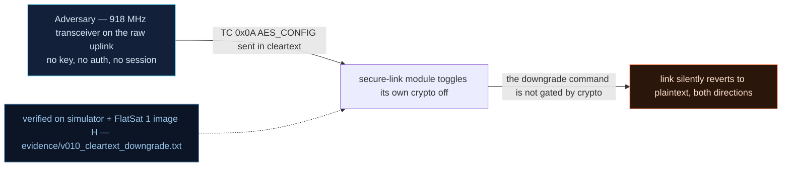

# V0-10 — Crypto downgrade: the AES_CONFIG toggle is accepted in cleartext

| Field | Value |
|---|---|
| ID | V0-10 |
| Severity | High — one uplinked byte turns the secure link OFF for every subsequent command and telemetry frame; encryption exists only until someone says `00` (24\|21\|17) |
| Category | Crypto bypass / downgrade (authentication bypass) |
| Interface | Radio uplink — TC APID 0x0A AES_CONFIG; affects both link directions |
| SPARTA | EX-0006 · Disable/Bypass Encryption; secondary DE-0003.07 On-Board Values Obfuscation: Cryptographic Modes (18\|15\|11) (v3.2, notional risk 24\|21\|17) |
| PoC | `poc/v010_cleartext_downgrade.py` — evidence `evidence/v010_cleartext_downgrade.txt` (`POC OK`) |

## Summary
`AES_CONFIG` toggles the whole secure link — and the toggle command itself is parsed in
**cleartext** even while the link is encrypted, because the code only attempts
decryption when the payload length is a multiple of 16. A one-byte uplink `00` from an
unauthenticated attacker switches encryption off for the rest of the mission state.

## Attack diagram



## Root cause
Baseline defect kept from v1.0.3 (`extractToggleConfigMode` in `worker.cpp`): the
AES_CONFIG/DEBUG_CONFIG path evaluates the toggle state as
`payload[0] != 0` whenever `data_len % 16 != 0`, i.e. the decrypt branch is skipped for
non-block-aligned payloads. The designers intended "accept both wrapped and raw toggles";
they shipped "anyone can toggle it raw". The simulator mirror is byte-faithful
(`flatsat_sim.py`, toggle path for APID 0x0A/0x10: `if len(payload) % 16 == 0: dec ...
else: new_state = payload[0] != 0`).

## Attack mechanism
1. Attacker uplinks APID 0x0A with the single byte `00` — length 1, not a multiple of
   16, so the firmware never decrypts it; it reads byte0 = 0 → `secure = false`.
2. The craft ACKs its new state on TM 0x0A: `[SC, secure, 0]` = `01 00 00`.
3. From then on every TM is emitted in the clear and any cleartext TC is accepted — the
   key from V0-02 becomes irrelevant; no re-enable requires the key either (a `01`
   toggles it back on, by the same path).

## Exploitation walkthrough
1. Send the downgrade: `dev.tc(0x0A, b"\x00", via="radio", encrypt=False)`.
2. Observe the state flip and its durability — evidence:

```
--> TC apid=0x0A via=radio clear payload=00
<-- TM apid=0x0A clear len=3
AES_CONFIG status: [Tm(apid=0x0A len=3 010000)]
device state secure=False
--> TC apid=0x01 via=radio clear payload=-
<-- TM apid=0x01 clear len=5
```

3. The PoC asserts `st[0].u8(1) == 0` (crypto OFF), `dev.sim.secure is False`, and that
   a *cleartext* PING now ACKs — the link is naked and stays naked.

## Impact
The confidentiality/integrity story collapses on demand: an attacker who cannot break
the key (say, after key injection per V0-02 remediation) simply *turns it off*, then
reads or injects freely. Defensively it is also self-inflicted blindness — the operator
sees cleartext TMs but nothing alarms. Within a 5–15 min pass, one 3-byte uplink at
any moment compromises every later exchange.

## Mitigations
- Accept the toggle only inside an authenticated context (GS session or wrapped +
  MACed), and never from a payload that wasn't actually verified — remove the
  odd-length cleartext branch (a real fix, one function; costs the "quick bench toggle"
  convenience, keep it USB-only like V0-12's debug port).
- Emit a beacon/TM *state* bit for crypto mode (already in beacon flags bit 0x10) and
  alarm operator-side when it flips mid-pass (v2 counters `DEF_*` extend this).
- Add an auto-revert: if crypto has been off for more than N seconds without an
  authenticated re-arm, force it back on — cheap state machine, small false-positive
  risk during legitimate debugging passes.

## References
- PoC + evidence: `poc/v010_cleartext_downgrade.py`, `evidence/v010_cleartext_downgrade.txt`
- `docs/SPARTA_MAPPING.md` — baseline table row V0-10
- `../RAPPORT-FIRMWARE-VULNERABLE-FLATSAT.md` §2 baseline v1.0.3 catalog, row V0-10
  (`extractToggleConfigMode`, `data_len %16 != 0` path; internal catalogue row, no
  course chapter); wire formats: `simulator/flatsat_sim.py`
